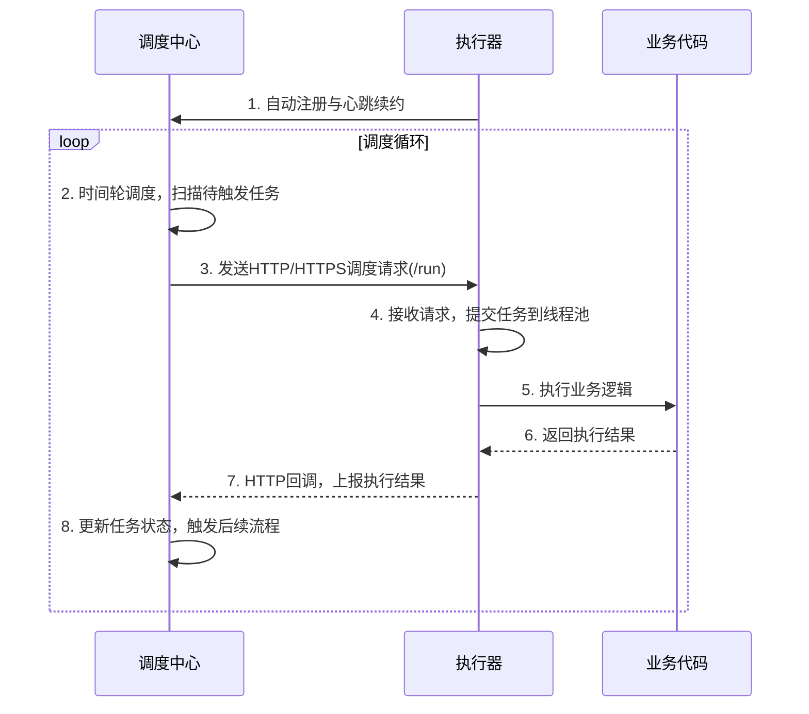

## BeanFactory & ApplicationContext

Spring 中 `ApplicationContext` 与 `BeanFactory` 在单例 Bean 初始化策略上的核心差异，源于两者的**定位、设计目标与运行场景**的根本不同。

简单来说：**`ApplicationContext` 默认“急加载”，在容器启动时就完成所有单例 Bean 的实例化，以求在第一时间暴露问题；而 `BeanFactory` 默认“懒加载”，只有在程序真正请求某个 Bean 时才会创建，以追求轻量和快速启动。**

### 📊 差异对比一览

| 维度 | 🟢 BeanFactory | 🔵 ApplicationContext |
| :--- | :--- | :--- |
| **初始化策略** | **延迟初始化 (Lazy)**：`getBean()` 时才创建。 | **预初始化 (Eager)**：容器启动时一次性创建所有单例 Bean。 |
| **核心设计目标** | 提供极简、低开销的依赖注入基础能力。 | 面向完整企业级应用，提供声明式、开箱即用的丰富特性。 |
| **问题发现时机** | **运行时**：可能在应用运行一段时间后，才因缺少依赖而失败。 | **启动时 (Fail-Fast)**：任何依赖缺失、配置错误都会立刻暴露。 |
| **启动开销** | 极小，启动极快。 | 较大，启动较慢（因需实例化所有单例并完成依赖注入）。 |
| **运行时性能** | 首次获取时有创建开销。 | 获取时零开销，直接返回缓存实例。 |
| **典型场景** | 资源极度受限的环境（如移动设备、Applet），或仅需最基础的 DI 功能。 | 几乎所有标准的后端服务，如 Spring Boot 应用、Web 服务等。 |

---

### 💡 深层原因解析

#### 设计哲学：Fail-Fast 与 Fail-Safe
这是最核心的区别。`ApplicationContext` 遵循“**Fail-Fast（快速失败）**”原则：
*   它假设你构建的是一个需要长期运行的服务，**任何隐藏的配置错误都可能在生产环境中造成灾难**。
*   通过在启动时实例化所有 Bean，它能检查出依赖缺失、循环依赖、类型不匹配等问题。这相当于在应用正式“开门迎客”前做了一次**全面的“体检”**，让问题尽早暴露，增强系统的稳定性。

#### 功能完整性的内在要求
`ApplicationContext` 扩展了许多 `BeanFactory` 不具备的功能，这些功能的正确运行**依赖于 Bean 的提前初始化**。
*   **BeanPostProcessor**：例如 AOP 代理的创建、`@PostConstruct` 回调等，都需要在 Bean 初始化阶段完成。预初始化保证了所有增强处理器能按正确顺序应用。
*   **事件发布**：`ApplicationContext` 启动完毕后会发布 `ContextRefreshedEvent` 事件。如果某个监听此事件的 Bean 尚未初始化，就无法响应。所以，在事件发布前必须将所有单例 Bean 就位。
*   **国际化与资源加载**：这些功能也需要在启动阶段就组装完毕。

简单说，**`ApplicationContext` 的启动流程（refresh()）设计成了一个严格的阶段化过程，而“预初始化所有单例”是这个流程图中必要且不可跳过的一步**。

#### 实际应用中的使用与配置
在现实开发中，`BeanFactory` 几乎不被直接使用，它的存在更多是作为 Spring 内部的基础设施。所有我们熟知的 `ClassPathXmlApplicationContext`、`AnnotationConfigApplicationContext`，以及 Spring Boot 中的 `ApplicationContext`，都是预初始化的。

不过，你依然可以在 `ApplicationContext` 中实现延迟初始化：
*   **全局配置**：在 XML 中设置 `default-lazy-init="true"`，或在 Boot 的配置文件中写 `spring.main.lazy-initialization=true`。
*   **精准控制**：使用 `@Lazy` 注解标记在特定 Bean 上。

当这些配置生效后，`ApplicationContext` 的行为就趋近于 `BeanFactory`，但它的所有高级特性依然保留。

总的来说，`ApplicationContext` 的预初始化策略并非性能设计缺陷，而是一种为应对复杂企业级应用而做出的**谨慎、安全的设计选择**，它与 `ApplicationContext` 提供的丰富功能是相辅相成的。

## BeanFactory

`ApplicationContext` 和 `BeanFactory` 都是 Spring 框架的核心 IoC 容器，用于管理 Bean 的生命周期和依赖关系。它们之间最核心的关系是：**`ApplicationContext` 是 `BeanFactory` 的子接口，是后者的功能超集**。

简单来说，`BeanFactory` 是 Spring 的“基础设施”，而 `ApplicationContext` 是面向企业级开发的“功能完备的框架”。

下面是它们各项能力的具体对比：

| 特性 | BeanFactory | ApplicationContext |
| :--- | :--- | :--- |
| **核心关系** | Spring 最基础的 IoC 容器接口。 | 继承自 `BeanFactory`，是它的扩展。 |
| **Bean 加载策略** | **延迟加载 (Lazy Loading)**：只有在首次调用 `getBean()` 时才实例化 Bean。 | **预先加载 (Eager Loading)**：容器启动时即实例化所有单例 Bean。 |
| **核心功能** | 提供最基本的 Bean 管理：实例化、配置和依赖注入。 | 在 `BeanFactory` 基础上，提供丰富的企业级服务。 |
| **国际化 (i18n)** | **不支持**。 | **支持**。通过继承 `MessageSource` 接口，方便地访问国际化消息资源。 |
| **事件发布/监听** | **不支持**。 | **支持**。内置事件发布机制，允许 Bean 之间通过事件进行解耦通信。 |
| **资源加载** | 能力较弱，主要关注 Bean 配置。 | **支持**。能以统一的方式加载多种资源，如文件、类路径、URL 等。 |
| **AOP 集成** | 需要手动配置才能集成。 | **支持**。与 Spring AOP 特性集成更为容易。 |
| **后处理器支持** | **需要手动注册** `BeanPostProcessor` 和 `BeanFactoryPostProcessor`。 | **自动检测并注册**。容器能自动识别并应用这些后处理器。 |
| **配置方式** | 通常以**编程方式**创建。 | 既支持**编程方式**，也支持**声明方式**（如通过 `ContextLoader`）创建。 |
| **适用场景** | 资源受限的环境（如移动设备、小型Applet）、对启动速度要求极高的轻量级应用。 | **绝大多数企业级应用、Web 应用**的默认选择。 |

---

### 💡 核心差异解读

#### 加载策略的取舍：延迟加载 vs. 预先加载

*   **`BeanFactory` 的延迟加载**：优点在于**启动速度快、内存占用低**，因为未使用的 Bean 不会被创建。但缺点是**无法在容器启动时发现配置错误**，相关问题只有在首次调用时才会暴露。
*   **`ApplicationContext` 的预先加载**：虽然会增加启动时间和内存开销，但最大的好处是 **“ Fail-Fast”（快速失败）** ，能在容器启动时立即发现并定位 Bean 配置问题。同时，Bean 在运行时已准备就绪，响应速度更快。

#### 功能丰富度：从“基础设施”到“企业级框架”

`ApplicationContext` 提供的不仅仅是 `BeanFactory` 的简单“升级”，而是提供了一整套构建企业级应用所需的服务。

*   **国际化支持**：在开发多语言应用时，`ApplicationContext` 能让你轻松管理不同语言的资源文件。
*   **事件机制**：这是实现代码解耦的强大工具。例如，你可以发布一个“订单创建成功”事件，由多个监听器分别处理发送邮件、更新库存等操作。
*   **资源加载**：`ApplicationContext` 提供了统一的资源访问接口，让你能更方便地读取配置文件、模板文件等各种资源。

### 🚀 总结与建议

`ApplicationContext` 是 `BeanFactory` 的功能超集，并提供了现代企业级开发所需的一切能力。官方文档也明确指出：**除非你有充分的理由，否则应该使用 `ApplicationContext`**。

因此，在实际开发中，**99% 的场景都应选择 `ApplicationContext`**。无论是标准的 Web 应用、Spring Boot 项目，还是大多数独立的 Java 应用，`ApplicationContext` 都是最佳实践。仅当你的应用是运行在内存或资源极度受限的环境中（如某些嵌入式设备），且确实用不到 `ApplicationContext` 的高级功能时，才需要考虑使用 `BeanFactory`。

## Spring Bean

Spring 容器中的 Bean 作用域（Scope）决定了 Bean 实例的生命周期和在容器内的可见范围。Spring 框架共支持 6 种标准作用域，应用最广泛的是单例和原型。

### Singleton（单例，默认作用域）
- **行为**：在整个 Spring IoC 容器中，**一个 Bean 定义只对应一个共享实例**。所有对该 Bean 的请求都返回同一个缓存对象。
- **生命周期**：容器启动时创建（默认，也可延迟加载），容器关闭时销毁，会执行相应的销毁回调。
- **线程安全性**：**容器本身不提供任何线程安全保证**。由于同一实例被多线程共享，你必须自行解决线程安全问题（通常通过无状态设计）。
- **适用场景**：无状态的 Service、Dao、配置类、工具类等。
```java
@Service
// @Scope("singleton") // 默认，可省略
public class UserService { }
```
> ⚠️ **注意**：Spring 的单例是“容器级别”的，有别于经典设计模式中“ClassLoader 级别”的单例。如果存在多个容器实例，每个容器会持有自己的单例 Bean。

---

### Prototype（原型）
- **行为**：**每次通过 `getBean()` 请求或注入时，都会创建一个全新的实例**。
- **生命周期**：容器负责初始化和依赖注入等完整创建过程，但**不管理其销毁**。这意味着 `prototype` Bean 的 `@PreDestroy` 等方法不会被 Spring 自动调用，资源释放需由调用方自行处理。
- **适用场景**：包含可变状态的 Bean，如一次性的任务处理对象、请求上下文封装等。
```java
@Component
@Scope("prototype")
public class ReportGenerator { }
```
> 注意：将 `prototype` Bean 注入到 `singleton` Bean 时，由于依赖注入只发生一次，**singleton Bean 内部持有的 `prototype` Bean 将始终是同一个实例**，这会让原型作用域名存实亡。解决方法是使用 `@Lookup` 方法注入、`ApplicationContext.getBean()` 或使用作用域代理。

---

### 仅 Web 环境可用的作用域
这些作用域仅在 Spring 的 Web 应用上下文（如 Spring MVC）中生效，用于将 Bean 的生命周期与 HTTP 请求或会话绑定。

| 作用域 | 行为描述 | 典型场景 |
| :--- | :--- | :--- |
| **request** | 每个 HTTP 请求创建一个新实例，请求结束后销毁。 | 请求级别的日志追踪对象、表单数据对象。 |
| **session** | 每个 HTTP 会话（Session）创建一个实例，会话过期后销毁。 | 保存用户登录信息、购物车、用户配置偏好。 |
| **application** | 每个 `ServletContext` 共享一个实例，等效于 Servlet 容器的“全局单例”。 | 跨会话共享的全局缓存、配置信息。 |
| **websocket** | 每个 WebSocket 会话生命周期内一个实例，会话关闭时销毁。 | WebSocket 会话级的状态管理。 |

```java
@Component
@Scope(value = "session", proxyMode = ScopedProxyMode.TARGET_CLASS)
public class ShoppingCart { }
```

---

### 🔗 核心难点：作用域依赖与代理
在 Web 开发中，最常见的困惑是将一个**短生命周期**的 Bean（如 `request` 作用域）注入到**长生命周期**的 Bean（如 `singleton` 作用域）时，Spring 如何保证每次都能获取到新的实例？

**问题根源**：`singleton` Bean 在容器启动时就被创建，此时可能根本不存在 HTTP 请求，无法注入 `request` 作用域 Bean。即使勉强注入，单例属性里保存的也永远是创建时的那一个实例。

**解决方案：作用域代理（Scoped Proxy）**  
必须为短生命周期 Bean 声明代理模式，让 Spring 注入的是一个 CGLIB/JDK 动态代理对象。每次调用代理的方法时，它都会从当前上下文（如当前 HTTP 请求）动态获取“真正”的 Bean 并委托执行。

```java
@Component
@Scope(value = "request", proxyMode = ScopedProxyMode.TARGET_CLASS) // 基于类
// 或 ScopedProxyMode.INTERFACES // 基于接口
public class RequestData { }
```
注入后，`singleton` 控制器中的 `RequestData` 字段其实是一个代理，每个请求都能拿到属于自己的 `RequestData` 实例，方法调用正常。

---

### 🧬 自定义作用域
Spring 允许通过实现 `org.springframework.beans.factory.config.Scope` 接口并注册到容器来创建自定义作用域，比如实现一个“线程作用域”（每个线程一个实例）。最常见的是集成 `SimpleThreadScope`，用于同一线程内共享 Bean。

```java
@Configuration
public class ScopeConfig {
    @Bean
    public static CustomScopeConfigurer customScopeConfigurer() {
        CustomScopeConfigurer configurer = new CustomScopeConfigurer();
        configurer.addScope("thread", new SimpleThreadScope());
        return configurer;
    }
}
```

---

### 📌 总结与选型指南

| 作用域 | 实例数 | 生命周期 | 关键注意事项 |
| :--- | :--- | :--- | :--- |
| **singleton** | 每个 IoC 容器 1 个 | 容器启动→关闭 | 无状态设计，避免共享可变状态。 |
| **prototype** | 每次注入/获取新建 | 创建后由调用者管理 | 资源释放需手动处理；解决单例注入问题。 |
| **request** | 每个 HTTP 请求 1 个 | 请求开始→结束 | 必须使用代理才能注入到单例 Bean。 |
| **session** | 每个 HTTP 会话 1 个 | 会话创建→过期 | 同上；注意内存占用，合理设置过期时间。 |
| **application** | 每个 ServletContext 1 个 | 应用启动→关闭 | 作用类似于 singleton，但上下文级别不同。 |
| **websocket** | 每个 WebSocket 会话 1 个 | 会话连接→关闭 | 同上，需代理才能注入到单例。 |

理解了作用域，也就掌握了 Spring 管理 Bean 生命周期和可见性的基本规则。如果需要，我可以接着讲某个作用域在实际项目中的踩坑案例或代码示例。

### prototype Bean

你提出的这个问题，触及了 Spring IoC 容器设计的核心权衡。答案可以总结为一句看似矛盾的话：**容器并非“不想”管理，而是无法在没有客户端明确指令的情况下，安全、无副作用地完成管理。**

具体来说，容器对 `prototype` Bean 的处理遵循 **“创建后即遗忘 (Fire-and-Forget)”** 的原则。下面是详细的原因解析。

---

### 🌱 容器到底“管理”了什么？

首先需要明确，Spring **会管理** `prototype` Bean 的**初始化生命周期**。这部分是完整的：

1.  **完整创建**：容器负责调用构造函数，执行依赖注入。
2.  **执行初始化回调**：包括 `@PostConstruct` 注解的方法、`InitializingBean` 接口的 `afterPropertiesSet()` 方法，或 `init-method` 配置的方法都会照常执行。

容器唯一**不会管理**的，是它的**销毁生命周期**。也就是说，`@PreDestroy`、`DisposableBean.destroy()` 等方法**不会被容器自动调用**。

### ⚙️ 为什么容器选择“放手”？

设计上的根本原因有以下几点，它们都指向一个核心：**对象所有权和控制权的转移**。

1.  **避免内存泄漏，防止垃圾回收受阻**
    这是最核心的原因。`prototype` Bean 每次被请求都会产生一个新实例。如果 Spring 容器要管理其销毁生命周期，就必须**持有每个已创建 `prototype` Bean 的强引用**，以便在容器关闭时遍历并调用它们的销毁方法。
    然而，客户端代码拿到这个 Bean 后，可能很快就不再使用它了。由于容器仍持有引用，这个本该被 GC 回收的对象就会一直留在堆内存中，**造成严重的内存泄漏**。尤其是在一个长时间运行的应用中，如果有大量 `prototype` Bean 被创建，内存很快就会被耗尽。

2.  **无法自动感知“销毁时机”**
    容器无法知道客户端什么时候用完了这个 Bean。对于 `singleton` Bean，它和容器生命周期一致，容器关闭时统一销毁就好。但 `prototype` Bean 的“生命周期终点”是由客户端代码的逻辑决定的。容器没有能力去分析代码执行流，自动判断某个 Bean 实例是否已“退役”。

3.  **职责分离与设计哲学**
    Spring 容器的主要职责是作为“超级工厂”来**配置、装配和管理对象的依赖**，而不是一个负责内存管理的运行时对象垃圾回收器。一旦对象被创造并完整装配好，它就脱离了工厂的传送带，成为一个独立的、完全由客户端代码负责的普通 Java 对象。

### 💡 一个反事实推论：如果强制管理会怎样？

假设 Spring 在创建每个 `prototype` Bean 时，都将其引用放入一个内部的 `Set` 中，并在容器关闭时遍历销毁。后果是：
*   **严重内存泄漏**：`Set` 中的对象会因 GC Roots 可达到而永远无法被回收。
*   **行为不可预测**：你可能在容器关闭时发现大量早已用不着的 Bean 突然开始执行它们的 `@PreDestroy` 方法，这很可能会产生无意义的副作用。

### 🔁 与 Singleton 的对比

| 作用域 | **引用持有** | **销毁触发** | **核心原因** |
| :--- | :--- | :--- | :--- |
| **singleton** | 容器持有单例缓存中的唯一引用 | 容器关闭时统一调用 `destroy()` | 生命周期与容器绑定，容器既是创造者也是所有者。 |
| **prototype** | 容器**不持有**引用，引用交给调用方 | 容器**不负责**，需调用方手动处理 | 生命周期与容器解耦，所有权转移到客户端。 |

---

### 🛠️ 那客户端该如何“善后”？

既然容器放权了，就需要我们自己来管理 `prototype` Bean 的销毁工作。常用的方案有：

*   **方案一：手动调用**
    在代码逻辑明确的结束位置，直接调用 Bean 实现的 `DisposableBean.destroy()` 或自定义的 `close()` 方法。

*   **方案二：利用“后处理器”记录，手动触发**
    你可以实现一个 `BeanPostProcessor`，在 `postProcessAfterInitialization` 方法中识别出 `prototype` Bean，并将其注册到某个自定义的注册表中，然后在你需要的时机手动触发销毁。但记住，这仍然是你自己在管理引用，需要注意内存泄漏。

*   **方案三：依赖注入一个工厂或 `ObjectProvider`**
    通过 `ObjectProvider<T>` 来获取 `prototype` Bean，Spring 并不会干涉你如何使用它。你可以在 `ObjectProvider` 获取的 Bean 上使用 try-finally 模式执行清理。

*   **方案四：考虑其他作用域**
    如果你的真实需求是“在某个局部范围内只创建一次 Bean，并在此范围结束时销毁”，可以看看 **`request`、`session`** 或 **自定义作用域**（例如基于线程的 `SimpleThreadScope`），它们都提供了明确定义的销毁回调。

总而言之，Spring 对 `prototype` Bean 不完整生命周期的管理，是一种**深思熟虑的“刻意不作为”**，是为了避免给应用带来更严重的内存问题，并将资源的精细控制权交还给最了解上下文的开发者手中。

## JDK & CGLIB

JDK动态代理和CGLIB动态代理的核心区别可以用一句话概括：**JDK动态代理“基于接口”，而CGLIB动态代理“基于继承”**。

为了让你能快速了解两者的全貌，我把核心对比整理成了下面这个表格：

### 📊 JDK vs. CGLIB 对比概览

| 对比维度 | 🟢 JDK动态代理 | 🔵 CGLIB动态代理 |
| :--- | :--- | :--- |
| **代理机制** | **基于接口**：要求被代理类必须实现至少一个接口。 | **基于继承**：通过生成目标类的子类来实现代理。 |
| **核心组件** | `Proxy`类和`InvocationHandler`接口。 | `Enhancer`类和`MethodInterceptor`接口。 |
| **技术原理** | 利用**Java反射机制**动态创建代理。 | 使用**ASM字节码框架**直接操作字节码。 |
| **适用场景** | 目标类**实现了接口**。 | 目标类**未实现接口**，或需要代理具体类。 |
| **主要限制** | 被代理类**必须实现接口**。 | 无法代理`final`类和`final`方法。 |
| **性能特点** | - **创建开销小**（速度快）<br>- **方法调用开销大**（因使用反射） | - **创建开销大**（速度慢）<br>- **方法调用开销小**（因直接调用） |
| **依赖关系** | **无需额外依赖**，是JDK标准库的一部分。 | 需要引入第三方库（如`cglib`），Spring-Core已内置。 |

---

### 💡 具体差异解析

*   **代理机制与限制**
    *   **JDK动态代理**的实现非常直接，它利用`Proxy.newProxyInstance()`创建一个新的类，这个类实现了目标对象的所有接口，并将所有方法调用转发给`InvocationHandler`处理，其本质是接口的另一个实现。这导致它**只能代理接口中定义的方法**。
    *   **CGLIB动态代理**则通过`Enhancer`在运行时动态生成一个目标类的子类，并重写其中的方法来实现代理。因此，如果类或方法被`final`修饰，将无法被继承和重写，也就无法被代理。

*   **性能差异演变**
    *   **一个常见的误区是认为CGLIB的性能一定优于JDK**。这在不同JDK版本下结论不同：
        *   **早期（JDK 6及更早）**：CGLIB在执行效率上确实普遍占优，因为JDK的反射机制相对较慢。
        *   **JDK 7 / 8 时期**：JDK对反射进行了大量优化，在多次调用场景下性能反而超越了CGLIB。
        *   **高版本JDK（9+）**：随着JDK的持续优化，两者的性能差距已非常小。通常认为，JDK Proxy在**创建对象**时更快，而CGLIB在**方法调用**时性能更高。
    *   因此，在现代JDK环境下，**性能差异不再是选择的首要因素**。

### ⚙️ Spring 框架的代理选择

在Spring AOP中，框架会自动判断并使用最合适的代理方式。
*   **选择逻辑**：如果目标对象（Bean）实现了至少一个接口，Spring将**默认使用JDK动态代理**；否则，将使用CGLIB。
*   **Spring Boot的转变**：请注意，从**Spring Boot 2.0**版本开始，默认的代理策略变更为**总是使用CGLIB**，无论目标对象是否实现了接口。

### 📌 总结与选型建议

综合来看，选择哪种代理方式并没有绝对的对错，关键在于匹配具体的应用场景：

1.  **优先考虑JDK动态代理**
    *   你的类**已经实现了某个接口**。
    *   你希望遵循**面向接口编程**的最佳实践，且项目结构清晰。
    *   你的目标是**减少对外部库的依赖**，或是在对内存敏感的环境（如早期Android开发）中运行。

2.  **果断使用CGLIB动态代理**
    *   你需要代理一个**没有实现任何接口的普通类**。
    *   你正在使用**Spring Boot 2.0及以上版本**，且没有特殊配置，框架会为你默认使用CGLIB。
    *   目标类是第三方库中的，你**无法修改其代码**去实现一个接口。

希望这份详细的对比能帮助你更好地理解这两种技术。如果需要针对特定场景的代码示例，也可以告诉我。

## Spring AOP 
基于 Spring AOP 实现自定义注解，核心好处是**将“业务逻辑”与“非业务代码”彻底解耦**，让你能用**一行注解**代替**大量重复的样板代码**。

结合你之前问的分布式锁场景，如果不用 AOP，你的业务方法里会混杂着 `tryLock()`、`unlock()` 和 `catch` 异常处理；而用了 AOP 注解后，业务方法里只剩纯净的业务逻辑。

具体有五大核心好处：

### 🧹 消灭样板代码，实现“极简主义”
这是最直观的好处。假设你要给方法加分布式锁、记录日志或做权限校验：

-   **传统写法**：每个方法都要写 `if(!redisLock.tryLock()){ return; }`，代码膨胀且难以维护。
-   **AOP 注解写法**：直接在方法上加上 `@RedisLock(key = "#userId")`。业务代码干干净净，只关注“点赞”或“发帖”本身。

### 🎯 完美的关注点分离（单一职责）
AOP 专门处理**横切关注点**（Cross-cutting concerns），如日志、事务、缓存、锁、鉴权。

-   **业务开发**：只关心核心逻辑（比如计算热榜分数）。
-   **框架/切面开发**：只关心非功能需求（比如重试机制、锁超时）。
这样代码的**可维护性**大幅提升，修改切面逻辑时，绝不会误伤业务代码。

### 🔧 配置集中化与动态调整
注解通常配合属性（如 `timeout`、`retryTimes`）使用。

-   将所有锁的默认超时时间、重试策略写在切面的统一配置类里。
-   如果某天需要把 Redis 锁换成 ZooKeeper 锁，你**只需修改切面的底层实现**（Aspect 类），所有打了 `@RedisLock` 注解的地方**自动生效**，无需逐个修改业务类。

### 📖 增强代码的自描述性（声明式编程）
注解本身是一种**元数据**。当一个新人看到 `@RateLimiter`（限流）、`@DistributedLock` 或 `@AuditLog`（审计日志）时，**一眼就能明白该方法的作用和约束**，这比去读几十行复杂的 `if-else` 逻辑要直观得多。

### 🚀 符合开闭原则（OCP）
AOP 是动态织入的，完全**无侵入**。

-   对一个已有的、稳定的老方法，你想要增加“操作日志”功能。
-   你不需要去修改这个老方法的源代码（关闭修改），只需要新建一个切面类，并给该方法打个注解（开放扩展）。这在大型线上系统中，对降低测试回归成本有巨大帮助。

---

### ⚠️ 但必须注意一个“陷阱”
虽然好处多多，但 AOP 基于**动态代理**。**方法内部调用（this.method()）不经过代理对象，注解会直接失效**。例如，在 Service 内部调用自己的 `@RedisLock` 方法，锁是不生效的。解决方法是需要自行注入代理对象（如 `@Autowired` 自己）或通过 `AopContext.currentProxy()` 调用。

### 💎 总结
在分布式博客论坛中，基于 AOP 的自定义注解（如 `@AvoidDuplicateSubmit`、`@CacheRefresh`）能让你把 90% 的分布式协调“脏活累活”封装在切面里，业务代码里只剩干净的 CRUD。**这是 Spring 框架最优雅的实践，没有之一。**

你想看看实现一个“防止重复提交”的 `@RepeatSubmit` 注解切面代码吗？我可以手写一段核心逻辑给你。😊

## @Autowired

核心原因在于：**构造器注入让你能够**完全不依赖 Spring 容器**，仅用标准的 Java 语法（`new` 关键字）就能完成对象的创建和依赖注入，这使得单元测试变得极其纯粹和快速。

为了让你直观感受，我们直接对比两种写法在测试时的区别：

### 字段注入（传统写法）—— 测试非常痛苦
如果使用 `@Autowired` 直接打在字段上：

```java
@Service
public class UserService {
    @Autowired 
    private UserRepository userRepository; // 私有字段，无法直接赋值
    @Autowired 
    private RedisClient redisClient;
}
```
**测试时的困境**：由于字段是 `private` 的，你无法直接将 Mock 对象（模拟对象）赋值进去。
- **笨办法**：必须使用 `ReflectionTestUtils.setField(userService, "userRepository", mockRepo)` 这种反射暴力手段，代码丑陋且容易因字段名重构而失败。
- **重办法**：必须启动 Spring 测试上下文（`@SpringBootTest`），加载整个容器配置，导致测试启动耗时十几秒，违背了“单元测试应毫秒级完成”的原则。

### 构造器注入（推荐写法）—— 测试极其丝滑
如果使用构造器注入（Spring 4.3+ 推荐，单构造器甚至可省略 `@Autowired`）：

```java
@Service
public class UserService {
    private final UserRepository userRepository;
    private final RedisClient redisClient;

    // 构造器注入（可直接省略 @Autowired）
    public UserService(UserRepository userRepository, RedisClient redisClient) {
        this.userRepository = userRepository;
        this.redisClient = redisClient;
    }
}
```
**测试时的优势**：你可以像拼乐高一样，在测试类里随心所欲地组装对象。
```java
// 单元测试代码：不启动 Spring，纯粹用 Mockito
UserRepository mockRepo = mock(UserRepository.class);
RedisClient mockRedis = mock(RedisClient.class);

// 直接 new 出来，传入 Mock 对象，像调用普通构造函数一样自然！
UserService service = new UserService(mockRepo, mockRedis);

// 然后进行断言测试，整个过程仅需几毫秒
```

---

### 除了便于测试，还有 3 个额外红利：

1.  **强制不可变性（线程安全）**：构造器注入的字段可以声明为 `final`，一旦对象创建完毕，依赖关系就不可变。这在多线程环境下天然安全，而字段注入无法设为 `final`。

2.  **避免 NPE（空指针异常）**：字段注入可能在对象创建后、依赖注入前被调用，导致 NullPointerException。构造器注入确保了**对象处于“可运行”状态的前提是依赖必须齐备**，从根本上杜绝了空指针。

3.  **消灭循环依赖的隐患**：如果 A 和 B 相互注入，字段注入在运行时不会报错，但埋下了性能隐患；而构造器注入在容器启动时就会直接抛出 `BeanCurrentlyInCreationException`，让你**第一时间发现问题**，而不是等到上线后才发现。

### 💎 总结
在 Spring 官方文档和最佳实践中，**构造器注入是首选**。它通过回归 Java 最基础的 `new` 对象方式，让单元测试变得极其轻量和高效，这是字段注入永远无法比拟的。

如果你用的是 **Spring Boot 3.x**，甚至可以完全省略 `@Autowired` 注解，直接写构造器即可，代码更干净。😊

## Setter

你的观察非常敏锐，**完全正确**！Setter 注入在测试时确实也可以直接调用 setter 方法注入 Mock 对象，从“能调用”这个层面上看，两者打平。

我之前强调构造器注入便于测试，核心区别不在于“能不能调”，而在于**“编译器是否强制你必须调”**。这决定了测试代码的**健壮性**和**编写体验**。

我们直接对比两种注入方式在测试时的实际代码：

### 构造器注入：编译器当“监工”
测试时，依赖是**构造函数的硬性参数**。
```java
// 测试代码
UserRepository mockRepo = mock(UserRepository.class);
RedisClient mockRedis = mock(RedisClient.class);

// 编译器强制要求：你必须把所有参数都传齐，少一个就编译报错！
UserService service = new UserService(mockRepo, mockRedis); 
```
**好处**：如果你漏掉了 `mockRedis`，IDE 会直接报红叉，**连编译都不让你过**。这保证了测试用例**永远处于“零件齐全”的状态**，不会因为漏掉某个 setter 调用而导致莫名其妙的 NullPointerException。

### Setter 注入：测试代码容易“缺胳膊少腿”
测试时，你先生成对象，再单独调用 setter。
```java
// 测试代码
UserService service = new UserService(); 
service.setUserRepository(mockRepo); 

// 此处非常危险：如果开发者忘了写下面这行，编译器完全不会报错！
// service.setRedisClient(mockRedis); 
```
**隐患**：这段代码可以**完美编译通过**，但运行到调用 `redisClient` 的地方时，测试会直接崩溃（NPE）。如果业务复杂，这种遗漏在代码审查时极难用肉眼发现，必须等到测试跑挂了才知道。

---

### 更深层的区别：对象状态的“完整性”
-   **构造器注入**：创建出来的对象是**“完整的”**。对象一经实例化，所有依赖就位，可以直接投入战斗。这符合对象设计的基本原则（**对象应处于可工作状态**）。
-   **Setter 注入**：创建出来的对象是**“半成品”**。它被 new 出来，但依赖还未填充，处于不合法状态。虽然测试时可以调用 setter 补全，但这个“补全”是人为控制的，容易出错。

### 那个“致命伤”：final 关键字
这是 Setter 注入永远无法弥补的硬伤。

-   **构造器注入**：字段可以声明为 `private final`，确保依赖**永不改变**，线程安全且意图清晰。
-   **Setter 注入**：字段**不能**是 `final`（因为要随时被 setter 修改），对象可变性增加，在多线程环境下需要额外考虑并发安全。

### 💎 结论
你说得对，**从“测试里可以调用”这个角度看，两者没区别**。
但业界推崇构造器注入，核心原因是**让编译器充当你的“质检员”**。它强制你在测试的**第一步（new对象时）**就把所有依赖摆清楚，将“运行时才发现漏依赖”的风险，提前扼杀在**编译期**。这种安全感和代码的不可变性，是 Setter 注入给不了的。😊

## ReadOnly Transaction

只读事务的性能优化，核心在于告知数据库“此事务只读”，从而使其能跳过为写操作准备的内部机制（如分配事务ID等），在提升整体吞吐量的同时，也保障了多条查询语句间的数据一致性。

### 📊 优化一：减轻数据库内部开销
以 MySQL InnoDB 为例，其核心是通过“减法”来优化：

*   **避免分配不必要的事务ID**：InnoDB 为只读事务**避免分配事务ID (`TRX_ID`)**，从而减少了内部数据结构大小，加速了读视图（Read View）构建的过程。
*   **分离管理链表与跳过回滚段**：数据库内部会将只读事务和读写事务放入不同管理链表。这使得在创建 MVCC 快照时，只需遍历更短的“读写事务”链表，速度更快。同时，只读事务也**无需分配回滚段 (rollback segment)**。
*   **ORM 层的配合**：在 Spring 中，`@Transactional(readOnly = true)` 会让 Hibernate 将刷新模式设为 `NEVER`，从而**跳过脏检查**，在处理大量对象时能显著提升性能。
*   **不同数据库的差异**：这些优化在 MySQL InnoDB 上效果显著，而 Oracle 会禁用 Redo 日志减少 I/O，但在 PostgreSQL 中，显式声明带来的直接性能提升相对有限。

### ⚠️ 注意：“只读”不代表“无锁”
这是一个关键点。只读事务并不会完全无锁。
*   在 MySQL `REPEATABLE READ` 级别下，`SELECT` 依然会加行级锁或间隙锁，高并发下仍可能引发阻塞。
*   在 PostgreSQL 中，只读查询仅获取 `ACCESS SHARE` 锁，与写操作互斥。

### 🎯 优化二：保证数据一致性（读一致性）
这解决了你关于“为什么要开启事务而不是分别查询”的疑问。对于需要跨表关联生成报表等场景，如果分别查询或使用默认自动提交，是**无法保证两次读取之间数据一致的**。而将所有查询放入一个只读事务，就能基于**数据库的 MVCC 快照**，保证全部读取数据的一致性。

### 💡 这解释了为什么需要“事务”
你问“如果只读为什么要开启事务而不是分别查询”，答案的核心就在于此。
*   **独立查询（自动提交）**：每个查询都是独立的事务。在 `REPEATABLE READ` 隔离级别下，不同时刻的快照可能导致最终结果对不上。
*   **只读事务**：所有查询都在同一个事务快照内执行，完美解决了读不一致的问题。

### ⚠️ 避坑指南：为何用了反而变慢？
有时加上 `@Transactional(readOnly = true)` 后性能反而会下降，常见原因及解决方案如下：

*   **事务范围过大**：把耗时逻辑（如HTTP调用）包裹进事务，导致数据库连接被长时间占用，引发**连接池饥饿**。
    *   *解决方案*：**事务瘦身**。把无关的耗时逻辑移出事务边界。
*   **不必要的事务**：对于某些简单的单表主键查询，开启事务维护快照的开销可能大于收益。
    *   *解决方案*：**按需使用**。只在需要保证读一致性时才用事务。
*   **隔离级别过高**：`REPEATABLE READ` 的精确快照维护成本高。
    *   *解决方案*：**降低隔离级别**。如果业务允许（如允许读到提交后新数据），可考虑降为 `READ COMMITTED`。

总而言之，只读事务并非银弹。当需要保证多次查询间的**数据一致性**时，应果断使用；对于简单的单次查询，让连接自动提交是更明智的选择。

## @Transactional

在 Spring Boot 中，`@Transactional` 的传播行为（Propagation）定义了**当一个事务方法被另一个事务方法调用时，事务该如何传播**。它决定了是加入当前事务、新建事务还是非事务执行，是控制事务边界的关键。

Spring 共提供了 7 种传播行为，定义在 `Propagation` 枚举中。默认传播行为是 **`REQUIRED`**。

### REQUIRED（默认）
- **行为**：如果当前存在事务，则**加入**该事务；如果没有事务，就**新建**一个事务。
- **回滚影响**：任何一处出现异常，整个事务都会回滚。
- **典型场景**：最常用，适用于绝大多数业务逻辑。比如下单时扣库存、生成订单，它们需要在同一个事务中成功或失败。

```java
@Transactional(propagation = Propagation.REQUIRED)
public void placeOrder() {
    // 减库存（内部调用 REQUIRED）
    // 生成订单（内部调用 REQUIRED）
}
```

---

### REQUIRES_NEW
- **行为**：无论当前是否存在事务，都**挂起**当前事务（如果有），并**全新开启**一个独立的事务。新事务提交/回滚与外部事务互不影响。
- **回滚影响**：内部事务独立提交或回滚；外部事务的回滚不会影响已提交的内部事务。
- **典型场景**：日志记录、发送通知等**不允许因主业务失败而丢失**的操作。例如，下单失败时，扣款记录仍需保留。

```java
@Transactional(propagation = Propagation.REQUIRES_NEW)
public void writeLog() {
    // 即使外部事务回滚，这条日志也会成功写入
}
```

---

### SUPPORTS
- **行为**：如果当前有事务，就**加入**；如果没有，就**非事务**执行。
- **回滚影响**：如果加入了事务，回滚行为与加入的事务一致；非事务时每条 SQL 独立提交。
- **典型场景**：对事务要求不严的查询方法，**可读可不读**。比如某些报表查询，有事务就复用快照，没有也接受。

```java
@Transactional(propagation = Propagation.SUPPORTS, readOnly = true)
public List<User> queryUsers() {
    // 复用已有事务的读视图，若没有则直接查询
}
```

---

### NOT_SUPPORTED
- **行为**：总是**非事务**执行，如果当前有事务，会**挂起**该事务。
- **回滚影响**：不受任何事务约束，每个操作独立提交。
- **典型场景**：某些业务逻辑**必须脱离事务**执行，比如发送 HTTP 请求调用外部系统，不希望长时间占用数据库连接和锁。

```java
@Transactional(propagation = Propagation.NOT_SUPPORTED)
public void callRemoteApi() {
    // 调用远程接口，避免事务时间过长
}
```

---

### MANDATORY
- **行为**：必须**在已有事务中**运行，如果当前没有事务，则抛出 `IllegalTransactionStateException`。
- **回滚影响**：与外部调用者的事务相同。
- **典型场景**：严格要求调用方必须提供事务上下文，比如某些核心数据变更操作，**强制必须在事务内执行**，防止误用。

```java
@Transactional(propagation = Propagation.MANDATORY)
public void mandatoryUpdate() {
    // 若调用方未开启事务，直接抛异常
}
```

---

### NEVER
- **行为**：必须**以非事务方式**执行，如果当前存在事务，则抛出异常。
- **回滚影响**：自身无事务；但调用者事务会被异常打断。
- **典型场景**：绝对不允许在事务中执行的操作，比如某些数据库 DDL 语句或非事务型存储操作。

```java
@Transactional(propagation = Propagation.NEVER)
public void nonTransactionalWork() {
    // 不允许在事务中执行
}
```

---

### NESTED
- **行为**：如果当前存在事务，则在**嵌套事务**中执行（底层通过数据库 Savepoint 实现）；如果当前没有事务，则效果等同于 `REQUIRED`（新建事务）。
- **回滚影响**：嵌套事务可以**独立回滚到保存点**，不影响外部事务；外部事务回滚会导致嵌套事务也回滚。
- **典型场景**：子流程失败回滚但不希望影响主流程，比如批量导入中单条数据失败回滚，整体导入继续。

```java
@Transactional(propagation = Propagation.NESTED)
public void importSingleRow() {
    // 此方法回滚不影响外部批量事务，只是回滚到 savepoint
}
```
> ⚠️ **注意**：NESTED 只在支持 Savepoint 的数据库（如 MySQL InnoDB、PostgreSQL）的 JDBC 驱动中有效，且 Spring 的 `NESTED` 默认只在 `AbstractPlatformTransactionManager` 子类（如 `DataSourceTransactionManager`）中支持，`JtaTransactionManager` 不支持。

---

### 🔁 总结对比表

| 传播行为 | 当前存在事务时 | 当前无事务时 | 回滚影响 |
| :--- | :--- | :--- | :--- |
| **REQUIRED** | 加入 | 新建 | 统一回滚 |
| **REQUIRES_NEW** | 挂起当前，新建独立事务 | 新建 | 完全独立 |
| **SUPPORTS** | 加入 | 非事务执行 | 取决于是否加入 |
| **NOT_SUPPORTED** | 挂起事务，非事务执行 | 非事务执行 | 无事务约束 |
| **MANDATORY** | 加入 | 抛出异常 | 与调用者一致 |
| **NEVER** | 抛出异常 | 非事务执行 | 抛出异常时中断调用者 |
| **NESTED** | 新建嵌套事务（Savepoint） | 新建 | 嵌套可独立回滚，外部回滚连锁 |

### 🧠 避坑要点
1.  **传播行为只对“通过 Spring 代理调用”的方法生效**，同一个类中的内部调用（`this.method()`）不会触发 AOP，传播行为会失效。  
2.  **REQUIRES_NEW 与 NESTED 的区别**：前者是两个完全物理独立的事务，后者是同一个事务内的逻辑子事务（靠 Savepoint），性能开销更小但不能独立提交。  
3.  **与只读事务（readOnly）结合**：只读优化在 `REQUIRED`、`REQUIRES_NEW` 等开启事务的传播行为中有效；在 `NOT_SUPPORTED` 下由于没有事务，只读标记无意义。

如果需要某个场景下的具体代码配置或踩坑案例，可以告诉我。

## SPRING DATA JPA

在 Spring Data JPA 中处理时间，核心是**根据你的 Java 版本选择合适的类型，并利用框架提供的注解来简化映射和审计**。主要涉及类型选择、注解映射、自动审计和时区处理这几个方面。

### 选择正确的 Java 时间类型

这是最重要的一步。推荐使用 **Java 8 引入的 `java.time` 包**中的类，它们能清晰表达时间语义且线程安全。

| 你的需求 | 推荐使用的Java类型 | 对应的SQL类型 | 说明 |
| :--- | :--- | :--- | :--- |
| **只有日期** (年月日) | `LocalDate` | `DATE` | 例如：出生日期、合同生效日期 |
| **只有时间** (时分秒) | `LocalTime` | `TIME` | 例如：每日打卡时间、营业开始时间 |
| **日期和时间** (无时区) | `LocalDateTime` | `TIMESTAMP` | 例如：订单创建时间、文章发布时间 |
| **日期和时间** (有时区) | `ZonedDateTime` 或 `OffsetDateTime` | `TIMESTAMP` | 例如：全球性活动的开始时间 |
| **时间戳** (机器时间) | `Instant` | `TIMESTAMP` | 例如：日志记录时间 |

> **重要提示**：如果你仍使用 `java.util.Date` 或 `Calendar`，**必须**配合 `@Temporal` 注解来指定映射类型。而 `java.time` 包的类型在 JPA 2.2+ 中可直接使用，无需此注解。

### 使用 `@Temporal` 注解（仅针对旧类型）

如果你因为某些原因在使用 `java.util.Date`，`@Temporal` 注解就是必须的：

```java
@Entity
public class Article {
    // ...
    @Temporal(TemporalType.DATE)     // 只映射日期部分 "yyyy-MM-dd"
    private Date publicationDate;

    @Temporal(TemporalType.TIME)     // 只映射时间部分 "HH:mm:ss"
    private Date publicationTime;

    @Temporal(TemporalType.TIMESTAMP) // 映射完整的日期和时间
    private Date creationDateTime;
}
```


### 利用审计注解自动填充

Spring Data JPA 提供了方便的审计注解，让你无需手动设置创建和修改时间。

首先，在配置类上启用审计功能：`@EnableJpaAuditing`。
然后，在你的实体类中使用：

```java
@Entity
@EntityListeners(AuditingEntityListener.class)
public class User {
    // ...
    @CreatedDate
    private LocalDateTime createdDate;  // 对象持久化时自动填充

    @LastModifiedDate
    private LocalDateTime lastModifiedDate; // 对象每次更新时自动更新
}
```


### 查询时间字段

配置好实体后，查询就变得非常简单。

*   **使用查询方法（Query Methods）**：
    ```java
    public interface ArticleRepository extends JpaRepository<Article, Long> {
        // 查询某天发布的文章 (只比较日期部分)
        List<Article> findAllByPublicationDate(LocalDate publicationDate); //
        
        // 查询某时间段内的文章 (只比较时间部分)
        List<Article> findAllByPublicationTimeBetween(LocalTime start, LocalTime end); //
    }
    ```

*   **使用 @Query 注解**：
    ```java
    public interface ArticleRepository extends JpaRepository<Article, Long> {
        @Query("select a from Article a where a.creationDateTime <= :dateTime")
        List<Article> findAllWithCreationDateTimeBefore(@Param("dateTime") LocalDateTime dateTime); //
    }
    ```

### 时区处理：一个常见的坑

这是最容易被忽略的问题。默认情况下，JDBC 驱动会使用 JVM 的时区，这可能导致存储和读取的时间不一致。

**最佳实践是统一使用 UTC 时区**。在 `application.properties` 中配置：

```properties
# 让Hibernate在将时间存入数据库前，都转换为UTC时间
spring.jpa.properties.hibernate.jdbc.time_zone=UTC
```


### 💎 总结与最佳实践

1.  **用新不用旧**：在 Java 8+ 项目中，始终优先使用 `java.time` 包下的类。
2.  **用注解省代码**：使用 `@CreatedDate` 和 `@LastModifiedDate` 让框架帮你自动维护审计字段。
3.  **查询很简单**：实体映射正确后，Spring Data JPA 的查询方法就能正常工作。
4.  **统一时区**：在应用层面通过 `spring.jpa.properties.hibernate.jdbc.time_zone=UTC` 统一时区，避免时区混乱。

## 对比工厂，工厂方法和抽象工厂

简单来说，三者的核心区别在于**粒度**和**复杂度**：

- **简单工厂**：一个工厂干所有活，根据参数“开关”生产不同产品。
- **工厂方法**：一个工厂只生产一种产品，通过子类来具体创建。
- **抽象工厂**：一个工厂生产**一整套**产品（产品族），用于切换整体风格。

下面这个对比表能帮你快速建立认知：

| 维度 | 简单工厂 (Simple Factory) | 工厂方法 (Factory Method) | 抽象工厂 (Abstract Factory) |
| :--- | :--- | :--- | :--- |
| **核心逻辑** | 创建逻辑集中在**一个工厂类**中，用 `if-else` 或 `switch` 判断。 | 定义**抽象工厂接口**，让**子类**决定具体实例化哪个类。 | 定义**抽象工厂接口**，子类负责创建**一系列相关产品**。 |
| **扩展方式** | 新增产品需**修改**工厂类代码（违反开闭原则）。 | 新增产品只需**新增**对应工厂子类（符合开闭原则）。 | 新增产品族只需**新增**具体工厂（符合开闭原则），但新增产品类型需修改接口。 |
| **产品数量** | 生产**多种无关**产品。 | 只生产**一种**产品（但会有多个不同实现）。 | 生产**一个产品族**（多个有关联的产品）。 |
| **典型场景** | 简单的参数解析、日期格式化工具创建。 | JDBC `Connection` 创建、日志框架适配。 | 更换 UI 皮肤（Windows/Mac 风格）、更换数据库（MySQL/Oracle 的 Connection+Command）。 |

---

### 简单工厂（Simple Factory）：“全能大管家”
它不是 GoF 设计模式，更偏向一种编程习惯。
**关键点**：工厂类通常包含静态方法，根据传入的“类型”直接返回产品实例。
**优点**：逻辑简单，客户端无需关心创建细节。
**缺点**：**违反开闭原则**。一旦要加新产品，必须修改工厂类，会导致该类的判断逻辑越来越臃肿。

### 工厂方法（Factory Method）：“专厂专做”
针对单一产品定义抽象接口，让子类去决定创建谁。
**关键点**：将“实例化”推迟到了子类。客户端调用的是抽象工厂，具体由子类工厂返回。
**优点**：完全符合开闭原则，系统扩展性极强（加产品不用动旧代码）。
**缺点**：每增加一种产品，必须同时增加一个工厂子类，**类数量爆炸**。

### 抽象工厂（Abstract Factory）：“家族企业”
解决工厂方法的痛点：当一个系统需要处理**产品族**时（比如既要创建 `Button`，又要创建 `TextBox`）。
**关键点**：工厂接口中定义了**多个创建方法**，返回不同类型的产品。具体工厂负责生产一整套匹配的产品（比如“浅色主题”的按钮和文本框）。
**优点**：保证客户端使用的始终是同一系列的对象，切换整个产品族极其方便（只需换一个工厂实例）。
**缺点**：扩展产品等级（比如新增一个“滑块”组件）时，需要修改所有工厂接口，改动成本巨大。

---

### 🚀 演变关系（进阶视角）
在实际源码中，这三者往往是联动的：

- **抽象工厂**通常由**工厂方法**来实现（即抽象工厂接口中的每个 `create` 方法，由具体子类实现）。
- 如果工厂方法只需要创建一个对象，且逻辑不复杂，通常会被简化为**简单工厂**（比如 Spring 的 `BeanFactory` 就是典型的工厂模式应用，而 `ApplicationContext` 则是它的高级扩展）。

### 💡 总结建议
面试或实际编码时，记住一句话：
**工厂方法**解决“产品”的纵向扩展（加种类）；**抽象工厂**解决“产品族”的横向切换（换全套风格）。日常业务中，**工厂方法**最常用，**抽象工厂**门槛较高，遇到替换界面主题或跨数据库中间件时才大显身手。

如果你是在 Spring 源码中看到它们，`FactoryBean` 就是工厂方法的绝佳实践，而 `BeanFactory` 则更像一个复杂化的简单工厂+注册表。还想深入看看它们在 Spring 里的具体用法吗？我可以接着给你拆解。😊

## 模块和包

在 Java 中，**模块（Module）** 是比 **包（Package）** 更高层级的容器。它们的层级关系非常明确：

**模块（Module） ≥ 包（Package） ≥ 类（Class）/接口（Interface）**

一个模块可以包含**零个或多个包**，而一个包包含多个类。这是自 Java 9 引入模块化系统（Project Jigsaw）后确立的全新组织架构。

为了让你更清晰地理解，我们可以将 Java 的代码组织比作“图书馆”：

-   **类（Class）**：相当于**一本书**，是承载代码逻辑的最小单元。
-   **包（Package）**：相当于**书架**，将功能相近的书（类）归拢在一起（如 `java.util` 存放工具类），并解决类名冲突。
-   **模块（Module）**：相当于**整个图书分馆**。它拥有独立的管理权限，可以决定将哪些“书架”（包）对外开放，以及需要依赖隔壁哪个“分馆”（其他模块）。

---

### 包（Package）：传统命名空间与访问控制

包是 Java 诞生之初就有的逻辑划分机制，主要有三个作用：

-   **命名空间**：防止类名冲突（例如 `com.example.User` 和 `com.test.User` 可以共存）。
-   **物理路径映射**：通常对应文件系统的文件夹结构。
-   **访问控制**：`protected` 和默认（包私有）访问权限，都是基于包级别生效的。

### 模块（Module）：Java 9 引入的强封装单元

模块在包的基础上，增加了**更高级别的封装性**和**显式依赖管理**。它通过项目根目录下的 **`module-info.java`** 文件来定义。

这个文件中主要有两个核心指令：

-   **`exports` 包名**：对外暴露该包。如果不声明 `exports`，模块内的所有包都**默认对外不可见**（即使这些包是 `public` 类，外部也无法访问）。
-   **`requires` 模块名**：声明当前模块需要依赖其他模块。

**示例代码：**
```java
// module-info.java
module com.example.myapp {
    // 导出 service 包，允许其他模块使用
    exports com.example.myapp.service; 
    
    // 要求依赖 Java 的 SQL 模块
    requires java.sql; 
}
```

### 两者的交互关系与层级特性

-   **物理包含关系**：在 JDK 9+ 中，模块是 JAR 包的升级版。一个 JAR 包如果包含了 `module-info.class`，它就变成了一个**模块化 JAR**。这意味着，模块是从**物理层面**（JAR 包）约束包，而包是从**逻辑层面**（命名空间）约束类。
-   **可见性逻辑**：
    -   **传统（无模块）**：只要 Classpath 里有，且类是 `public`，就能访问。
    -   **模块化（有模块）**：即使类是 `public`，如果它所在的包没有在 `module-info.java` 里被 `exports`，那么**外部模块绝对无法访问**。

### 一个特殊情况：未命名模块（Classpath）

对于绝大多数还在使用 Java 8 或尚未改造为模块化的项目（即直接把 JAR 包放在 Classpath 上），JVM 会将这些内容统一归入 **“未命名模块（Unnamed Module）”**。

-   在未命名模块中，**所有包都自动对所有其他代码可见**，这意味着模块化的约束被暂时“屏蔽”了。此时，层级关系退化回传统的 **包 > 类** 结构。

### 💎 总结

-   **层级图**：`JDK 平台模块 (java.base 等)` > `自定义模块 (Module)` > `包 (Package)` > `类 (Class)`
-   **核心区别**：**包**解决的是**命名冲突**问题；**模块**解决的是**依赖显式化**和**封装可见性**问题（即强有力地阻止外部访问不该访问的 API）。

如果你想要把一个老项目升级到模块化，或者正在纠结是否要使用 `module-info.java`，关键看一点：**你是否极度需要隐藏内部实现细节，并希望构建一个极度清晰、无循环依赖的架构？** 如果是，那么模块化是极好的工具。😊

## Java 集合

Java 集合框架（Java Collections Framework, JCF）是一套极其成熟的体系，日常开发中90%的场景都集中在几个核心实现类上。根据底层数据结构，我们可以把它们划分为三大阵营：**List（序列）**、**Set（集）** 和 **Map（映射）**。

下面我用一张速查表帮你厘清最常用的类型及其核心区别，然后补充一些实战中的“默认选择”原则。

### ⚡️ 核心类型速查表

| 接口类型 | 常用实现类 | 底层结构 | 核心特点（顺序、重复、null） | 适用场景 |
| :--- | :--- | :--- | :--- | :--- |
| **List** (有序、可重复) | **ArrayList** | 动态数组 | 查询极快（O(1)），中间插入/删除稍慢（O(n)）。允许 null。 | **绝大多数单列集合的首选**，频繁随机访问时必用。 |
| | **LinkedList** | 双向链表 | 插入/删除极快（头部/尾部O(1)），查询慢（O(n)）。允许 null。 | 频繁在头部/尾部插入删除，或作为**队列（Queue）/双端队列（Deque）**使用。 |
| **Set** (无序、不可重复) | **HashSet** | 哈希表 (HashMap) | 存取最快，无序。允许一个 null。 | **去重首选**，不关心顺序时使用。 |
| | **LinkedHashSet** | 哈希表+链表 | 存取快，**保持插入顺序**。允许 null。 | 需要去重且**必须保持原有顺序**（如按加入时间展示）。 |
| | **TreeSet** | 红黑树 | 存取稍慢，**自动排序**（自然顺序或自定义Comparator）。不支持 null。 | 需要**自动升序/降序**遍历，或需要范围查询（如 `subSet`）。 |
| **Map** (键值对) | **HashMap** | 哈希表 (数组+链表/红黑树) | 存取极快，Key 无序。允许一个 null Key 和多个 null Value。 | **绝大多数双列集合的首选**，缓存、字典等。 |
| | **LinkedHashMap** | 哈希表+链表 | 存取快，Key **保持插入顺序**。允许 null。 | 需要按插入顺序访问（如 LRU 缓存的基础）。 |
| | **TreeMap** | 红黑树 | 存取稍慢，Key **自动排序**。不支持 null Key。 | 需要 Key 排序或范围查询。 |
| | **ConcurrentHashMap** | 分段锁/CAS + 同步 | **线程安全**，读操作几乎无锁，并发性能极高。不允许 null。 | **高并发环境下的 Map 唯一选择**（替代 `Hashtable`）。 |

---

### 🚀 实战中的“无脑选择”原则

作为开发者，通常不需要纠结，按照以下路径选择即可：

1.  **单列数据（只管元素）**：**无脑选 `ArrayList`**。除非你确定业务逻辑是频繁在头部插入/删除，那才考虑 `LinkedList`。
2.  **去重场景**：**无脑选 `HashSet`**。只有在需要排序时换 `TreeSet`，需要保留原顺序时换 `LinkedHashSet`。
3.  **键值对（K-V）**：**无脑选 `HashMap`**。只有在需要排序时换 `TreeMap`，需要保留顺序或做 LRU 缓存时换 `LinkedHashMap`。
4.  **多线程并发环境**：**禁止使用 `Hashtable`（遗留类，全表锁）**，也避免使用 `Collections.synchronizedXxx`（性能差）。**直接上 `ConcurrentHashMap`**，它是并发 Map 的绝对王者。

---

### ⚠️ 一个容易踩坑的点：ArrayList 与 LinkedList 的性能真相
很多人背八股文说“ArrayList 增删慢，LinkedList 增删快”，这在生产环境是不准确的。`LinkedList` 在**中间位置**插入元素，仍然需要 O(n) 的时间去遍历寻找下标，速度并不比 `ArrayList` 快（`ArrayList` 只需移动内存块，在 CPU 层面极快）。**除非你在迭代器遍历的过程中进行 `remove` 操作，否则 `LinkedList` 在绝大多数场景下都不如 `ArrayList`。** 因此，`ArrayList` 是绝对的主力军。

### 💎 补充：Queue 和 Stack
虽然很少单独提，但 **`ArrayDeque`** 是比 `LinkedList` 更推荐的队列/双端队列实现。它基于数组实现，做队列的入队出队操作时，性能远超 `LinkedList`。当需要栈（LIFO）结构时，也推荐使用 `ArrayDeque` 而非遗留的 `Stack` 类。

如果你想了解 `HashMap` 在 JDK 1.7 和 1.8 中底层数据结构（头插法/尾插法、红黑树阈值）的具体演变细节，我可以接着为你展开。😊

## String[] parts = str.split("\\.");

这行代码的作用是**按英文句号（`.`）分割字符串**，但这里的关键在于**转义**。如果你直接写 `str.split(".")`，是行不通的，因为 `split()` 的参数是**正则表达式**，而 `.` 在正则中代表“任意字符”。

### 为什么是 `"\\."` 而不是 `"."`？
这背后有两层转义逻辑，用一张表可以看得很清楚：

| 层级 | 文本表示 | 含义 |
| :--- | :--- | :--- |
| **正则表达式引擎** 需要的语法 | `\.` | 转义后的点，表示匹配字面量的“`.`”字符。 |
| **Java 字符串字面量** 中的写法 | `"\\."` | 因为 `\` 在 Java 中是转义前缀，必须写 `\\` 才能表示一个反斜杠 `\`。 |
| **如果写 `"."`** | `"."` | 正则引擎会把它当作通配符，导致 `"a.b".split(".")` 返回一个**空数组**（因为每个位置都匹配了）。 |

### 特别需要注意的隐藏陷阱（尾部空字符串）
`split()` 方法有一个默认行为：**它会丢弃末尾的空字符串**。

- **示例**：`"192.168.1.".split("\\.")` 
- **预期**：`["192", "168", "1", ""]`
- **实际结果**：`["192", "168", "1"]` （末尾的空字符串被删掉了）

如果你需要保留所有内容（包括末尾的空值），必须传入**负数限制参数**：
```java
String[] parts = str.split("\\.", -1); // 这样就会保留尾部的空字符串
```

### 更优雅的写法（避免转义困扰）
如果你不想被反斜杠绕晕，可以使用 `Pattern.quote()` 方法自动转义：
```java
String[] parts = str.split(Pattern.quote("."));
```
这样代码可读性更强，且不需要手动处理正则元字符的转义。

### 💎 总结
- **代码含义**：用字面量 `.` 分割字符串。
- **核心要点**：必须写 `"\\."` 而不是 `"."`。
- **扩展建议**：如果处理 IP 地址或文件后缀，注意区分 `\.` 和 `\\` 的区别；如果担心末尾空串丢失，记得加上负参数 `-1`。

## CLH 队列

CLH 队列锁是一种**基于链表**的**自旋公平锁**。它由 Craig、Landin 和 Hagersten 三位科学家发明，其核心思想是**将多个线程对共享变量的并发竞争，转化为每个线程对其前驱节点本地变量的独立轮询**，从而减少资源争抢。

### ⚙️ 核心原理解析

*   **数据结构**：CLH 队列是一个 FIFO（先进先出）的逻辑队列。每个等待获取锁的线程都被封装成一个 **Node 节点**。在 AQS 的实现中，这是一个双向链表，每个节点都保存了**线程引用**、**等待状态**以及**前驱/后继节点**的引用。
*   **关键属性**：队列通过一个原子引用类型的 **`tail`（尾节点）指针**来维护。同时，每个节点都有一个 **`locked` 状态位**，`true` 表示该线程正在等待或持有锁，`false` 表示已释放锁。
*   **入队操作**：当线程获取锁失败时，会**通过一次 CAS 原子操作**将自身节点设为新的尾节点。入队成功后，该线程便开始**自旋**，持续检查**前驱节点**的 `locked` 状态。
*   **出队与唤醒**：当持有锁的线程释放锁时，只需将**自身节点的 `locked` 状态设为 `false`**。此时，其后继节点在自旋中检测到前驱 `locked` 为 `false`，便会停止自旋，成功获取锁。
*   **公平性保证**：基于 FIFO 的排队机制，保证了**先到先服务**的公平性，避免了线程饥饿。

### ✨ 优缺点与改进

原始的 CLH 队列锁主要有以下特性：

*   **优点**：
    *   **减少竞争**：将竞争从共享资源转移到了每个线程的本地变量上。
    *   **空间复杂度低**：为 `O(L+n)`，其中 `n` 是线程数，`L` 是锁数。
    *   **无惊群效应**：锁释放时，只会通知队列中的下一个节点，而不会唤醒所有等待线程。
*   **缺点**：
    *   **CPU 消耗高**：线程获取锁失败后会一直自旋（忙等待），会持续消耗 CPU 资源。
    *   **NUMA 架构下性能差**：在 NUMA（非统一内存访问）架构下，因节点可能位于不同 CPU 的内存上，自旋检查远程内存的开销很大。

为了解决纯自旋带来的 CPU 消耗问题，**AQS（AbstractQueuedSynchronizer）** 对 CLH 锁进行了改进：

*   **自旋 + 阻塞**：节点入队后会先**短暂自旋**，若仍失败则通过 `LockSupport.park()` 进入**阻塞状态**，等待前驱节点唤醒。
*   **双向链表**：将单向链表改为双向链表，便于从队列中间移除因超时或中断而取消的节点。

### 💎 总结：从理论到实践

CLH 队列锁是理解 Java 并发框架的基石。它通过排队和自旋巧妙解决了锁竞争，但其纯自旋模型在现实中代价过高。Java 的 AQS 正是**对 CLH 队列锁进行了优化，引入了线程阻塞/唤醒机制**，才构建出了 `ReentrantLock`、`Semaphore` 等强大且高效的同步工具。

## static ThreadLocal

将 `ThreadLocal` 设为 `static`，在功能表现上依然是**“每个线程拥有独立副本”**（隔离性不变），但在**生命周期、内存风险和使用规范**上发生了根本性改变。

总结成一句话就是：**`static` 让 `ThreadLocal` 的“键”变成了全局常量，这使得内存泄漏风险剧增，同时也让它的使用方式变规范了**。

下面是具体的三大表现：

### ✅ 数据隔离性：依然绝对安全
这是最核心的一点。**即使加了 `static`，`ThreadLocal` 存放的值依然是线程私有的。**
原因在于，数据的读取逻辑是由当前线程（`Thread.currentThread()`）决定的。`static` 只是让“容器”本身变成全局唯一，但底层 `ThreadLocalMap` 是以当前线程作为 `key` 去查找的，所以**不会出现多线程数据错乱**。

### ⚠️ 生命周期：从“跟随实例”变为“跟随类加载器”
这是最关键的区别：

-   **非静态 (实例变量)**：`ThreadLocal` 对象依附于外部实例。当实例被回收时，`ThreadLocal` 对象进入 GC 回收队列，JVM 会清理其对应的 Map 条目。
-   **静态 (类变量)**：`ThreadLocal` 对象**与类加载器绑定**。只要类未被卸载（Web 应用中常有），这个 `ThreadLocal` 就**永远存在**。

### 💀 内存泄漏风险：显著增加（核心痛点）
因为第 2 点的生命周期变长了，`static` 导致内存泄漏的条件更容易触发。

-   **非静态场景**：外部实例被回收 -> `ThreadLocal` 弱引用失效 -> 下一次 `Map` 扩容或 `get/set` 时会自动清理无效 `Entry`，风险相对可控。
-   **静态场景（高危）**：`static` 让 `ThreadLocal` 本身永远“强引用”存活。**只要线程还在（比如 Tomcat 线程池中的核心线程永不销毁），`Map` 中指向该线程的 `Entry` 就永远有效，且值为强引用。** 如果不手动 `remove()`，这个 `Value` 会**一直卡在内存里**，直到应用重启。

### 🏆 最佳实践：为什么推荐 static final？
虽然 `static` 有风险，但在源码（如 Spring、JDK 本身）中，`ThreadLocal` **几乎总是被声明为 `static final`**。

-   **节省内存**：所有实例共享同一个 `ThreadLocal` 对象，避免了创建海量实例。
-   **强制规范**：正因为它是 `static` 且生命周期极长，开发者会潜意识里强制自己在 `finally` 块中调用 `remove()`，从而养成良好的资源清理习惯。

### 💎 总结与使用铁律
`static` 并没有破坏 `ThreadLocal` “线程隔离”的底色，但它强行把“生命周期”拉到了应用级。

**如果你一定要用 `static`，请务必遵守以下铁律：**
**在线程池（Tomcat、ForkJoinPool）场景下，使用 `static ThreadLocal` 时，必须在 `finally` 代码块中显式调用 `remove()`**，否则一定会产生难以排查的内存泄漏（Metaspace 或 Old Gen 暴涨）。

```java
// 推荐的标准写法
private static final ThreadLocal<SimpleDateFormat> dateFormat = ThreadLocal.withInitial(() -> new SimpleDateFormat("yyyy-MM-dd"));

try {
    dateFormat.get().format(new Date());
} finally {
    dateFormat.remove(); // 必须手动清空，尤其是 Tomcat 线程池环境
}
``` 
如果想了解 `ThreadLocal` 配合线程池使用时，不调用 `remove()` 具体是如何导致内存泄漏的（源码级分析），我可以接着给你拆解。😊

## ConcurrentHashMap

`ConcurrentHashMap` 是 Java 为高并发场景设计的线程安全哈希表。它的核心设计理念是，通过精细化的锁机制和无锁（Lock-Free）算法，在保证线程安全的同时，最大化地提升并发访问性能。

从 JDK 1.7 到 JDK 1.8，它的实现经历了重大演进，其核心差异可以通过下表来快速把握：

| 特性 | **JDK 1.7 实现** | **JDK 1.8+ 实现** |
| :--- | :--- | :--- |
| **数据结构** | `Segment` 数组 + `HashEntry` 数组 + 链表 | `Node` 数组 + 链表 + 红黑树 |
| **并发控制** | **分段锁 (`Segment`)** | **CAS + `synchronized`** (锁桶/首节点) |
| **锁粒度** | `Segment` 级别（默认16个） | 单个哈希桶（`Node` 数组的每个槽位） |
| **扩容机制** | 每个 `Segment` 独立扩容 | **多线程并发协助扩容** |
| **并发度** | 受限于 `Segment` 数量 | 理论并发度与数组长度相关，远高于 JDK 1.7 |

---

### 🏛️ JDK 1.7：分段锁（Segment Lock）

在 JDK 1.7 中，`ConcurrentHashMap` 的核心思想是“分而治之”。

*   **数据结构**：它内部维护了一个 `Segment` 数组。每个 `Segment` 都是一个独立的、类似于 `HashMap` 的小型哈希表，它继承自 `ReentrantLock`，**既是容器，也是锁**。
*   **操作流程**：
    *   **写入 (`put`)**：进行两次哈希定位，首先找到对应的 `Segment`，然后**尝试获取该 `Segment` 的锁**。获取锁后，再在其内部的 `HashEntry` 数组中进行操作。
    *   **读取 (`get`)**：同样是两次哈希定位。但**读取操作完全不需要加锁**，依靠 `HashEntry` 中 `value` 等关键字段的 `volatile` 语义来保证数据的可见性。
*   **优缺点**：这种设计允许多个线程并发访问不同的 `Segment`，大大提高了并发度。但它的缺点是，并发度被 `Segment` 的数量限制，并且需要两次哈希，性能有一定损耗。

### 🚀 JDK 1.8：CAS + `synchronized`

从 JDK 1.8 开始，`ConcurrentHashMap` 进行了彻底的重构，放弃了 `Segment` 设计，转而采用与 `HashMap` 类似的结构和更细粒度的锁。

*   **数据结构**：底层是一个 `Node` 数组。为了解决哈希冲突，当链表长度超过阈值（8）且数组长度超过64时，链表会转换为红黑树，以提升查找效率。
*   **并发控制**：
    *   **无锁初始化**：在数组初始化等环节，大量使用 **CAS（Compare-And-Swap）** 操作来实现无锁的线程安全。
    *   **细粒度锁**：在发生哈希冲突需要写入时，仅对 `Node` 数组的**某个桶（即链表或红黑树的头节点）** 使用 `synchronized` 关键字加锁。这种锁粒度比 `Segment` 精细得多，只要两个线程操作的哈希桶不同，就不会产生锁竞争。
*   **操作流程**：
    *   **写入 (`put`)**：根据哈希值定位到数组的某个桶。如果桶为空，则通过 CAS 尝试插入；如果桶不为空，则 `synchronized` 锁定该桶的头节点，然后进行链表或红黑树的插入或更新操作。
    *   **读取 (`get`)**：**完全无锁**。通过一次哈希定位到桶，然后遍历链表或红黑树找到对应节点，读取其 `value` 值。`Node` 类的 `value` 和 `next` 属性都被 `volatile` 修饰，确保了读操作能获取到最新的值。

### 🌱 并发扩容：多线程协同工作

JDK 1.8 的扩容机制也是其高性能的关键，它支持**多线程并发协助扩容**。

当元素数量超过阈值时，会触发扩容。扩容时，旧数组的数据会被迁移到新的数组中。这个过程是并发的：一个线程在执行扩容时，其他线程也可以进行写入操作，如果发现数据正在扩容，它们会**协助完成部分数据的迁移工作**。这种“众人拾柴火焰高”的设计极大地提升了扩容效率。

### 💎 总结

`ConcurrentHashMap` 通过不断演进的设计，在高并发环境下提供了卓越的性能：

*   **精细的锁控制**：从 `Segment` 锁到桶锁，再到无锁的 CAS 操作，粒度越来越细，竞争越来越少。
*   **高效的读取**：读取操作几乎总是无锁的，保证了极高的并发读性能。
*   **协同的扩容**：多线程共同参与扩容，减少了扩容带来的暂停时间。
*   **优化的数据结构**：引入红黑树，将最坏情况下的查找时间从 O(n) 提升到 O(log n)。

## 线程安全集合

在 Java 中，实现线程安全的 Collection（集合）主要分为三大类。为了让你快速建立认知，我先用一张对比表总结它们的核心区别：

| 类别 | 代表类 | 实现原理 | 并发性能 | 适用场景 |
| :--- | :--- | :--- | :--- | :--- |
| **遗留线程安全类** | `Vector`, `Hashtable` | `synchronized` 修饰方法（全局锁） | **极差** | 已被淘汰，**不建议使用** |
| **同步包装器** | `Collections.synchronizedXxx()` | 将所有方法用 `synchronized` 代码块包裹（全局锁） | **差** | 遗留系统兼容，**新项目不推荐** |
| **JUC 并发集合** | `ConcurrentHashMap`, `CopyOnWriteArrayList`, `BlockingQueue` 等 | **CAS + 分段/细粒度锁 + 无锁算法** | **极高** | **所有高并发场景的首选** |

---

### 早期方案（已过时）

*   **`Vector` 和 `Hashtable`**：这是 JDK 1.0 就存在的类。它们通过在方法上直接加 `synchronized` 关键字来实现同步，相当于给整个对象上了一把大锁。任何读写操作都会锁住整个集合，性能极差，**已被 JUC 包中的类取代**。

### 同步包装器（不推荐）

*   **`Collections.synchronizedList(list)` / `synchronizedMap(map)`**：这是 JDK 1.2 引入的装饰器模式工具。它通过传入一个普通的集合，返回一个所有方法都被 `synchronized` 代码块包裹的代理对象。
*   **缺陷**：它的锁粒度仍然是整个对象，并发性能依然低下。更关键的是，**迭代器（Iterator）遍历时不支持并发修改**，需要开发者在外部手动对集合对象加锁，非常容易出错。

### JUC 包下的高性能并发集合（核心重点）

`java.util.concurrent` 包为不同场景提供了针对性的高性能线程安全集合，这也是现代 Java 开发的主力。

#### 📋 List 并发场景：`CopyOnWriteArrayList`
*   **适用场景**：**读多写少**（如黑名单缓存、配置监听器列表）。
*   **核心原理（写时复制）**：当执行 `add`/`set` 等修改操作时，会先**复制**一份底层数组，在副本上进行修改，然后将原数组引用指向这个新副本。读取操作直接读取原数组引用，无需加锁。
*   **优点**：读操作无锁，性能极高，且迭代器不会抛出 `ConcurrentModificationException`。
*   **缺点**：写操作会复制数组，有内存开销；数据有**弱一致性**（读取时可能看到旧数据，但最终一致）。

#### 🗺️ Map/Set 并发场景：`ConcurrentHashMap` & `ConcurrentSkipListMap`
*   **`ConcurrentHashMap`**：这是并发 Map 的**绝对王者**。底层采用 **CAS + `synchronized` 锁桶节点**，锁粒度极细，读操作无锁。支持高效的并发扩容。
*   **`ConcurrentSkipListMap` / `ConcurrentSkipListSet`**：基于**跳表（Skip List）** 实现。当需要**Key 全局有序**（类似 `TreeMap`）时，用它替代 `ConcurrentHashMap`，提供 `subMap` 等范围查询功能，并发性能也优于 `Collections.synchronizedSortedMap`。

#### 🔗 Queue/Deque 并发场景：非阻塞与阻塞队列
这是生产者-消费者模式的核心武器：
*   **非阻塞队列（无锁，性能极致）**：**`ConcurrentLinkedQueue`**（单向队列）和 **`ConcurrentLinkedDeque`**（双端队列）。基于 **CAS** 无锁算法实现，适合高吞吐、低延迟的场景。
*   **阻塞队列（用于线程池和任务解耦）**：
    *   **`ArrayBlockingQueue`**：有界，基于数组，公平锁。
    *   **`LinkedBlockingQueue`**：有界/无界，基于链表，吞吐量通常优于 `ArrayBlockingQueue`。
    *   **`SynchronousQueue`**：不存储元素，每个插入必须等待一个删除，用于 `Executors.newCachedThreadPool()`。
    *   **`PriorityBlockingQueue`**：支持优先级排序。

### 💡 实战选择铁律

在实际开发中，你可以遵循以下路径快速决策：

1.  **全局容器**：首先考虑 **`ConcurrentHashMap`**，它覆盖了 90% 的 K-V 缓存场景。
2.  **列表（List）**：如果并发写入极少（例如启动阶段注册监听器），果断用 **`CopyOnWriteArrayList`**；若写入频繁，则需在外层使用 `Collections.synchronizedList` 并手动加锁，或考虑改用 `ConcurrentLinkedQueue` 等队列结构。
3.  **生产者-消费者**：**`LinkedBlockingQueue`** 是最稳妥、最常用的选择。
4.  **强制原则**：**永远不要使用 `Vector`、`Hashtable` 或 `Collections.synchronizedXxx` 来开发新系统**，它们是遗留设计。

### ⚠️ 重要陷阱：并发集合的“弱一致性”

使用 JUC 集合时，必须清楚它们大多提供**弱一致性（Weakly Consistent）** 迭代器。

*   **含义**：当遍历一个正在被修改的并发集合时，迭代器能保证遍历过程中不抛出异常（安全），但它**不保证**能立即看到其他线程的最新修改。它反映的是迭代器创建时或遍历过程中的某个中间状态。
*   **与 `CopyOnWriteArrayList` 对比**：它的迭代器快照更“旧”，但依然安全且性能极佳。如果你需要强一致性（立即读取最新写入），那么这些并发集合并不适合你，可能需要借助外部锁或 `synchronized` 同步块。

如果你想深入了解 `ConcurrentHashMap` 在 JDK 1.7 和 1.8 中扩容机制的具体区别，或者 `CopyOnWriteArrayList` 的“弱一致性”在源码中是如何实现的，我可以接着为你展开。😊

## 类循环引用

**完全可以，而且非常常见。** 

在 Java 中，两个类互相引用（A 持有 B 的引用，B 持有 A 的引用）不仅在语法上**完全合法**，编译器也能**正常通过**。这被称为**双向关联**，在领域建模中极其普遍（例如：`Order` 包含 `List<OrderItem>`，而 `OrderItem` 又引回所属的 `Order`）。

但关键在于，这种“循环引用”在 Java 中要区分**三个不同层面**，每个层面的后果天差地别：

### 编译层面（合法，无风险）
编译器处理这种“先有鸡还是先有蛋”的问题非常聪明，它采用**两遍扫描**策略：

-   第一遍只收集所有类的符号（类名、方法签名），不关心具体实现的字节码。
-   第二遍才进行类型检查和编译。因此，当编译器看到 `class A` 里的 `B b;` 时，它只需要知道“B 是一个存在的类”即可，不需要知道 B 的完整结构，所以编译毫无压力。

### 运行时实例化层面（高风险，极易 StackOverflowError）
**这是最需要警惕的坑！** 如果两个类在**构造方法**中互相创建对方实例，会立刻引发灾难：

```java
class A {
    private B b;
    public A() {
        this.b = new B(); // A 创建时，必须 new B()
    }
}
class B {
    private A a;
    public B() {
        this.a = new A(); // B 创建时，必须 new A()
    }
}
// 调用 new A() -> 触发 new B() -> 触发 new A() -> 无限递归 -> StackOverflowError
```
**解决办法**：打破构造链。改为 **setter 注入**或 **Spring 的 `@Autowired` 构造器注入**（容器会处理这种循环依赖，通过三级缓存提前暴露对象），或者引入一个中间层（如 `Order` 不直接 `new OrderItem`，而是先创建空对象，再通过方法设置引用）。

### 类加载/静态初始化层面（极端风险，死锁）
如果两个类的**静态代码块（static {}）** 或静态字段互相依赖，则可能导致**类加载死锁**或 `IllegalStateException`。因为 JVM 加载类时是同步的，A 加载到一半需要引用 B，而 B 加载到一半需要引用 A，互相等待，导致类加载阻塞甚至应用启动失败。

---

### 关键误区：这跟 JVM 垃圾回收（GC）有什么关系？

很多人会误以为“两个类循环引用会导致内存泄漏”，这在 Java 中是一个**经典误区**。

-   **误区来源**：早期的 **引用计数法**（如 Python/Old COM）确实无法回收循环引用的对象。
-   **Java 的真相**：Java 虚拟机（HotSpot）**不使用引用计数法**，而是使用 **GC Roots 可达性分析算法**。

只要 `A` 和 `B` 的实例之间互相引用（你引用我，我引用你），但这两个实例**没有任何外部的 GC Roots 指向它们**（比如局部变量、静态变量不再持有它们），那么**它们在 GC 眼里就是“不可达”的**，会被当作垃圾**一并回收**。所以，**类/对象级别的循环引用不会造成 Java 内存泄漏**（除非有外部强引用链）。

### 💎 总结
1. **编译**：完全合法，放心写。
2. **实例化**：**避免在构造函数中 `new` 对方**，改用 Setter 或依赖注入（Spring 能解决单例池的循环依赖）。
3. **GC**：**无需担忧**，Java 的垃圾回收算法天生支持处理循环引用。
4. **最佳实践**：虽然允许，但设计上应遵循**依赖倒置原则**。如果两个类耦合太紧，可以考虑引入**接口（Interface）** 或将双向引用拆解为“父 -> 子”的单向引用（子需要找父时，通过一个 `Holder` 或上下文对象查询，而非直接持有引用）。

## native 方法

通过 JNI 调用 Native 方法（如 C/C++）进行 SM2 这类计算密集型操作，之所以能带来性能提升，核心原因在于**C/C++ 等静态编译语言在运行时，省去了 Java 的多层中间环节，能更直接、更高效地利用底层硬件能力。**

这种性能优势主要体现在以下几个方面：

*   **高效的静态编译与优化**：C/C++ 代码通过 GCC 等编译器直接优化成机器码，运行无中间层开销。而 Java 需先编译成字节码，由 JVM 的 **JIT（即时编译器）** 动态编译，虽有优化但**受编译时间限制，优化程度不如静态编译器彻底**。

*   **摆脱 JVM 的管理开销**：Java 的对象分配和垃圾回收（GC）会带来额外开销。Native 方法可以**直接向操作系统申请内存**并自主管理，规避了 GC 的停顿，对追求极致性能的加密场景至关重要。

*   **直接的系统级与硬件访问**：Native 方法能**直接调用操作系统 API** 和硬件驱动，还能**直接使用 CPU 寄存器**。例如 SM2 可通过 JNI 直接调用高度优化的国密库（如 GMSSL）。

*   **充分利用 CPU 高级指令集**：静态编译语言更容易进行**自动向量化**，将循环等操作编译为 SIMD（单指令多数据流）指令。同时，C/C++ 编译器能做更激进的手动优化（如数据对齐），实现对 CPU 算力的极致压榨。

### 💡 性能权衡：并非“免费午餐”
虽然 Native 方法执行快，但通过 JNI 调用自身有**固定开销**。因此，**要获得明显收益，必须让单次 Native 调用执行足够多的计算**来摊薄开销。这也是为什么实践中常采用“批处理”，在一次 JNI 调用中处理一批数据。

### 💎 总结
简单来说，用 Native 方法做 SM2 计算，本质上是**用 C/C++ 的“极致性能”换取 Java 的“开发便利”**。它通过静态编译、绕过 JVM 和直接操作硬件，榨取了 CPU 的极限算力。

虽然 JNI 调用本身有“过路费”，但对于 SM2 这种计算密集的任务，只要单次调用工作量够大（如**批量签名**），性能提升就非常可观，有案例显示吞吐量能**提升 10 倍**。

对于SM2这种计算密集型的任务，你是想了解具体的JNI性能优化实践（比如减少数据拷贝、缓存JNI引用等），还是想看看SM2在Java中还有没有其他性能更好的替代方案？

## 偏向锁 STW

撤销偏向锁之所以需要 **STW（Stop-The-World）**，核心原因是为了**保证内存状态的绝对一致性和操作的安全性**。简单来说，这是一个为了数据准确而不得不做的“安全”操作。

具体原因有以下几点：

### 🧵 需要安全点（Safepoint）来冻结线程状态
偏向锁的撤销需要检查**持有锁的线程是否存活**以及**是否还在执行同步代码块**。为了在不干扰线程执行的前提下获取这些信息，JVM必须等待所有线程进入**全局安全点（Safepoint）**。一旦进入安全点，所有线程的执行状态就被“冻结”了，JVM才能在一致且稳定的内存快照下进行后续操作。

### 🔍 必须安全地遍历栈帧（Stack Frame）
如果原持有线程存活，JVM需要**遍历该线程的整个栈帧**，来确认它是否仍持有锁，以及锁的重入次数。这个操作需要线程处于完全暂停的状态，否则栈帧在不断变化，遍历结果将毫无意义。

### 🔄 执行复杂的状态检查和锁升级
撤销偏向锁并非简单的“清除标记”，而是需要根据检查结果做不同决策：
*   **原线程已死亡或已退出同步块**：将锁对象恢复为**无锁状态**（可重偏向或轻量级锁）。
*   **原线程仍活跃且在同步块中**：将锁**升级为轻量级锁**。这需要修改原线程栈帧中的锁记录（Lock Record）和对象头，是**一个多内存区域的复杂写入操作**。这些操作必须在绝对安全（STW）的环境下进行，才能避免数据错乱。

### ⚛️ 避免复杂的并发竞态条件
这是最根本的原因。偏向锁的**加锁/解锁过程本身不依赖CAS等原子操作**，追求的是零开销。当另一个线程发现锁被偏向后，它无法通过简单的CAS来安全地“抢走”锁，因为**它甚至不确定原线程是否还在使用这个锁**。

处理这种不确定性，唯一安全的方式就是**暂停所有线程**，在一个全局同步点（STW）下彻底搞清楚状况，再统一行动。虽然STW代价高昂，但这是为了数据绝对正确而必须付出的代价。

也正是因为撤销偏向锁需要STW，开销太大，自JDK 15起，偏向锁已被默认禁用。

## JVM Intrinsic

**JVM Intrinsic（固有方法/内联方法）**，可以理解为 **JVM 的“魔法导弹”**。它在不破坏 Java 语义的前提下，将某个 Java 方法调用**直接替换为当前 CPU 架构下最高效的机器码**，而不是老老实实地执行 Java 字节码。

简单来说：**你用 Java 写了 `Math.sin()`，JVM 在运行时把它偷梁换柱，改成直接用 CPU 的 `FSIN` 汇编指令算结果。**

### 为什么需要 Intrinsic？（核心目的）

主要有三大驱动力：

-   **利用硬件指令**：Java 字节码无法直接调用 CPU 底层的数学协处理器（如 `sin/cos`）或 SIMD（单指令多数据流，如向量化计算）指令。Intrinsic 充当了“桥梁”，让你用 Java 语法享受 C/C++ 级别的硬件加速。
-   **摆脱 JNI 开销**：如果不做 Intrinsic，要实现 `System.arraycopy()` 这类高性能操作，只能去写 JNI（C++）代码。JNI 调用有固定的穿越屏障（开销）。Intrinsic 直接在 JIT 编译器层面替换，**零穿越开销**。
-   **极致编译器优化**：某些算法（如 `String.indexOf`）在 Java 层用循环实现，编译器受限于字节码很难优化。Intrinsic 允许 JVM 编译器直接插入最优的汇编实现（如 `repne scasb` 指令）。

### 哪些经典方法被 Intrinsic 化？（身边的例子）

你每天写的代码里，大量底层方法都在享受这个“黑魔法”：

-   **数学运算类**：`java.lang.Math` 中的 `sin`、`cos`、`log`、`exp`、`sqrt`、`pow`，以及 `Float.intBitsToFloat` 等。
-   **系统级操作**：`System.arraycopy()`（这是性能最高的数组复制）、`System.identityHashCode()`。
-   **字符串处理**：`String.charAt`、`String.length`、`String.equals`、`String.compareTo`，尤其是**`String.indexOf`**（热点场景下会直接使用 Intel 的 SSE/AVX 向量指令逐字节扫描）。
-   **并发与 CAS**：`sun.misc.Unsafe` 中的 `compareAndSwapInt`、`getObjectVolatile` 等，直接映射为 CPU 的 `LOCK CMPXCHG` 指令。
-   **反射与类加载**：`Class.isInstance`、`Class.getClassLoader` 等。

### 触发机制：谁来决定“是否替换”？

Intrinsic 不是乱来的，它由 **JIT 即时编译器（C1 或 C2）** 在运行时决定：

1.  **方法识别**：JVM 内部维护一张“Intrinsic 候选表”（在 `vmSymbols.hpp` 文件中）。当 JIT 编译某个 Java 方法时，发现该方法名、签名匹配表中的条目。
2.  **平台判断**：JVM 会检查当前运行的 CPU 是否支持特定指令。比如在不支持 AVX2 的老 CPU 上，某些向量化 Intrinsic 会退化回普通 Java 实现（安全降级）。
3.  **内联与替换**：一旦匹配成功，编译器**不再生成字节码对应的机器码**，而是直接生成手写的、高度优化的 CPU 指令片段并内联到调用处。

### 如何验证你的程序用了 Intrinsic？

如果你想亲眼看见哪些方法被“魔法附体”，可以启动时加 JVM 参数：

```bash
-XX:+UnlockDiagnosticVMOptions -XX:+PrintIntrinsics
```
运行后，控制台会打印类似：
```text
@ 67   java.lang.System::arraycopy (0 bytes)   (intrinsic)
@ 12   java.lang.Math::cos (0 bytes)   (intrinsic)
```
看到 `(intrinsic)` 字样的，就是被替换成功的方法。

### ⚠️ 进阶陷阱：Intrinsic 并不总是“银弹”

虽然 Intrinsic 很快，但有两点需要注意：

-   **内联阈值限制**：Intrinsic 通常是内联（Inlining）的。如果调用链太长或方法太大，JIT 可能选择不内联，此时 Intrinsic 不会触发，退化回解释执行。
-   **逃逸分析冲突**：某些 Intrinsic（如 `String.charAt`）依赖逃逸分析的结果。如果分析失效，Intrinsic 可能不会生效。

### 💎 总结与面试建议

在面试中若被问到，一句话总结即可：**“JVM Intrinsic 是 JIT 编译器针对特定热点方法，绕过字节码直接生成手写汇编的优化手段，目的是榨干 CPU 硬件性能，常见于 Math 库、Unsafe 和字符串处理中。”**

如果你是在做**低延迟中间件**（如自研 RPC），记住一个原则：**频繁调用的 Java 底层工具方法（如 `hashCode` 比较），尽量用 JDK 提供的原生方法，不要自己重写算法**，否则你会失去 JVM 给你开的这个“外挂”。😊
如果还想了解 C2 编译器如何与 Intrinsic 配合做“向量化循环展开”，我可以接着给你深挖。JVM Intrinsic（固有方法/内联方法），可以理解为 **JVM 的“魔法导弹”**。它在不破坏 Java 语义的前提下，将某个 Java 方法调用**直接替换为当前 CPU 架构下最高效的机器码**，而不是老老实实地执行 Java 字节码。

简单来说：**你用 Java 写了 `Math.sin()`，JVM 在运行时把它偷梁换柱，改成直接用 CPU 的 `FSIN` 汇编指令算结果。**

### 为什么需要 Intrinsic？（核心目的）

主要有三大驱动力：

*   **利用硬件指令**：Java 字节码无法直接调用 CPU 底层的数学协处理器（如 `sin/cos`）或 SIMD（单指令多数据流，如向量化计算）指令。Intrinsic 充当了“桥梁”，让你用 Java 语法享受 C/C++ 级别的硬件加速。
*   **摆脱 JNI 开销**：如果不做 Intrinsic，要实现 `System.arraycopy()` 这类高性能操作，只能去写 JNI（C++）代码。JNI 调用有固定的穿越屏障（开销）。Intrinsic 直接在 JIT 编译器层面替换，**零穿越开销**。
*   **极致编译器优化**：某些算法（如 `String.indexOf`）在 Java 层用循环实现，编译器受限于字节码很难优化。Intrinsic 允许 JVM 编译器直接插入最优的汇编实现（如 `repne scasb` 指令）。

### 哪些经典方法被 Intrinsic 化？（身边的例子）

你每天写的代码里，大量底层方法都在享受这个“黑魔法”：

*   **数学运算类**：`java.lang.Math` 中的 `sin`、`cos`、`log`、`exp`、`sqrt`、`pow`，以及 `Float.intBitsToFloat` 等。
*   **系统级操作**：`System.arraycopy()`（这是性能最高的数组复制）、`System.identityHashCode()`。
*   **字符串处理**：`String.charAt`、`String.length`、`String.equals`、`String.compareTo`，尤其是 **`String.indexOf`**（热点场景下会直接使用 Intel 的 SSE/AVX 向量指令逐字节扫描）。
*   **并发与 CAS**：`sun.misc.Unsafe` 中的 `compareAndSwapInt`、`getObjectVolatile` 等，直接映射为 CPU 的 `LOCK CMPXCHG` 指令。
*   **反射与类加载**：`Class.isInstance`、`Class.getClassLoader` 等。

### 触发机制：谁来决定“是否替换”？

Intrinsic 不是乱来的，它由 **JIT 即时编译器（C1 或 C2）** 在运行时决定：

1.  **方法识别**：JVM 内部维护一张“Intrinsic 候选表”（在 `vmSymbols.hpp` 文件中）。当 JIT 编译某个 Java 方法时，发现该方法名、签名匹配表中的条目。
2.  **平台判断**：JVM 会检查当前运行的 CPU 是否支持特定指令。比如在不支持 AVX2 的老 CPU 上，某些向量化 Intrinsic 会退化回普通 Java 实现（安全降级）。
3.  **内联与替换**：一旦匹配成功，编译器**不再生成字节码对应的机器码**，而是直接生成手写的、高度优化的 CPU 指令片段并内联到调用处。

### 如何验证你的程序用了 Intrinsic？

如果你想亲眼看见哪些方法被“魔法附体”，可以启动时加 JVM 参数：

```bash
-XX:+UnlockDiagnosticVMOptions -XX:+PrintIntrinsics
```
运行后，控制台会打印类似：
```text
@ 67   java.lang.System::arraycopy (0 bytes)   (intrinsic)
@ 12   java.lang.Math::cos (0 bytes)   (intrinsic)
```
看到 `(intrinsic)` 字样的，就是被替换成功的方法。

### ⚠️ 进阶陷阱：Intrinsic 并不总是“银弹”

虽然 Intrinsic 很快，但有两点需要注意：

*   **内联阈值限制**：Intrinsic 通常是内联（Inlining）的。如果调用链太长或方法太大，JIT 可能选择不内联，此时 Intrinsic 不会触发，退化回解释执行。
*   **逃逸分析冲突**：某些 Intrinsic（如 `String.charAt`）依赖逃逸分析的结果。如果分析失效，Intrinsic 可能不会生效。

### 💎 总结与面试建议

在面试中若被问到，一句话总结即可：**“JVM Intrinsic 是 JIT 编译器针对特定热点方法，绕过字节码直接生成手写汇编的优化手段，目的是榨干 CPU 硬件性能，常见于 Math 库、Unsafe 和字符串处理中。”**

如果你是在做**低延迟中间件**（如自研 RPC），记住一个原则：**频繁调用的 Java 底层工具方法（如 `hashCode` 比较），尽量用 JDK 提供的原生方法，不要自己重写算法**，否则你会失去 JVM 给你开的这个“外挂”。😊
如果还想了解 C2 编译器如何与 Intrinsic 配合做“向量化循环展开”，我可以接着给你深挖。

## 垃圾回收

通常情况下，**ParNew 并不是唯一能搭配 CMS 的收集器，但它是唯一被官方长期、稳定支持的选择。** 这种“唯一”的地位，是 JVM 开发者出于工程、设计目标以及维护成本考量后，在代码层面做出的明确限制。

具体原因和决策逻辑可以拆解如下：

### 框架依赖性：决定性的技术原因

HotSpot JVM 内部主要有两个分代式垃圾收集器框架：

*   **通用分代式框架 (Generational GC Framework)**：历史最悠久，`Serial`、`ParNew` 和 `CMS` 均基于此框架，共享同一套底层内存管理、对象引用追踪等核心机制，天生就能“对话”和协作。
*   **独立吞吐量框架 (Throughput Framework)**：`Parallel Scavenge` 和 `Parallel Old` 基于此框架，设计目标纯粹是最大化吞吐量，与通用框架在底层不互通，无法与 `CMS` 直接协作。

### 具体与其他新生代收集器的对比

| 新生代收集器 | 所属框架 | 能否与 CMS 搭配？ | 不能搭配的核心原因 |
| :--- | :--- | :--- | :--- |
| **ParNew** | **通用分代式框架** | **能** | `ParNew` 是唯一一个在保持与 `CMS` 框架一致的前提下，实现了**多线程并行**的新生代收集器。 |
| **Serial** | **通用分代式框架** | 能，但理论上，极少在生产环境使用 | 尽管官方表示在JDK 8及以前`Serial`也可搭配`CMS`，但因其**单线程**回收的特性会导致STW过长，通常只用于资源受限的环境或调试。JDK 9 后Oracle也明确放弃了对`Serial + CMS`这个组合的支持。 |
| **Parallel Scavenge** | **独立吞吐量框架** | **不能** | 根本原因在于**框架不兼容**。`Parallel Scavenge`是专门为最大化吞吐量设计的，它未使用CMS所需的通用分代式框架，无法实现后者要求的协同机制。 |
| **G1** | **Region化布局** | **不能** | 根本原因在于**职责重叠**。G1 是一个**全功能的垃圾收集器**，自身就能独立管理整个堆内存，并且它设计的初衷就是为了**替代 CMS**，自然没必要“自己搭配自己”。 |

### CMS 为何只能与通用框架下的收集器搭配？

`CMS` 在并发标记等核心阶段，**依赖 `ParNew` 执行 Minor GC 来“协助”更新对象引用关系**，这种协同要求双方必须遵循同一套内存模型和协议。

### 官方层面的强制约束与废弃

为了维护系统的稳定，Oracle 在 **OpenJDK 源代码**里，通过 `arguments.cpp` 文件从根源上杜绝了不安全的组合：

*   **强制绑定**：代码会强制检查，如果启用了 `CMS`，新生代必须使用 `ParNew`。
*   **明确限制**：`ParNew` 被设计成专用于 `CMS` 的“搭档”，JDK 官方曾明确表示“`ParNew` 新生代收集器不能与 `CMS` 以外的任何收集器搭配使用”。
*   **最终废弃**：随着 G1 的成熟，为了降低维护成本，**Oracle 在 JDK 9 中正式废弃了 CMS**，并在 **JDK 14 中彻底将其移除**。此后，G1 成为了服务端模式下的默认垃圾收集器。

### 💎 总结

`ParNew` 之所以能成为 `CMS` 的“黄金搭档”，是**框架兼容性**、**并行能力**、**设计目标契合**以及**官方强制约束**四个因素共同作用的结果。简而言之，不是它太强，而是它恰好拥有与 `CMS` 协作所需的一切条件，而其他收集器则因为各种原因（分属不同框架、或为功能更全面的下一代收集器）无法满足这些要求。

## CMS

**标记的是 GC Roots 直接引用的对象**，而不是 GC Roots 本身。

这是一个非常经典的误区，我们先把概念厘清：

-   **GC Roots** 是垃圾回收的**起点**，它们本身在栈、静态变量区等非堆区域，**不在堆里**，所以不需要被“标记”为存活（它们默认就是活的）。
-   **初始标记**要做的事情，是从这些起点出发，**只走一步**（即只扫描直接引用），把所有被 GC Roots **直接关联**的堆内存对象打上“存活”标记。

---

### 为什么只标记“直接引用”？

1.  **保证速度（STW 时间极短）**：初始标记是 **Stop-The-World（暂停所有用户线程）** 的，必须极快完成。如果它顺着对象图（比如 A 引用了 B，B 引用了 C）一直往下找（像深度遍历），那就变成了全堆扫描，STW 时间会变得不可接受。所以它只标记“第一层邻居”。
2.  **后续接力**：剩下那些**间接引用**的对象（比如 A 引用的 B，B 引用的 C），交给下一个**并发标记**阶段去做。并发标记阶段不需要 STW，可以慢慢遍历整个对象图。

---

### 一个隐藏的细节：跨代引用（跟 ParNew 有关）

既然你问的是 CMS（老年代收集器），这里有一个非常关键的细节，可能会出现在面试中：

**CMS 在初始标记时，除了标记 GC Roots 直接引用的老年代对象，还会“顺便”标记被新生代（Young Gen）对象直接引用的老年代对象。**

-   因为 GC Roots 通常不包括新生代里的普通对象。如果不处理，老年代里那些**只被新生代对象持有**的旧对象，就会被误判为“不可达”而被清理掉。
-   所以，CMS 会扫描新生代（ParNew 负责的区域），把新生代中**直接指向老年代**的对象也作为“特殊的根”进行标记，确保这部分老年代对象存活。

### 💎 一句话总结
**初始标记**做的事是：**停顿所有线程，极快地标记出从“GC Roots 直接出发”就能碰到的第一层老年代对象**（以及被新生代直接引用的老年代对象）。更深层对象的标记，留给并发阶段去做。

## CMS STW

CMS（并发标记清除）的第二次 STW（Stop-The-World）发生在**“最终标记（Remark）”**阶段。它存在的根本原因只有一个：**在并发标记阶段，用户线程还在运行，对象间的引用关系一直在变，导致“并发标记”无法得到一个准确、一致的存活对象快照。**

为了修正这些“并发期间”产生的变动，JVM 必须暂停所有用户线程（STW），进行一次彻底的收尾工作。这也是 CMS 虽然号称“并发”，但依然有停顿的根本原因。

### 并发标记留下了什么“烂摊子”？

在并发标记阶段，业务线程仍在运行，可能会出现两种“棘手”的变动，导致标记结果不准确：

-   **新增引用（漏标风险）**：并发标记结束后，一个原本“白色”（未标记）的对象，突然被一个“黑色”（已标记）的对象引用了。如果就这样不清查，这个白色对象会在清除阶段被当作垃圾回收掉，**导致程序运行时对象丢失（严重 Bug）**。
-   **删除引用（浮动垃圾）**：一个原本“灰色”（正在扫描）的对象，在扫描过程中引用被删除了，变成了垃圾。如果不清查，它会被误认为是存活的，导致**内存泄漏（浮动垃圾）**。

### 最终标记（Remark）是如何收拾残局的？

为了解决上述问题，CMS 引入了 **“增量更新（Incremental Update）”** 机制。在并发标记期间，只要发生引用赋值（比如 `obj.field = newObj`），JVM 就会利用**写屏障（Write Barrier）** 把这个新对象（`newObj`）所在的**“区域”**记录下来（通常是标记为“脏卡”）。

**第二次 STW（最终标记）就是做这件事：**

1.  **暂停所有用户线程**。
2.  **重新扫描所有被记录为“脏”的内存区域**（这些区域是并发期间引用可能发生变化的地方）。
3.  **遍历并追踪**这些脏区域内的新引用，将那些“本应是垃圾但被漏标”的对象重新标记为存活。

### 为什么一定要 STW，不能并发做最终标记？

**因为必须取得一个“一致性的快照”**。

-   如果最终标记阶段不 STW，而是继续并发进行，那么在 JVM 扫描脏卡（记录引用变更的区域）期间，业务线程**还在不断地修改引用**。
-   JVM 就会陷入“剪不断，理还乱”的死循环：刚扫描完这块区域，它又被修改了，永远无法确定“此时此刻到底哪些对象是存活”的。
-   **只有 STW（停止业务线程）**，内存中的引用关系才被“冻结”住，JVM 才能基于这个静止的快照，精确地修正之前的标记错误。

### 额外细节：第二次 STW 前的“预清理”

CMS 为了**尽量缩短**第二次 STW 的时间，在最终标记之前，还会有一个**“并发预清理（Concurrent Precleaning）”**阶段。

-   这个阶段也是**并发**的（不 STW）。
-   它会尝试主动处理一些并发的引用变化，目的是让“脏卡”变少。
-   处理完之后，最后再来一次短暂的 STW（最终标记）进行收尾。如果预清理做得好，最终标记 STW 的时间会非常短。

### 💎 总结
一句话概括：**第二次 STW 是为了“修正并发标记阶段因用户线程运行而产生的偏差”，以获取一个绝对准确的对象存活快照，从而保证“不该回收的绝不回收”。** 这是为了正确性而不得不付出的代价。虽然 CMS 有多次 STW，但其设计初衷就是将最耗时的“遍历对象图”放在并发阶段，而把最耗时的“修正偏差”控制在尽可能短的停顿内。

## SATB

SATB（Snapshot-At-The-Beginning，起始快照）算法是G1垃圾收集器实现并发标记的理论基础。它的核心思想是在并发标记开始时，为堆内存中的对象关系拍一张“逻辑快照”，并基于这个快照独立进行标记，从而保证在并发标记期间，即使应用线程（mutator）改变了对象引用，标记的准确性也不会被破坏。

### 🧠 核心思想：逻辑快照与“三色标记”

SATB算法建立在**三色标记法**的基础上：

*   **白色 (White)**：尚未被标记的对象，在标记结束后被视为垃圾。
*   **灰色 (Gray)**：已被标记，但其引用的对象尚未全部扫描完成。
*   **黑色 (Black)**：已被标记，且其引用的所有对象都已扫描完成。

SATB算法的核心是**“起始快照”**。在并发标记开始时，所有存活对象构成一张逻辑快照。SATB保证此快照中的所有对象在本次收集中均被视为存活，即使过程中引用被删除，这些对象也可能变成“浮动垃圾”，需等待下次收集。

### 🛠️ 核心数据结构：支撑SATB的骨架

G1通过几个关键数据结构来实现SATB算法。

*   **位图 (BitMap)**：用于高效标记对象的存活状态，每个Region都有两个位图：
    *   **`PrevBitMap`**：记录上一次并发标记完成后的存活对象信息。
    *   **`NextBitMap`**：记录**当前**并发标记过程正在构建的存活对象信息。
*   **TAMS指针 (Top-At-Mark-Start)**：每个Region包含两个TAMS指针，用于区分标记开始时已存在的对象和之后新分配的对象：
    *   **`prevTAMS`**：指向上一次标记开始时的Top位置。
    *   **`nextTAMS`**：指向**当前**标记开始时的Top位置。
    并发标记期间，**位于 `nextTAMS` 指针之上的对象被视为“隐式存活”**，无需通过SATB队列处理。

### ✍️ 写屏障 (Write Barrier)：SATB的“守护者”

为了维护快照的正确性，G1使用**写前屏障（Pre-Write Barrier）**。当应用线程要更新一个引用时（如 `B.ref = C`），屏障会在更新前记录下**旧引用**（`B.ref` 原本指向的对象）。

```java
// 伪代码示例：当执行 B.ref = C 时
void oop_store(oop* field, oop new_value) {
    pre_write_barrier(field); // <-- 写前屏障：记录 field 指向的旧对象
    *field = new_value;       // 执行实际的引用更新
}
```

### 📦 SATB队列 (SATB Queue)：记录变化的“日志”

*   **记录变化**：每个Java应用线程都拥有一个独立的**SATB队列**，用于存储写屏障捕获到的旧引用。
*   **队列处理**：当队列满了，会被加入全局处理队列。在**最终标记（Remark）** 阶段，G1会处理这些队列。
*   **过滤与标记**：处理时会**过滤掉无效条目**，只对**仍需标记且未标记**的引用进行标记。判断依据包括指针是否在堆内、是否在 `nextTAMS` 之下等。

### 🔄 工作流程：从开始到结束

1.  **初始标记 (Initial Mark, STW)**：标记GC Roots直接可达的对象，并设置 `nextTAMS` 指针和清空 `NextBitMap`。
2.  **并发标记 (Concurrent Mark)**：根据快照标记对象，应用线程通过写屏障将引用变化记录到SATB队列。`nextTAMS` 以上新分配的对象被视为存活。
3.  **最终标记 (Remark, STW)**：**处理所有SATB队列**，将队列中记录的旧引用对象标记为存活，完成标记。
4.  **清理 (Cleanup)**：交换 `PrevBitMap` 和 `NextBitMap` 的指针，并重置 `prevTAMS` 和 `nextTAMS` 指针。

### 💎 总结

SATB是G1实现并发标记的核心算法。它通过**起始快照**的思想，结合**位图**、**TAMS指针**和**SATB队列**等数据结构，并利用**写屏障**在引用变化时记录信息，最终在**最终标记阶段**通过处理这些记录来保证标记的准确性，从而在减少STW的同时，确保了垃圾回收的正确性。

## 分布式锁

在分布式博客论坛中，**并非所有并发场景都需要分布式锁**。真正需要它的，是那些**跨服务/实例、涉及“检查-然后-执行”（Check-Then-Act）且存在资源竞争**的写操作。

以下是论坛中最典型的 5 类需要分布式锁的场景，以及一个**“看似需要实则不需要”**的避坑指南：

### 库存/稀缺资源的扣减（如“限量徽章”或“抢座”）
论坛搞活动时，可能会发放限量版徽章（比如前 100 名注册用户）或限定线下沙龙名额。

-   **痛点**：若 200 人同时点击“领取”，数据库库存为 1。A 实例查询还有 1 个，B 实例查询也有 1 个，两者同时执行 `update stock = stock - 1`，最终库存可能变成 -1 或发放超发。
-   **锁的作用**：在扣减前加锁，保证“查询库存 -> 判断 >0 -> 更新库存”是一个原子操作。

### 防止重复提交与幂等性校验（如“重复点赞”或“重复发帖”）
用户因网络抖动连续点了两次“发布文章”或“点赞”。

-   **痛点**：请求 A 和 B 几乎同时到达不同服务器。A 检查“用户对该帖子未点赞”通过，B 检查也通过，结果数据库插入了两条点赞记录，或生成了两篇相同标题的草稿。
-   **锁的作用**：以“用户ID + 帖子ID”或“请求唯一ID”为 Key 加锁。抢到锁的请求处理业务，抢不到的请求直接返回“请勿重复操作”。

### 全局唯一且有序的业务编号生成（如“订单号”或“文章编号”）
虽然雪花算法（Snowflake）可以不依赖锁生成 ID，但如果业务要求**全局严格自增且无空洞**（例如内部审计流水号），依赖数据库 `auto_increment` 或 Redis 的 `INCR` 是原子操作，**不需要锁**。但如果需要先查询当前最大值再拼接特定业务前缀（如 `BLOG-2026-0001`），在多实例下就必须加锁，防止 A 和 B 读到同一个 `0001`。

### 缓存击穿时的“单线程重建”（如“热点文章数据失效”）
当一篇爆款文章缓存过期，瞬间有十万个请求打到数据库。

-   **痛点**：如果不加控制，所有请求都会去查 DB 并尝试写回 Redis，数据库瞬间压力爆表。
-   **锁的作用**：抢到锁的线程去查 DB 并重建缓存，没抢到锁的线程**直接等待或返回旧数据**。这种场景下，分布式锁充当了“只允许一个实例执行复杂计算”的门卫。

### 分布式定时任务的调度执行
如果论坛部署了 3 台服务器，且都配置了凌晨 3 点统计昨日热榜的 Cron 任务。

-   **痛点**：三台机器同时跑，会生成三份相同的数据，或者导致数据重复累加。
-   **锁的作用**：在执行定时任务前，尝试获取一把全局锁（如 Redis 锁）。抢到的机器执行，其他机器直接放弃执行。

---

### ⚠️ 避坑：哪些“并发”不需要分布式锁？

**计数器（阅读数、点赞数）** 绝对**不需要**分布式锁。直接使用 **Redis 的 `INCR`** 或 **数据库的 `update table set count = count + 1 where id = ?`** 即可。这种**原子自增**操作由底层引擎保证了线程安全，加锁反而会因为串行化急剧降低并发吞吐量。

### 💎 总结策略
在博客论坛中，**优先使用 Redis 的原子操作（INCR、SETNX）**；无法用原子操作解决的业务逻辑（Check-Then-Act），才考虑使用 **Redisson 或 ZooKeeper** 实现的分布式锁。**记住一个铁律**：锁的粒度要尽可能小（如 `用户ID:文章ID`），避免锁住整个业务线。
如果需要，我可以为你提供一段基于 `@RedisLock` 注解防止重复提交的 Spring Boot 核心代码示例。😊

## UUID

直接回答你的核心问题：**不能，UUID在数学和分布式理论上无法提供绝对的“保证”，但在实际工程中，它提供了“极高概率”的唯一性。** 

这个“极高”到底有多高，以及有哪些坑，下面分几个层面拆解：

### 概率有多高？（数学上的“几乎”）
以最常用的 **UUID v4**（完全随机生成）为例：
*   它由 **122个随机位** 组成。
*   碰撞概率极低：要产生 50% 的碰撞概率，需要生成约 **26亿亿个** UUID（2.7 x 10^18）。
*   形象比喻：**每秒生成 10 亿个 UUID，持续 85 年，发生一次碰撞的概率约为 50%**。在常规业务中，这个概率低到完全可以忽略不计，所以通常被认为是“工程上的唯一”。

### 不同版本的“可靠性”完全不同（关键！）
UUID 有多个版本，分布式的安全性天差地别：

| 版本 | 生成依据 | 分布式唯一性风险 |
| :--- | :--- | :--- |
| **UUID v1 / v2** | **时间戳 + 网卡MAC地址** | **风险高**。如果机器时钟回拨（人为调整或NTP同步），或者MAC地址冲突，**极大概率产生重复**。不推荐分布式下使用。 |
| **UUID v4** | **随机数/伪随机数** | **几乎无风险**，仅依赖随机数生成器的质量。如果底层随机数种子不够“随机”（如某些旧虚拟机），存在理论碰撞可能。 |
| **UUID v3 / v5** | **命名空间 + 名称的哈希值** | **确定性**。只要输入（命名空间+名称）相同，生成的UUID就**完全相同**。这适合去重，但**绝不代表唯一**。 |

> **建议**：分布式系统请**优先选用 UUID v4**，或较新的 **UUID v7**（包含时间戳排序，对数据库索引更友好）。

### 分布式的真正隐患（算法之外的坑）
即便用了 v4，分布式环境下还有两个非算法层面的隐患：

*   **随机源耗尽/劣化**：如果虚拟机克隆时熵池（Entropy Pool）不足，可能导致生成的随机数可预测甚至重复。
*   **数据库主键性能**：UUID 是随机字符串，作为 InnoDB 聚簇索引时，插入会导致**大量的页分裂和随机IO**，性能远低于雪花算法（Snowflake）的递增 ID。

### 什么情况下绝对不能用“保证”二字？
如果你的系统处于**金融对账、幂等性控制、全局事务ID**等场景，要求 **100% 数学证明无重复**，UUID 不达标。此时必须引入**中央协调器**（如 Redis 自增、数据库序列）或使用 **Snowflake 雪花算法**（需配置独立的机器ID/数据中心ID）。

### 💎 总结
**结论**：UUID 提供的是 **“概率性唯一”** ，而非 **“确定性唯一”**。  
**行动指南**：对于绝大多数互联网业务（日志、用户ID、订单号），放心用 UUID v4；如果每天亿级流量且对数据库写入性能敏感，换成 **Snowflake**；如果对重复零容忍（如资金流水号），必须用 **Redis/DB 自增序列** 加锁。

如果还想了解 Snowflake 算法的时钟回拨解决方案，或者 JPA 中如何将 UUID 映射为二进制类型节省空间，我可以接着给你讲。😊

## canal

Canal 和延迟双删都是解决缓存一致性的方案，但它们的**出发点和适用场景截然不同**。简单来说，**Canal 追求的是“无侵入的最终一致性”**，而**延迟双删是在“简单编码”和“降低不一致概率”之间找平衡**。

### ⚔️ Canal vs. 延迟双删：核心对比

| 对比维度 | **Canal 方案 (基于Binlog增量订阅)** | **延迟双删方案 (业务代码主动删除)** |
| :--- | :--- | :--- |
| **核心原理** | 伪装成MySQL Slave，监听并解析Binlog，异步更新缓存。 | 写操作时，先删缓存，更新DB后，**sleep一段时间**再删一次缓存。 |
| **代码侵入性** | **低 (无侵入)** | **高 (强侵入)**，每次写操作都需编写删除逻辑 |
| **实时性** | **高 (准实时)**，监听Binlog变化后立即同步 | **低 (有延迟窗口)**，二次删除前存在不一致窗口 |
| **一致性保证** | **最终一致性** | **最终一致性** |
| **技术复杂度** | **高**，需部署和维护Canal、MQ等组件 | **低**，仅需在业务代码中加入删除和sleep逻辑 |
| **性能影响** | **低**，异步处理，对业务性能几乎无影响 | **中/高**，`sleep`会**阻塞**当前线程，降低写性能 |
| **适用场景** | 对一致性要求高、业务**无法或不愿**侵入代码、**高并发**或**核心**业务 | 并发不高的业务，或作为**临时**、**低成本**的一致性保障方案 |

---

### 深入分析各自的优缺点

#### Canal 方案：架构的解耦与进阶

*   **优势**：
    1.  **代码零侵入**：业务代码只关心CRUD，无需编写任何缓存更新逻辑，让开发更专注于业务。
    2.  **逻辑解耦**：将“缓存更新”这个职责从业务服务中剥离，由独立的Canal监听服务负责，符合单一职责原则。
    3.  **可靠性高**：Canal通过记录Binlog位点，可保证同步任务不丢、不重。即使更新失败，也易于重试和追溯。
    4.  **统一管理**：所有缓存更新逻辑由Canal统一处理，消除了“一处修改，多处遗漏”的隐患，便于维护。
*   **劣势**：
    1.  **架构复杂**：需独立部署和维护Canal、消息队列（如Kafka/RabbitMQ）等组件，增加了运维成本。
    2.  **引入延迟**：异步处理带来**毫秒到秒级**的延迟，不适用于**强一致性**场景。

#### 延迟双删方案：简单但有代价的妥协

*   **优势**：
    1.  **实现极其简单**：无需引入额外组件，在业务代码中增加几行删除和sleep代码即可实现。
    2.  **成本低**：不依赖外部中间件，适合中小型项目或资源受限的团队。
*   **劣势**：
    1.  **sleep时间是玄学**：这是该方案最致命的问题。sleep时间难以精确估算，太短可能无效，太长又会严重影响性能。
    2.  **性能损耗**：`Thread.sleep()`会**阻塞线程**，在高并发下大幅降低系统吞吐量。
    3.  **缓存穿透风险**：两次删除之间缓存为空，大量读请求会直接打到DB，可能导致DB压力骤增。

### 💎 总结与选型建议

总的来说，这两种方案并非对立，而是在不同阶段的权衡：

*   **Canal 方案**：是追求**高一致性、高并发、架构优雅**的**生产环境标准方案**。它通过引入一定的架构复杂度，换来了业务的纯粹和系统的健壮。
*   **延迟双删 方案**：更适合**并发量不高、对一致性要求不严苛**的业务，可作为**快速实现**或**过渡方案**。

你可以根据以下情况来做选择：

*   **选择 Canal**：如果系统是**高并发**的核心业务，对数据一致性要求高，且团队有能力维护相关组件。
*   **选择 延迟双删**：如果系统**并发量低**，能容忍短暂的不一致，且希望以**最小成本**快速解决问题。
*   **作为保底方案**：即使采用了Canal，延迟双删也可作为**兜底策略**，在极端情况下再次删除缓存，确保最终一致。

## 延迟双删

完全可以，而且**这正是生产环境的标准做法**。`Thread.sleep()` 最大的问题就是**阻塞当前线程**，在 Tomcat 这种线程池模型中，一个请求 sleep 500ms 就会白白占用一个宝贵的线程资源，高并发下很快会耗尽线程池。

用 MQ 或 Timer 代替 `Thread.sleep()`，本质上是将**同步阻塞**变为**异步延迟**。下面我给你拆解这两种方案的利弊，以及一个更关键的进阶思考。

### 方案一：延迟消息队列（MQ 延迟消息）—— 生产环境首选

这是最优雅的方案，利用 MQ 自带的延迟投递能力。

-   **实现方式**：更新 DB 后，发送一条延迟消息（如 RabbitMQ 的 `x-delay` 插件，或 RocketMQ 的定时消息），消息的延迟时间设定为你预估的 sleep 时长（如 500ms）。消费者监听到这条消息后，执行第二次缓存删除操作。
-   **优点**：完全释放 Request 线程；消息持久化，即使消费者宕机，重启后仍可继续消费，可靠性高；天生支持分布式。
-   **缺点**：需要引入并维护 MQ 组件，系统复杂度和运维成本增加；延迟精度不如本地 sleep（有几十毫秒的误差），但对于延迟双删的兜底目的（毫秒级容忍）完全足够。

### 方案二：JVM 内存级定时任务（Timer / ScheduledExecutorService）

**注意**：这里的 `Timer` 通常指 `ScheduledExecutorService.schedule()`，而非过时的 `java.util.Timer`。

-   **实现方式**：更新 DB 后，向本地线程池提交一个延迟任务：`scheduledExecutorService.schedule(() -> deleteCache(key), 500, TimeUnit.MILLISECONDS)`。
-   **优点**：无需引入外部中间件，实现极其轻量，延迟精度高。
-   **致命缺点（集群环境慎用）**：**任务存在 JVM 内存中**。如果执行第二次删除前，该服务节点重启或宕机，这个延迟任务会直接丢失，兜底删除永远不会发生，导致缓存脏数据残留。**因此该方案仅适用于单机部署，分布式集群下绝对不要依赖它来做一致性兜底。**

---

### ⚠️ 关键转折：替换 sleep 并不能解决“逻辑失效”问题

我需要特别提醒你：**使用 MQ 或 Timer 只解决了“阻塞线程”的性能开销，但完全无法解决我上一轮提到的“分布式并发误删”逻辑问题。** 

就算你用 MQ 延迟 500ms 执行第二次删除，如果在这 500ms 内，**另一个节点**也修改了数据并更新了缓存，你的 MQ 消费者执行删除时，依然会**删掉最新写入的数据**（即误删 V3），导致缓存频繁击穿。

### 💎 更高级的演进：引入“版本号”（Version）彻底干掉延迟

既然 MQ 和 Timer 都无法解决并发乱序问题，业界在“延迟双删”失效后，通常会演进为 **“版本号（Version）写入法”**，彻底摆脱对延迟时间的依赖：

1.  **缓存中存对象**：`{value: "V2", version: 2}`。
2.  **更新时**：更新 DB 并将版本号加 1（如 version=3），**删除旧缓存**。
3.  **回填时**：当一个读请求查 DB 后准备回填缓存，会**带上当前记录的 version（3）** 写入缓存。
4.  **删除时**：执行删除操作时，先比较缓存中的 version 和当前 DB 的 version。如果缓存 version < DB version（说明是旧数据），则删除；如果缓存 version == DB version（说明是最新数据），则**保留缓存，不执行删除**。

**这样做的结果**：你根本不需要 sleep 500ms 去等主从同步，也不需要担心 MQ 任务误删最新数据。你只需要通过一个简单的版本号判断，就能精确地只删“脏数据”，留下“最新数据”。

### 💎 总结选择

-   **简单场景，容忍阻塞**：直接 `Thread.sleep`。
-   **高并发 Web，不想引入太多组件**：用 **MQ 延迟消息**（释放线程，但要承受 MQ 引入的复杂度）。
-   **追求终极一致性，且想抛弃 sleep 玄学**：放弃延迟双删，采用 **“缓存版本号（Version）”** 方案，结合 AOP 或 Canal 自动维护版本，逻辑更严密。

如果你想看“版本号写入法”的伪代码示例，我可以随时写给你参考。😊

## Java 原生定时任务方案

Java 原生（即标准 JDK，不依赖任何第三方库）支持两种主要的定时任务方案，它们适用于不同的场景。

下表总结了它们的核心区别，方便你快速对比和选型。

| 特性 | `java.util.Timer` + `TimerTask` | `java.util.concurrent.ScheduledExecutorService` |
| :--- | :--- | :--- |
| **引入版本** | JDK 1.3 | JDK 1.5 |
| **线程模型** | **单线程**，所有任务串行执行 | **线程池**，任务可并发执行 |
| **异常处理** | 任务抛出未捕获异常会导致整个 `Timer` 线程终止，影响所有任务 | 单个任务异常不影响其他任务，更健壮 |
| **调度灵活性** | 支持延迟执行和固定频率执行 | 支持延迟执行、**固定速率**和**固定延迟**执行 |
| **对系统时间敏感度** | **敏感**，系统时间变更会影响任务执行 | **不敏感**，更可靠 |
| **支持 Cron 表达式** | 不支持 | 不支持 |
| **适用场景** | **极简**、对稳定性和并发要求不高的场景，**现已不推荐使用** | **单机应用**中大部分定时任务场景的首选 |

---

### ⏳ 方案一：`java.util.Timer` + `TimerTask`（古老且不推荐）

这是 JDK 1.3 就提供的原生定时任务工具。核心是 `Timer` 调度器和 `TimerTask` 任务。

*   **工作原理**：`Timer` 内部使用**单线程**顺序执行所有任务。
*   **核心问题**：正因为单线程，一旦某个任务执行时间过长或抛出异常，整个 `Timer` 就会停止工作，影响所有任务。

因其脆弱性，`Timer` 方案在实际生产环境中**已不再推荐使用**。

### 🚀 方案二：`ScheduledExecutorService`（现代应用首选）

为解决 `Timer` 的缺陷，Java 5 引入了 `java.util.concurrent.ScheduledExecutorService`。它通常通过 `Executors.newScheduledThreadPool()` 工厂方法创建。

*   **线程池支持**：任务交由线程池管理，可并发执行，互不干扰。
*   **灵活的调度模式**：提供三种核心方法：
    *   `schedule()`：延迟执行一次。
    *   `scheduleAtFixedRate()`：**固定速率**执行，无论任务耗时多久，都按固定间隔启动。
    *   `scheduleWithFixedDelay()`：**固定延迟**执行，上一个任务完成后，等待固定延迟再启动下一个。
*   **健壮的异常处理**：单个任务异常不会影响线程池和其他任务。

```java
// 示例：创建一个包含3个线程的调度线程池
ScheduledExecutorService scheduler = Executors.newScheduledThreadPool(3);

// 任务：延迟1秒后执行，之后每2秒执行一次
scheduler.scheduleAtFixedRate(() -> {
    System.out.println("任务执行中... " + System.currentTimeMillis());
}, 1, 2, TimeUnit.SECONDS);
```

### 💎 总结与选型建议

对于标准的 Java 应用，**`ScheduledExecutorService` 是官方推荐且功能最强大的原生方案**。它能满足绝大多数单机定时任务需求。

如果你的应用使用了 Spring 框架，还可以考虑其提供的 `@Scheduled` 注解，它底层封装了 `ScheduledExecutorService`，使用上更加便捷。但如果是更复杂的分布式调度需求（如集群防重复执行、任务持久化等），则需引入 Quartz、XXL-JOB 等专业框架。

## XXL-JOB

XXL-JOB 通过一套组合策略来**最大程度地保证任务执行，而非 100% 绝对执行**。它从调度、执行、容错三个层面构建了一个高可用（HA）的体系。

### 🎯 调度中心高可用：保证“有人调度”

调度中心是任务触发的源头。通过集群部署，可以避免单点故障（SPOF）。

*   **集群部署**：将调度中心部署在多台服务器上，并通过 Nginx 等负载均衡。当某一节点宕机，其他节点能立即接管服务。
*   **一致性保证**：集群调度中心共享同一数据库，通过**数据库行锁**（`select ... for update`）确保**同一个任务在同一时间只会被一个调度中心节点触发**，避免了重复调度。

### 🚀 执行器高可用与弹性注册：保证“有人执行”

执行器是任务的最终执行者，XXL-JOB 通过自动注册与发现机制实现了执行层的 HA。

*   **自动注册与心跳**：执行器启动后，会周期性地（默认30秒）向调度中心上报自己的地址和状态。调度中心维护一个活跃的执行器地址列表。
*   **弹性扩缩容**：调度中心能动态感知执行器的变化。新执行器上线会自动加入，宕机的执行器会因心跳超时而从列表中剔除，实现了集群的弹性伸缩。

### 🛡️ 任务执行的多重保障：保证“执行成功”

这是最核心的部分，包含了从触发到完成的各项容错机制。

*   **调度过期策略**：当调度中心因故错过任务触发时间，可根据配置选择 **“忽略”** 或 **“立即补偿触发一次”**，避免任务被遗漏。
*   **故障转移 (Failover)**：当路由策略为“故障转移”时，若一个执行器节点调度失败，调度中心会自动将任务平滑切换到另一个健康的执行器节点上执行。
*   **失败重试 (Retry)**：支持任务级别的失败重试。任务执行失败后，会按预设次数（如3次）和间隔（如30秒）自动重试，也支持分片粒度的重试。
*   **任务超时控制**：可为任务设置超时时间，超时后调度中心会主动中断任务，防止任务“卡死”占用资源。
*   **阻塞处理策略**：当任务执行过久、后续调度到来时，可配置三种策略：
    *   **单机串行**：排队等待，保证顺序。
    *   **丢弃后续调度**：丢弃新请求，避免任务堆积。
    *   **覆盖之前调度**：终止旧任务，开始新任务，保证结果最新。
*   **异步化与线程池隔离**：调度请求先进入异步队列再发送，且调度系统使用多线程池，确保调度行为本身高效且不被阻塞。

### 📢 监控与告警：保证“问题被发现”

即使无法100%避免失败，完善的监控告警也能确保问题被及时发现和处理。

*   **失败告警**：任务失败时，默认支持**邮件报警**，并预留扩展接口，可接入钉钉、短信等。
*   **全链路日志**：支持在线查看调度结果和完整的执行日志，方便快速定位问题。

### 💎 总结

XXL-JOB 并非神技，它通过“**集群部署防宕机、自动注册与故障转移防单点、失败重试与超时控制防意外、监控告警防遗漏**”这一整套组合拳，将任务“不执行”的概率降至极低。

不过，仍有一些场景可能导致任务不执行，例如业务代码本身的问题（如死循环、内存溢出）、数据库故障导致调度信息无法读写、或网络分区导致调度中心与执行器彻底失联等。因此，**“保证一定执行”更准确的理解是“尽最大努力可靠执行”**。

### 调度过程

XXL-JOB 一次完整的任务调度，可以概括为一个“**触发->执行->回调**”的闭环流程。这个流程由**调度中心**和**执行器**两个核心组件协作完成，下图展示了其核心交互步骤：



下面，我们来详细拆解每一步。

---

### 🚀 阶段一：前置准备——执行器注册

在任务被调度前，执行器需要先向调度中心“报到”，让调度中心知道它的存在。

1.  **自动注册**：执行器启动时，一个独立的`ExecutorRegistryThread`线程会周期性（默认30秒）地调用调度中心的`/api/register`接口，上报自己的`appName`、IP地址和端口等信息。
2.  **信息存储**：调度中心收到注册请求后，会将这些信息持久化到`xxl_job_group`（执行器信息表）和`xxl_job_registry`（在线机器表）中。
3.  **心跳续约与移除**：执行器通过这种周期性注册来实现“心跳续约”。如果调度中心超过90秒未收到某个执行器的续约，会将其从`xxl_job_registry`表中移除，认为其已离线。

### ⏰ 阶段二：任务触发——调度中心的决策与分发

调度中心是任务发起的源头，负责根据任务的配置，决定何时以及如何触发任务。

1.  **时间调度**：调度中心的核心调度线程`JobScheduleHelper`会**每隔5秒**扫描一次数据库，查找未来5秒内需要执行的任务。
2.  **预读与锁**：为了避免集群环境下多个调度中心节点重复触发，它会使用`select ... for update`语句对扫描到的任务进行**行锁**，确保同一时刻只有一个节点能处理该任务。
3.  **触发方式**：触发任务有五种入口：
    *   **`CRON`**：根据任务的Cron表达式定时触发。
    *   **`MANUAL`**：在调度中心的Web界面上手动点击“执行一次”。
    *   **`RETRY`**：任务失败后，由失败监控线程触发的重试。
    *   **`PARENT`**：当一个父任务执行完成后，触发其关联的子任务。
    *   **`API`**：通过调用调度中心开放的API接口来触发。
4.  **线程池隔离（快/慢池）**：调度中心使用**线程池**来执行任务触发逻辑。为了避免某些执行过慢的任务阻塞整个调度，它维护了两个线程池：
    *   **快任务线程池**：默认所有任务先进入此池。
    *   **慢任务线程池**：系统会监控每个任务在**1分钟内**的触发耗时，如果**超过500ms的次数大于10次**，该任务就会被降级到“慢任务线程池”中执行。
5.  **执行路由**：`XxlJobTrigger.trigger()`方法会根据任务配置的**路由策略**（如轮询、故障转移、分片广播等），从注册表中选出一个健康的执行器地址。

### ⚙️ 阶段三：任务执行——执行器的接收与处理

执行器收到调度请求后，开始真正地执行业务逻辑。

1.  **接收请求**：执行器内嵌了一个Web服务器（如Jetty/Netty），默认监听**9999**端口，用于接收调度中心的HTTP请求。
2.  **请求分发**：执行器根据请求路径（如`/run`）将请求分发到对应的处理器。
3.  **任务提交**：`ExecutorBiz.run()`方法被调用，它会将任务封装成一个`JobThread`，并提交给执行器本地的**任务线程池**去执行，从而实现异步化。
4.  **执行逻辑**：`JobThread`会根据任务模式执行不同逻辑：
    *   **BEAN模式**：从Spring容器中获取`@XxlJob`注解的Bean，并调用其`execute()`方法。
    *   **GLUE模式**：从调度中心获取Groovy脚本源码，动态编译并执行。
    *   **脚本任务**：在执行器本地生成脚本文件，并通过Java调用系统命令执行。
5.  **阻塞策略**：如果任务还在执行，新的调度请求就来了，执行器会根据配置的**阻塞处理策略**做出反应：**单机串行**（排队）、**丢弃后续调度**或**覆盖之前调度**。

### 📤 阶段四：结果反馈——回调与收尾

执行完成后，结果需要被反馈给调度中心，以完成整个调度闭环。

1.  **结果回调**：无论任务执行成功或失败，执行器都会通过HTTP回调调度中心开放的API接口（如`/api/callback`），上报执行结果。
2.  **状态更新**：调度中心收到回调后，会更新数据库中的任务日志（`xxl_job_log`），将状态从“运行中”改为“成功”或“失败”。
3.  **后续处理**：根据任务执行结果，调度中心会触发后续流程：
    *   **失败重试**：如果任务失败且配置了重试次数，`JobFailMonitorHelper`线程会发起一次`RETRY`类型的重试。
    *   **任务结果丢失处理**：如果执行器执行成功但回调丢失，任务状态会一直卡在“运行中”。调度中心的`JobCompleteHelper`线程会扫描并处理这些任务：当任务处于“运行中”**超过10分钟**，且对应执行器**已离线**，则主动将其标记为“失败”。

### 💎 总结

XXL-JOB 的任务调度全流程，本质上是一个**基于HTTP的异步、可靠调用**模型。通过**执行器的自动注册与心跳**、**调度中心的集群锁与时间轮扫描**、**快慢线程池隔离**，以及**失败重试与结果丢失兜底**等多重机制，共同构建了一个高可用、高吞吐的分布式任务调度系统。

### XXL-JOB 任务调度

XXL-JOB 任务执行过久的影响，取决于**是否配置了超时时间**以及**阻塞处理策略**。一个执行过久的任务，可能引发从任务堆积、线程池耗尽到任务状态丢失等一系列问题。

以下是任务超时未处理可能引发的主要问题：

### 🚨 主要影响与风险

#### 任务堆积与调度延迟
这是最常见的影响。如果任务执行时间超过了调度间隔，且未配置超时，后续的调度会开始在执行器端排队。

*   **表现**：在调度中心的日志界面，你会看到同一个任务有多个实例处于“**运行中**”状态。
*   **后果**：任务无法按照设定的Cron表达式准时执行，造成调度延迟。这种现象在使用“串行”阻塞策略时尤为明显。

#### 慢任务线程池耗尽
XXL-JOB 为了系统稳定性，对调度线程池进行了隔离。执行过慢的任务会被自动降级放入 `slow` 线程池。

*   **后果**：一旦慢任务过多，`slow` 线程池会被**撑爆**，导致后续新的慢任务无法被调度执行。

#### 任务状态丢失（假“运行中”）
这是一个比较隐蔽的问题。当执行器因内存溢出（OOM）等原因崩溃后迅速重启，它可能无法及时向调度中心汇报任务执行结果。

*   **后果**：调度中心的任务状态会**永远卡在“运行中”**，无法自动更新为成功或失败。
*   **恢复**：虽然调度中心有一个“任务结果丢失处理线程”，但其处理条件较为严格：只有当任务在“运行中”状态**超过10分钟**，且**对应执行器心跳注册失败（不在线）** 时，才会将本次调度标记为失败。如果执行器在10分钟内重启了，这个自动处理机制就不会生效。

#### 服务器资源耗尽
长时间运行的任务会持续占用 CPU、内存等资源。如果任务本身存在资源泄漏（如未关闭数据库连接、HTTP连接池未释放），会加剧资源消耗，甚至导致执行器节点 **OOM（内存溢出）**。

#### 影响其他任务的执行
这是最严重的后果。XXL-JOB 的执行器在处理任务调度时，其线程资源是有限的。

*   **表现**：如果慢任务占满了执行器的核心线程，后续的所有任务（无论是否慢任务）都只能排队等待。
*   **后果**：**一个任务拖垮整个执行器**，导致该执行器上所有定时任务都无法正常执行，造成大面积业务故障。

---

### ✅ 如何规避风险：配置与优化

要避免上述问题，主要从配置和代码两方面入手。

#### 设置合理的超时时间（首要措施）
这是最直接的解决方案。XXL-JOB 支持自定义任务超时时间，运行超时会**主动中断任务**。

*   **配置位置**：在调度中心的任务编辑页面，可以找到“**超时时间**”的配置项。
*   **建议**：根据历史执行时间的统计数据，将超时时间设置为最大值的 **1.5 至 2 倍**。同时开启“**超时终止**”选项，防止任务卡住下一次调度。

#### 选择合适的阻塞处理策略
XXL-JOB 提供了三种阻塞策略，可以根据业务场景选择：

*   **单机串行（默认）**：任务排队执行。适合对执行顺序有要求的场景，但要警惕任务堆积。
*   **丢弃后续调度**：如果任务已在执行，后续的调度请求直接丢弃。适合对实时性要求不高的场景。
*   **覆盖之前调度**：如果任务已在执行，停止正在执行的任务，开始新的调度。适合只关心最新一次执行结果的场景。

#### 优化任务代码与资源
*   **优化业务逻辑**：减少不必要的计算和I/O操作，如将循环查询数据库优化为批量查询。
*   **设置超时**：在代码内部，对远程调用（如HTTP、RPC、数据库操作）**单独设置超时时间**，避免因网络问题导致任务卡住。
*   **资源释放**：确保在 `finally` 块中正确释放文件流、数据库连接等资源。

#### 合理规划线程池
可以通过配置适当调整执行器的线程池大小，以应对高并发调度。但这个度需要根据服务器性能谨慎把握。

### 💎 总结
总而言之，**“放任不管”是XXL-JOB任务执行过久的大忌**。一个未设置超时时间的慢任务，就像一颗定时炸弹，随时可能因任务堆积或线程池耗尽，引发从单任务失败到整个执行器不可用的连锁反应。**设置合理的超时时间，是保障XXL-JOB任务稳定运行最基本、最重要的一步。**


### 超时与失败重试

**调度中心不会因为“任务执行超时”而自动触发重新调度**。在 XXL-JOB 中，“超时控制”和“失败重试”是两个独立的功能。

### ⏱️ 超时控制：主动中断，而非重试

任务超时控制的唯一作用是**中断**任务执行。当任务运行时间超过设定的“超时时间”时，调度中心会主动发送中断指令给执行器。

*   **核心目的**：防止任务长时间“卡死”占用执行器资源，或阻塞后续调度。
*   **结果**：该次任务执行被标记为**失败**。
*   **关键点**：**超时本身不会触发重试**。至于超时失败后是否重试，取决于你是否配置了下面要说的“失败重试”策略。

### 🔄 失败重试：基于结果，独立配置

“失败重试”是另一套独立的策略，它只关心任务的**最终执行结果**（成功或失败）。

*   **触发条件**：只要任务执行**失败**，并且你配置了大于0的“失败重试次数”，调度中心就会按照预设次数进行重试。
*   **重试时机**：重试并非立即执行，而是在**下一次调度时间点**重新触发该任务。
*   **关注点**：它**不关心**失败的具体原因，无论是超时、业务异常还是执行器宕机。

### 💎 两者的关系与配置建议

简单来说，“超时控制”决定了任务**能不能继续跑**，“失败重试”决定了任务**失败了怎么办**。

**一个常见的错误配置**：只设置了“超时时间”，但没有配置“失败重试次数”。这样，任务超时被中断后，就会被标记为失败，然后……就没有然后了，它**不会**自动重试。

**正确的做法是组合使用**：
1.  **设置合理的“超时时间”**：防止任务卡死。
2.  **配置合适的“失败重试次数”**：为超时或其他原因导致的失败提供容错。

例如，配置超时时间为300秒，失败重试次数为3次。这样，一个任务如果因超时而失败，调度中心会在后续的调度周期中最多重试3次。

### 📌 补充说明

*   **“调度失败”重试**：XXL-JOB 也支持“调度失败重试”策略，但这指的是**调度中心向执行器发起调度请求失败**（如网络不通）时的重试，与任务执行超时是两回事。
*   **任务结果丢失**：对于执行器成功但回调丢失的情况，调度中心有独立的“任务结果丢失处理”机制，会在特定条件下（如任务长时间处于“运行中”状态）将其标记为失败。

### 任务结果丢失

执行器任务成功但回调消息丢失，会导致调度中心的任务状态**永久性地卡在“运行中”**，直到触发调度中心的兜底策略。

这意味着，即使业务逻辑已经成功执行，但调度中心的记录会与实际不符，影响后续的监控、告警和调度。

### 📉 问题现象：卡在“运行中”

XXL-JOB 依赖执行器的回调来感知任务结果。当回调消息丢失时，最直接的现象就是：

*   **调度中心任务状态异常**：任务在调度中心的日志里会一直显示为 **“运行中”** 。即使业务代码已执行完，状态也无法更新为“成功”或“失败”。
*   **业务执行与记录不符**：可能出现业务逻辑执行成功，但调度中心却提示“任务结果丢失，标记失败”的情况。

### 🛡️ 执行器自救：本地容错与重试

在回调失败时，执行器本身有基本的容错机制：

*   **回调失败日志落盘**：当回调失败，执行器会将失败的回调信息（任务ID、执行结果等）写入磁盘文件（路径为 `${logPath}/callbacklog`）。
*   **失败重试线程**：执行器内部有一个重试线程，会定期读取磁盘上的回调失败日志，并**重新尝试向调度中心发起回调**。
*   **执行器重启恢复**：如果执行器因故重启，启动时也会检查并重试之前失败的回调任务。

### ⏳ 调度中心兜底：任务结果丢失处理

如果执行器的重试也失败了，调度中心有一个兜底的“任务结果丢失处理”线程（`JobCompleteHelper`）。它会定期扫描那些长时间处于“运行中”的任务，并根据条件处理。

*   **触发条件**：调度记录停留在“运行中”状态超过一定时间（通常是 **10分钟**），且对应执行器的心跳注册失败（即执行器被认为已离线）。
*   **处理动作**：一旦条件满足，调度中心会主动将该任务实例标记为 **“失败”**。这就是你可能会在日志里看到的“任务结果丢失，标记失败”提示。
*   **不同版本差异**：不同版本对这个“一定时间”的定义可能略有不同，有的可能是 `过期时间+1min` 或 `2H`。

### 💡 如何避免与排查

要避免或排查此问题，可以从下面几点入手：

*   **确保网络稳定**：保证执行器与调度中心网络畅通，避免因网络抖动导致回调失败。
*   **检查执行器配置**：确认执行器的注册方式是“自动注册”，并正确配置了 `xxl.job.executor.address`，避免因地址错误导致调度中心无法回调。
*   **避免使用`@Async`**：在 `@XxlJob` 方法内使用 `@Async` 会导致线程上下文（`ThreadLocal`）丢失，造成回调失效。如有异步需求，应将异步逻辑与回调分离。
*   **监控回调日志**：关注 `${logPath}/callbacklog` 目录下是否有大量积压文件，这可能是回调失败的信号。
*   **检查回调数据长度**：确保回调数据（如错误信息）不要过长，以免超出存储限制导致回调失败。

### 💎 总结

回调消息丢失虽然会导致短暂的状态不一致，但XXL-JOB通过“执行器本地重试”和“调度中心兜底标记”这两层机制，保证了系统最终的可靠性和数据一致性。

### XXL 幂等

XXL-JOB 本身**不内置**业务层面的幂等性保障，它是一个“调度”框架，只负责在正确的时间触发任务执行，但不保证任务执行一次且仅一次。

在分布式环境中，由于网络抖动、节点宕机、重试机制等，同一个任务可能被触发多次。因此，**实现任务幂等是业务开发者的职责**。

实现幂等主要有两个层面的思路：**调度层**和**业务层**。

### 🎯 调度层：尽量避免重复触发

调度层的策略只能**减少**重复触发的概率，无法**根治**。

*   **选择合适的“路由策略”**：在任务配置中，将路由策略设置为 `FIRST`、`ROUND`（轮询）或 `CONSISTENT_HASH`（一致性哈希），确保一次调度只派发给**一个**执行器节点。
*   **设置“任务并发数”为1**：在任务管理的高级配置中，将“任务并发数”设为1，可以确保**同一时刻**该任务只有一个实例在运行。但这并不能阻止任务在被执行完毕后，因重试等原因再次被触发。
*   **故障转移（Failover）的副作用**：`FAILOVER` 策略会在一个节点失败时将任务转移到另一个节点，但也可能造成**一个任务被多个节点同时或先后执行**，导致重复。

### ⚙️ 业务层：实现幂等的“终极武器”

业务层实现幂等是唯一可靠的方案，核心思想是：**让任务执行的结果，无论执行多少次，都与执行一次相同**。

#### 基于“唯一键”的去重（数据库层）
这是最常用、最可靠的方法，利用数据库的唯一约束来防止重复数据写入。

*   **核心逻辑**：为每次任务执行生成一个**全局唯一的业务ID**（如 `task_id + data_id`），并以此作为数据库表的**唯一索引**或**主键**。
*   **操作方式**：执行插入操作时，使用 `INSERT IGNORE` 或 `INSERT ... ON DUPLICATE KEY UPDATE`。如果ID已存在，则插入失败或转为更新，保证数据不会被重复插入。

#### 基于“状态机”的控制（流程层）
适用于有明确状态流转的任务（如订单处理），通过状态机来保证幂等。

*   **核心逻辑**：为业务数据定义一个状态机（如：`待处理` -> `处理中` -> `已完成`）。
*   **操作方式**：任务执行时，先检查数据状态。如果已经是“已完成”等终态，则直接返回成功，不再执行后续逻辑。

#### 基于“乐观锁”的更新（数据层）
适用于数据更新场景，通过版本号（Version）或状态字段来保证幂等。

*   **核心逻辑**：在数据表中增加一个 `version` 字段。
*   **操作方式**：更新数据时，在SQL中加上对版本号的判断，如 `UPDATE table SET value=2, version=version+1 WHERE id=1 AND version=old_version`。如果更新影响行数为0，说明数据已被修改，本次操作幂等失败。

#### 基于“分布式锁”的互斥（执行层）
确保**同一时间**只有一个线程或节点在执行任务。

*   **核心逻辑**：任务开始前，尝试获取一把**分布式锁**（如基于 Redis 的 Redisson 或 ZooKeeper）。
*   **操作方式**：抢到锁的节点执行任务，没抢到的节点直接放弃。这能有效防止因调度策略问题导致的多节点同时执行。

#### 基于“游标”的推进（数据同步层）
对于分页拉取数据并同步的任务，用 **“游标（Cursor）”** 替代传统的“页码（PageNum）”。

*   **核心逻辑**：记录上一次拉取到的**最后一条数据的唯一ID或时间戳**作为游标。
*   **操作方式**：下次任务执行时，从该游标处继续拉取，而不是从第1页开始。这样即使任务中断后重试，也能从上一次断点继续，避免数据重复或遗漏。

### 💎 总结：最佳实践路径

要构建一个高可用的幂等任务，推荐按以下路径实践：

1.  **首选方案**：**数据库唯一键 + 业务状态机**。这是最可靠、成本最低的方案，应在设计阶段就考虑。
2.  **辅助手段**：**设置合理的路由策略（如 `FIRST`）和任务并发数（=1）**。这能有效减少多节点同时执行的概率。
3.  **最后防线**：对于无法通过上述方案保证幂等的关键操作，**使用分布式锁作为互斥兜底**。

另外需要注意的是，XXL-JOB 调度中心本身的高可用是通过**数据库行锁**（`SELECT ... FOR UPDATE`）来实现的，确保同一任务在同一时间只会被一个调度中心节点触发。

## Dubbo SPI 
Dubbo SPI 的核心改进可以归结为三个层面：**性能效率**（按需加载）、**机制丰富**（IoC/AOP）、以及**动态灵活**（自适应/激活）。

### ⚔️ 先看对比：Dubbo SPI 如何解决 JDK SPI 的两大"痛点"

JDK 原生的 SPI 有两个核心缺陷，Dubbo 的改进正是从解决这两点开始的：

1.  **"笨重"：全量加载与缓存不足**
    *   **JDK SPI 的做法**：当 `ServiceLoader.load()` 被调用时，会一次性加载并实例化**所有**配置文件中声明的扩展实现。一旦某个实现初始化过程很耗时，或者根本用不上，就会造成严重的资源浪费。
    *   **Dubbo SPI 的增强**：引入了`ExtensionLoader`，只在调用 `getExtension` 时才会根据需要加载指定的实现类，实现了**按需加载**。同时内置了完善的缓存机制，避免重复创建，大幅提升性能。

2.  **"脆弱"：功能单一，缺乏容器能力**
    *   **JDK SPI 的做法**：扩展类之间如果有依赖关系，无法自动注入；也不支持对核心扩展点进行统一的逻辑增强（如日志、监控），使得扩展开发变得复杂。
    *   **Dubbo SPI 的增强**：内置了**轻量级 IoC 容器**，能自动为扩展类注入其依赖的其他扩展点。同时，通过 **Wrapper 包装类**机制，实现了类似 **AOP** 的能力，可以在不修改原类代码的情况下，对核心扩展点进行功能增强。

### ✨ 六大关键增强，构建Dubbo的插件生态

下面深入解析 Dubbo SPI 的六大关键增强点，它们共同构建了 Dubbo 强大的插件化生态。

#### 按需加载与缓存机制
这是最基础的性能优化。`ExtensionLoader`内部维护了缓存，当首次调用 `getExtension("name")` 时，会解析配置文件、创建实例、完成依赖注入，并存入缓存。后续再次获取时，直接从缓存返回，效率极高。配置文件也细分为三类目录：

| 目录路径 | 用途 |
| :--- | :--- |
| `META-INF/services/` | 用于兼容 Java SPI，Dubbo 会从这里加载配置 |
| `META-INF/dubbo/` | 存放用户自定义的 SPI 配置文件 |
| `META-INF/dubbo/internal/` | 存放 Dubbo 框架内部使用的 SPI 配置文件 |

#### IoC依赖注入
当一个扩展类通过 Setter 方法依赖了其他扩展接口时，Dubbo 的 `ExtensionLoader` 会通过其 `objectFactory` 自动寻找合适的实现并注入。
```java
public class MyProtocol implements Protocol {
    private Cluster cluster;
    // Dubbo 会自动找到 Cluster 的某个实现注入进来
    public void setCluster(Cluster cluster) {
        this.cluster = cluster;
    }
}
```

#### AOP包装增强
这是Dubbo实现AOP的巧妙方式。你只需在扩展类中，创建一个**构造函数仅包含一个扩展接口类型参数**的 Wrapper 类，并实现该接口。`ExtensionLoader` 会自动识别并对其进行包装，实现功能增强。
```java
// 这是一个 Protocol 接口的包装类
public class ProtocolFilterWrapper implements Protocol {
    private final Protocol protocol;
    // 构造函数只有一个参数，且为扩展接口 Protocol 类型，会被识别为Wrapper
    public ProtocolFilterWrapper(Protocol protocol) {
        this.protocol = protocol;
    }
    // 在这里可以在调用前后添加增强逻辑，如加入过滤器链
}
```

#### 自适应扩展
这是 Dubbo 实现框架级 "微内核" 的核心。`@Adaptive` 注解可以让扩展点**在运行时根据 URL 中的参数动态决定具体实现**，而非启动时固定死。Dubbo 会在运行时，基于该注解动态生成字节码的代理类（Adaptive Class）来实现此逻辑。
```java
// 以 Protocol 接口为例，其方法被 @Adaptive 注解修饰
@SPI("dubbo")
public interface Protocol {
    // @Adaptive 的 value 值表示从 URL 参数中提取实现类名称的 key
    @Adaptive
    <T> Exporter<T> export(Invoker<T> invoker) throws RpcException;
}
```
#### 激活扩展
`@Activate` 注解用于管理那些可以被“批量”激活的扩展点，例如 `Filter` 拦截器。你可以通过在注解上声明 `group`（生效的调用端，如 `provider` 或 `consumer`）和 `value`（URL参数中包含的key）等条件，实现插件按条件自动激活。
```java
// 此 Filter 在服务提供者端激活，只有当 URL 中包含 token 参数时才会生效
@Activate(group = Constants.PROVIDER, value = "token")
public class TokenFilter implements Filter {
    // ...
}
```
#### 排序与兼容性
*   **排序**：`@Activate` 注解提供 `order` 属性，可指定多个扩展点同时激活时的执行顺序。
*   **兼容**：Dubbo SPI 保留了 `META-INF/services/` 目录，使其能完美兼容现有基于 JDK SPI 的第三方库。

### 💎 总结：Dubbo SPI 如何构建强大的插件生态

Dubbo 的 `ExtensionLoader` 不仅是一个简单的“服务加载器”，更是一个集 **IoC**、**AOP**、**动态代理**和**条件激活**于一体的 **"微内核"框架**。它让 Dubbo 的每个核心功能都变成可插拔的“插件”，使得用户可以极其方便地替换或扩展其功能，而无需修改内核源码，这正是 Dubbo 拥有强大生命力和灵活性的关键所在。

## AST 解析

有的，除了 Java Parser，还有多个优秀的 AST 解析工具都能很好地支持 Java 泛型解析，它们各有侧重。

这里整理了三个主流且对泛型支持良好的工具，你可以根据项目需求进行选择：

| 工具 | 核心特点 | 泛型支持方式 | 适用场景 |
| :--- | :--- | :--- | :--- |
| **JavaParser** | 最流行的开源Java解析器，社区活跃 | 通过“类型解析”（Type Resolution）系统，可处理类型参数、通配符、类型边界等复杂关系 | 代码生成、审查、重构等通用场景 |
| **Spoon** | 强大的元编程库，提供丰富的分析和转换API | 持续增强对复杂泛型的处理，如嵌套泛型、通配符等 | 需要深度代码分析和自动重构的学术或复杂项目 |
| **Eclipse JDT** | Eclipse IDE的底层核心，工业级强度 | 在解析后通过“类型绑定”（Type Binding）提供精确的泛型类型信息 | 构建IDE插件、需要极高解析精度的企业级工具 |

---

### JavaParser：社区首选，功能全面

JavaParser 是目前最流行的开源 Java 解析器之一。它并不仅仅是将代码解析为 AST，其真正的威力在于一个独立的**符号解析（Symbol Resolution）** 系统。

*   **如何支持泛型**：通过其“类型解析”（Type Resolution）模块，JavaParser 可以理解泛型的复杂结构。例如，它能准确识别 `List<String>` 中的类型参数 `String`，并建立与泛型声明 `List<E>` 的映射关系。它支持处理类型变量、有界类型参数（`<T extends Number>`）以及通配符（`? extends Number`）等复杂泛型场景。
*   **适用场景**：如果你需要进行代码生成、代码审查或重构，JavaParser 因其功能全面和社区活跃而成为首选。

### Spoon：元编程利器，学术与工业的桥梁

Spoon 是法国国家信息与自动化研究所（INRIA）发起的开源项目，它不仅是一个解析器，更是一个完整的元编程库。

*   **如何支持泛型**：Spoon 对泛型的支持非常深入。其最近的版本（如 v11.2.1-beta-5）明确修复并增强了处理复杂泛型类型参数的能力，包括**嵌套泛型**（如 `Box<Pair<String, Integer>>`）、**通配符类型参数**以及**边界类型**等。
*   **适用场景**：Spoon 的设计目标是进行强大的代码分析和转换，因此在学术研究和需要大规模自动化重构的复杂项目中表现出色。

### Eclipse JDT：IDE 级精度，基础设施首选

Eclipse JDT（Java Development Tools）是 Eclipse IDE 背后的核心组件，它本身包含了一个工业级的 Java 编译器实现。

*   **如何支持泛型**：JDT 对泛型的支持是其核心能力之一。它在解析时不仅会生成 AST 节点，还会在后续的“分辨率”（Resolution）阶段，为每个类型创建包含完整泛型信息的**类型绑定（Type Binding）**。你可以通过 API 获取变量的声明类型和实例化类型等精确信息。
*   **适用场景**：由于其无与伦比的精确性，JDT 是构建 IDE 插件、高级静态分析工具等对精度要求极高的企业级应用的首选基础设施。

### 总结与建议

*   **通用场景**：**JavaParser** 是首选，它社区活跃，文档丰富，能满足绝大多数代码分析任务。
*   **复杂分析与转换**：**Spoon** 更合适，它提供了更高层级的 API，能更便捷地处理复杂的代码重构任务。
*   **追求极致精确或集成 IDE**：**Eclipse JDT** 是必然之选，它提供了最精确的 AST 和类型信息，但学习曲线可能更陡峭。

最后需要留意的是，由于 Java 泛型在编译期存在“类型擦除”，这些工具解析的是**源代码**中的泛型信息。如果需要分析编译后的字节码（如 JVM 运行时类型），则需要使用像 **ASM** 这样的字节码操作库。

