## 四层架构

一个能自主编程的 Agent 要处理的事情非常多：调大模型 API、执行 40 多种工具、管理权限、压缩上下文、维护记忆、支持多 Agent 协作……如果这些东西全部塞在一个文件里，代码会立刻变成一团乱麻。

那 Claude Code 是怎么组织这些子系统的？它采用了一个四层分层架构：

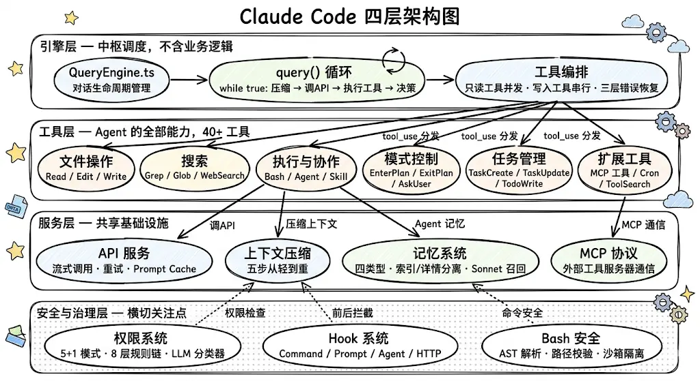

1. **引擎层**是 Agent 的「大脑」，负责思考和调度。它的关键设计原则是不包含任何业务逻辑：它不知道怎么读文件、怎么改代码、怎么搜索，这些全是工具层的事。引擎层只做三件事：第一，协调，把用户输入、系统指令、历史对话拼在一起，发给大模型；第二，分发，大模型说「我要用某个工具」时，找到对应的工具并执行；第三，决策，根据大模型的返回决定是继续循环还是结束对话。这种设计的好处是：新增能力只需要新增一个工具，引擎层完全不用改。
2. **工具层**是 Agent 的全部「能力」，40 多个工具都在这一层。每个工具就是 Agent 的一个能力：执行 Shell 命令、读写文件、搜索代码、生成子 Agent……这些工具不是随便写的，它们遵循一个统一的规范。这个规范不仅定义了「工具能做什么」，还强制定义了三个安全属性：这个工具是只读的还是会改东西的？它是否具有破坏性需要额外确认？它能不能和其他工具同时执行？这三个属性不是「建议加上」的，而是类型系统强制要求的，漏了任何一个，代码就编译不过。这意味着每一把刀都有刀鞘，从出厂就配好了安全机制。
3. **服务层**是所有层共享的「基础设施」。这一层包括三样东西：调大模型 API（不管是谁要调，主循环也好、子 Agent 也好，都走这一层）、上下文压缩（后面会详细讲的五步压缩策略）、MCP 协议（和外部工具服务器通信的标准接口）。你可以把它类比成大楼的水电煤，所有楼层都需要，但谁也不会自己去铺设管道。
4. **安全与治理层**有点特殊，它不像其他三层那样各管一块，而是像一张安全网罩在所有层上面。权限系统决定哪些操作需要用户确认、哪些可以自动执行；Hook 系统允许在工具执行前后插入自定义行为（比如「每次 `git push` 前自动跑 lint」）；Bash 安全模块会对 Shell 命令做语法级别的分析，检测命令注入、路径逃逸等危险模式，而不是简单地用正则匹配关键词。

## ReAct 与 Tool Use Loop

模型在每一轮都会先输出一段「思考」（Thought），比如「我需要先读取 `config.ts` 文件来了解数据库连接配置」；然后选择一个工具调用（Action）；最后拿到工具结果（Observation）。这三步不断循环，直到模型认为任务完成。

这个模式在 2022 年非常流行，因为当时的大模型（GPT-3.5 时代）推理能力有限，需要用显式的「Thought」步骤来引导模型一步步思考。

### ReAct 的问题

但 ReAct 有几个问题：

1. **Token 浪费**：每一轮都要输出一段 Thought 文本，这些文本要作为上下文的一部分发给 API，占用了宝贵的 Token 预算。对于编程 Agent 来说，一次任务可能循环 50 轮，每轮都写一段「我打算先读取……然后分析……」的思考过程，加起来就是好几万 Token 的浪费。
2. **应用层代码太复杂**：你需要解析模型的输出，区分「哪部分是 Thought、哪部分是 Action」，然后提取 Action 调用工具，再把 Observation 拼回去。这个解析过程写起来很麻烦，而且很容易出 bug，因为模型输出的格式不一定标准，一崩就全崩了。
3. **它是为弱模型设计的**：当大模型的推理能力不够强时，用显式的 Thought 来「强迫」它一步步思考是有意义的。但 Claude Opus 这种级别的模型，推理能力已经足够强了，它完全可以在内部完成推理，不需要在输出里显式写出每一步的思考过程。

Claude Code 没有采用 ReAct 的 Thought-Action-Observation 三步循环，而是用了一个更简洁的模式，我把它叫做 Tool Use Loop。

### Tool Use Loop

核心思路非常简单，就一个 `while (true)` 循环：

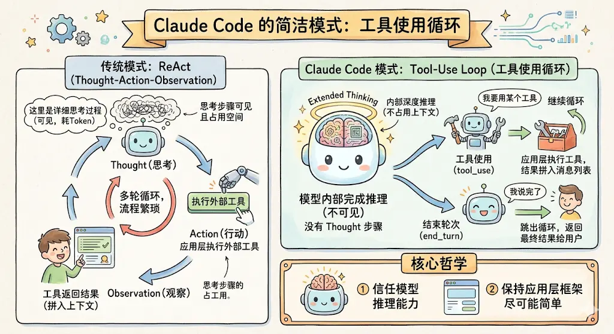

模型在内部完成推理（通过 `Extended Thinking`，这是 Claude Opus 的一个能力，模型在生成回复前会在内部进行一段不可见的深度推理，不占用上下文空间），然后直接返回两种结果之一：

- `tool_use`：我要用某个工具。应用层执行工具，把结果拼入消息列表，继续循环。
- `end_turn`：我说完了。跳出循环，把最终结果返回给用户。

这个设计的核心哲学是：信任模型的推理能力，保持应用层框架尽可能简单。

### 三个关键优势

1. **`Extended Thinking` 让推理在模型内部完成**：Claude Opus 支持 `Extended Thinking`，模型在生成最终回复之前，会在内部进行一段不可见的深度推理。这段推理发生在模型内部，不占用应用的上下文空间，也不需要应用层去解析。所以 ReAct 的 Thought 步骤在 Claude 的架构里是多余的，模型已经在内部「想好了」，不需要在外部输出中再写一遍。
2. **API 原生支持 `tool_use`**：Claude 的 API 原生支持工具调用，模型可以直接返回 `tool_use` 类型的响应，不需要用正则表达式从文本中提取「Action」。这消除了 ReAct 的格式解析问题，应用层代码变得极其简洁。
3. **`end_turn` 是天然的终止信号**：ReAct 需要一套额外的规则来判断「Agent 是否完成了」，比如检测输出中是否包含「Final Answer」。而 Tool Use Loop 用模型的 `end_turn` 信号作为终止条件，这是 API 层面的原语，语义清晰，不需要任何解析。

> Claude Code 的 Agent 工作模式可以总结为一句话：信任模型的推理能力，把应用层框架做得尽可能简单。

ReAct 的设计哲学是「帮模型思考」，用显式的 Thought 步骤引导模型一步步推理。这在弱模型时代是必要的。

但 Claude Code 面对的是 Opus 级别的强模型，它的推理能力完全可以在内部完成，不需要应用层去「教」它怎么想。

所以 Claude Code 的 Tool Use Loop 只做最简单的事：调 API、执行工具、再调 API。推理交给模型，执行交给工具，编排交给最简单的 `while (true)` 循环。

## Plan Mode

`Plan Mode` 的核心思想是：复杂任务应该先规划再执行，避免方向跑偏、浪费精力。它并不是一个独立的框架，而是在同一个 Tool Use Loop 中通过 `EnterPlanMode` 和 `ExitPlanMode` 两个工具实现的：

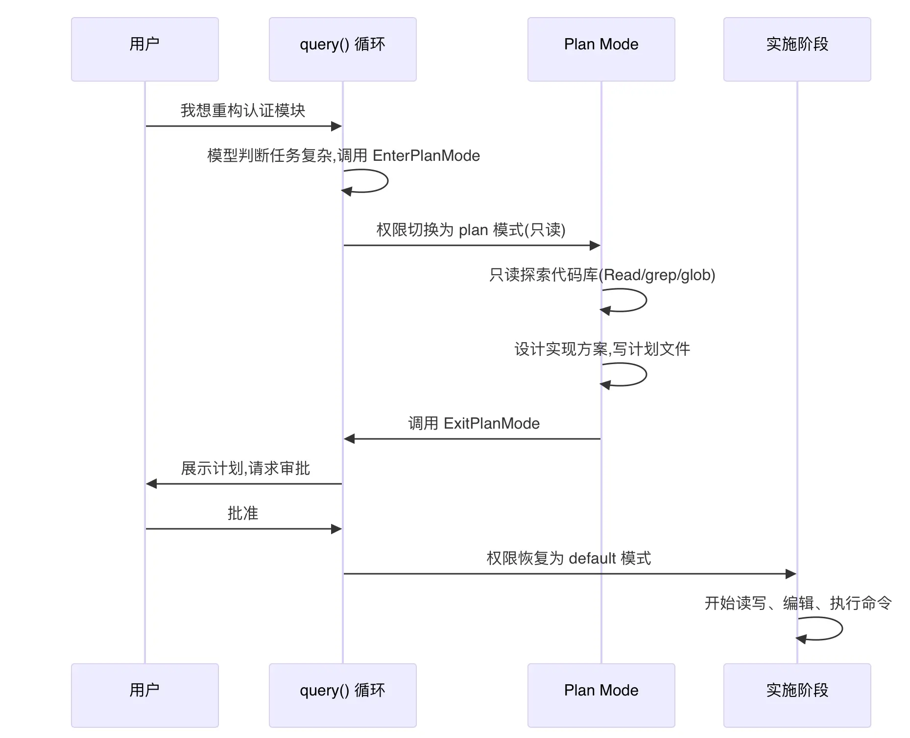

整个流程分三步：

1. **模型自主进入或用户手动触发**：当模型判断「这是一个复杂任务」时，它会调用 `EnterPlanMode` 工具。对于简单任务（修 typo、加 `console.log`），则明确不进入。用户也可以通过 `Shift+Tab` 手动切换。
2. **只读探索 + 设计方案**：进入 `Plan Mode` 后，权限降为只读，模型只能用 `Read`、`Grep`、`Glob` 这些工具去探索代码库，不能写文件、不能改代码、不能跑命令。探索完后，把计划写入 `.claude/plans/` 目录。每 5 轮对话，系统会偷偷给模型塞一张「小纸条」，提醒它「你现在还在 `Plan Mode`，别手痒改代码」，防止模型在长对话中「走神」。
3. **用户审批后实施**：模型调用 `ExitPlanMode`，此时需要用户确认。用户批准后，权限恢复为之前的模式，模型开始自由执行读写操作，按计划实施。

`Plan Mode` 最值得学习的设计是 **「工具即能力」**。

对模型来说，`Plan Mode` 不是一种特殊的「模式切换」，而只是调用了 `EnterPlanMode` 和 `ExitPlanMode` 这两个工具。

就像调用 `Read` 工具读文件一样自然。整个过程不需要引擎层做任何特殊处理，`query()` 仍然只是一个简单的 `while (true)` 循环。

## System Prompt

```text
┌─────────────────────────────────────────────────┐
│  [角色定义] 你是一个交互式代理，帮助用户完成...    │  ← 所有用户完全一样
│  [安全红线] 重要：允许协助已授权的安全测试...       │  ← 所有用户完全一样
│  [行为准则] 一般来说，不要对你没有阅读过的代码...   │  ← 所有用户完全一样
│  [操作安全] 仔细考虑操作的可逆性...               │  ← 所有用户完全一样
│  [工具使用] 当有专用工具可用时...                  │  ← 所有用户完全一样
│  [Git 安全] 绝不修改 git config...               │  ← 所有用户完全一样
│  [输出风格] 直奔重点，要极度简洁...               │  ← 所有用户完全一样
├────── __SYSTEM_PROMPT_DYNAMIC_BOUNDARY__ ────────┤
│  [环境信息] 主工作目录: /Users/you/my-project    │  ← 每个用户不一样
│  [CLAUDE.md] 本项目使用 TypeScript + Jest...      │  ← 每个项目不一样
│  [记忆指令] 你有一个持久记忆系统...               │  ← 每次对话可能不一样
│  [MCP 指令] 你已连接 GitHub MCP server...         │  ← 每个用户不一样
└─────────────────────────────────────────────────┘
```

Claude Code 在 `System Prompt` 中插入了一个分割标记：`__SYSTEM_PROMPT_DYNAMIC_BOUNDARY__`。

- 分割线之上的内容，对所有用户都完全一样。不管你是北京的 Java 工程师还是纽约的 Python 开发者，你看到的「角色定义」「行为准则」「Git 安全协议」这些内容是一模一样的。
- 分割线之下的内容，每个用户都不同。你的工作目录、你的 `CLAUDE.md`、你的记忆文件、你连接的 MCP 服务，这些是因人而异的。
- 分割线之上的内容对所有用户都一样，所以可以全球所有用户共享同一份缓存。你用的和东京开发者用的是同一份；而分割线之下的内容因人而异，没法共享，只能实时生成。

这就是 Claude Code 的三级缓存体系：

1. **全局缓存**：分割线之上，跨组织、跨用户共享。
2. **组织缓存**：同一组织内，跨会话共享。
3. **会话缓存**：同一个 Section 在一次会话内只计算一次。

## Memory

Claude Code 把记忆分成了四种明确的类型：

```ts
export const MEMORY_TYPES = [
  "user", // 用户画像：角色、偏好、知识水平
  "feedback", // 行为反馈：该做什么、不该做什么
  "project", // 项目动态：在做什么、截止日期、协作信息
  "reference", // 外部指针：哪里能找到什么信息
] as const;
```

限定四种类型，就是在逼 Agent 做分类决策。每存一条记忆，它必须想清楚「这到底属于哪一类」，而不是一股脑往里塞。

### 四种记忆类型

1. **User（用户画像）**：记住用户是谁、擅长什么、知识水平如何。比如用户说「我是一个写了十年 Go 的后端工程师，第一次接触 React」，Agent 就应该在解释前端概念时用后端的类比，而不是从零讲起。这类记忆让 Agent 的回答因人而异，而不是千篇一律。
2. **Feedback（行为反馈）**：记住用户说过「不要做什么」和「做得好继续保持」。这类记忆的关键在于，它不仅记规则本身，还要求记录 `Why`（为什么）和 `How to apply`（怎么应用）：

   ```text
   规则本身：集成测试必须使用真实数据库，不能用 mock
   Why：上季度 mock 测试全部通过但生产环境迁移失败了
   How to apply：在这个模块写测试时，始终连接真实数据库
   ```

3. **Project（项目动态）**：记的是「正在发生什么」，谁在做什么、截止日期是什么、有什么重要决策。这类记忆有一个特殊要求：必须把相对日期转成绝对日期。用户说「周四之前冻结合并」，Agent 要存成「2026-03-05 之前冻结合并」，因为「周四」过几天就没意义了，但「2026-03-05」永远准确。
4. **Reference（外部指针）**：记的是「去哪找什么信息」，Bug 在 Linear 的哪个项目里追踪、Grafana 看板的地址是什么、Slack 的哪个频道能问到相关的人。这类记忆的价值在于，Agent 不需要知道外部系统的具体内容，只需要知道去哪里找。

### 记忆文件格式

每条记忆存为一个独立的 `.md` 文件，文件开头有一段 YAML 格式的元信息。你可以把它理解为这条记忆的「身份证」：

```yaml
---
name: no-mock-database
description: 集成测试必须使用真实数据库，不能用 mock
type: feedback
---

集成测试必须使用真实数据库，不能用 mock。

**Why:** 上季度 mock 测试全部通过但生产环境迁移失败了。
**How to apply:** 在这个模块写测试时，始终连接真实数据库。
```

文件开头这段 YAML 里，三个字段各有用途：

- `name`：人类可读的标识。
- `description`：一句话摘要，专门用于检索时的相关性匹配。
- `type`：四类型之一。

然后有一个 `MEMORY.md` 文件作为索引，它是一个不超过 200 行（或 25KB）的轻量目录：

```md
- [No Mock Database](feedback_no_mock_db.md) — tests must use real DB
- [User Preferences](user_preferences.md) — prefers terse responses
- [Auth Rewrite](project_auth_rewrite.md) — driven by compliance, not tech debt
```

`MEMORY.md` 索引始终被加载到 `System Prompt` 里，但独立记忆文件按需加载。

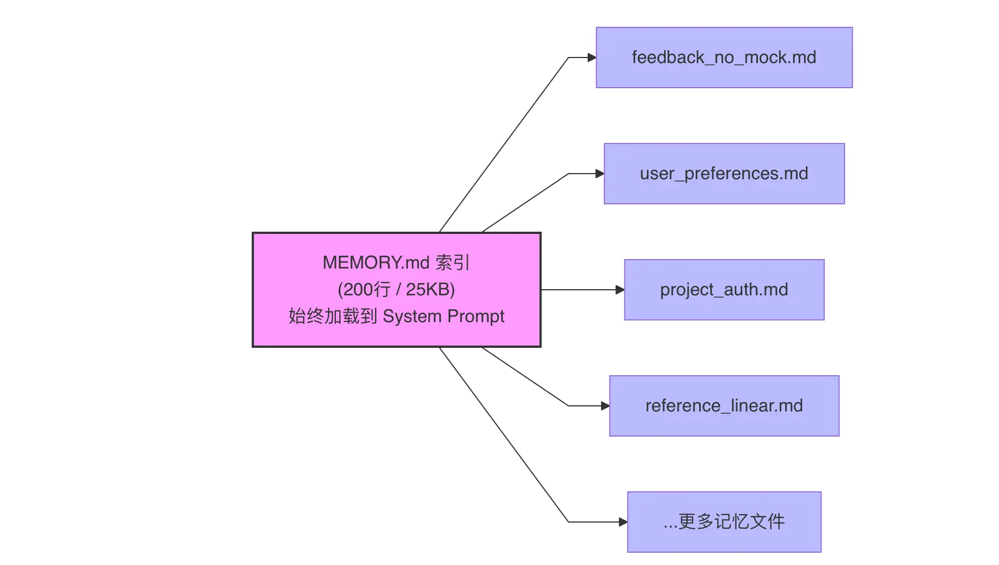

### 记忆检索

存好了记忆，关键问题来了：每次对话时，怎么从几十条记忆里挑出最相关的那几条加载进来？

Claude Code 的做法非常巧妙，用一个廉价的小模型（Sonnet）来做记忆检索。Sonnet 侧查询不是在主模型需要时才触发的，而是在用户提交消息后立刻就开始了，和主模型的 API 调用并行执行：

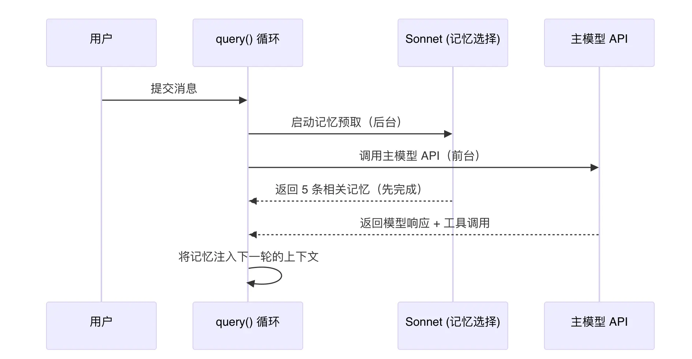

## Context Window

大模型有上下文窗口限制。即使是 200K Token 的窗口，一次复杂的编程任务（读了几十个文件、执行了几十条命令）很容易就塞满了。

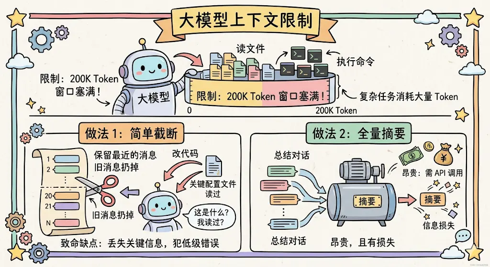

业界常见的做法是「简单截断」，只保留最近的 N 条消息，旧的扔掉。但这对于编程 Agent 来说是灾难性的：你可能 20 轮前读过一个关键配置文件，现在要改代码时那个文件的信息已经被截掉了，Agent 就会犯低级错误。

另一种做法是「全量摘要」，把整段对话总结成一段摘要。但这很贵（摘要本身就是一次 API 调用），而且有信息损失。

Claude Code 的核心理念是：压缩一定有信息损失，所以能不压就不压，必须压的时候从最轻的手段开始。

它设计了五个从轻到重的压缩手段，就像医院的分诊制度一样：先试最温和的，不行再上猛药。在每次 API 调用前依次尝试：

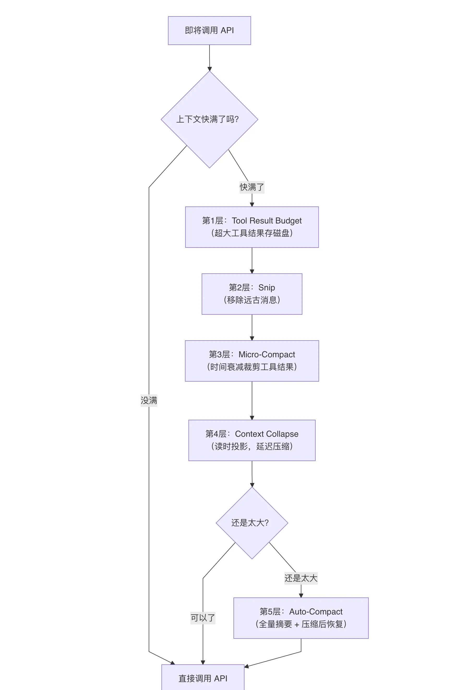

每一步的「代价」是递增的：

1. 第 1 层几乎没有信息损失，完整内容还在磁盘上，只是不在上下文里了。
2. 第 2、3 层有少量信息损失，丢掉了老的工具输出，但模型随时可以重新获取。
3. 第 4 层有中等信息损失，对话细节被分段压缩了。
4. 第 5 层信息损失最大，整段对话变成一段摘要。

所以 Claude Code 的策略是：先用代价最小的手段，实在不行再升级。大部分情况下，前三层就够用了，根本不需要触发昂贵的全量摘要。

### 第一层：大工具结果落盘

如果单个工具的结果超过约 50KB，就把完整内容写到磁盘上，在消息里只留一个 2KB 的预览摘要。这样模型还是能看到文件的大概内容（前 2KB），但不会撑爆上下文。

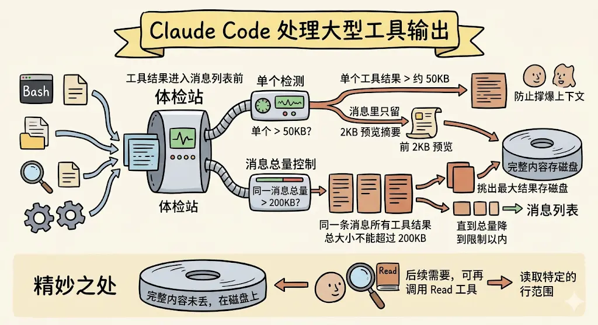

除了单个工具的限制，还有一个消息级的总量控制：同一条消息里所有工具结果的总大小不能超过 200KB。如果超了，系统会挑出最大的那几个结果存磁盘，直到总量降到限制以内。

这一层的精妙之处在于：完整内容并没有丢，它还在磁盘上。如果模型后面真的需要那个大文件的某个片段，它可以再次调用 `Read` 工具去读取特定的行范围。

### 第二层：Snip

`Snip` 是最「粗暴」但也最高效的一层，直接把对话开头的一批老消息移除掉，然后插入一个边界标记告诉模型「这之前的内容已经被清理了」。

它不做任何摘要，不总结「前面聊了什么」，直接砍掉。听起来很暴力，但对于那些确实已经完全过时的消息来说，这是代价最低的做法，因为它不需要额外调用大模型来生成摘要，零 API 开销。

### 第三层：Micro-Compact

经过前两层之后，上下文里剩下的都是「不太老但也不太新」的消息。这些消息不能直接砍掉（可能还有用），但里面大量的工具输出其实已经过时了，比如 30 分钟前读的一个文件，现在那个文件可能已经被改过了。

Claude Code 怎么做？`Micro-Compact` 的核心思想是时间衰减：越老的工具结果越不重要，可以被裁剪。但是，不是所有工具的结果都能裁剪：

```ts
const COMPACTABLE_TOOLS = new Set([
  FILE_READ_TOOL_NAME, // 读文件 → 可以重新读
  ...SHELL_TOOL_NAMES, // 执行命令 → 可以重新执行
  GREP_TOOL_NAME, // 搜索 → 可以重新搜
  GLOB_TOOL_NAME, // 查找文件 → 可以重新查
  WEB_SEARCH_TOOL_NAME, // 搜索网页 → 可以重新搜
  FILE_EDIT_TOOL_NAME, // 编辑文件 → 结果可裁剪
  FILE_WRITE_TOOL_NAME, // 写文件 → 结果可裁剪
]);
```

可以被裁剪的，都是「可重新获取」的工具。`Read` 的结果可以再读一次，Bash 的输出可以再执行一次，搜索结果可以再搜一次。

但 `AgentTool`（子 Agent 的输出）、`TaskTool`（任务状态）这类工具的结果永远不会被裁剪，因为子 Agent 的推理过程是不可重复的，砍掉就真的丢了。

### 第四层：Context Collapse

经过前三层后，如果上下文还是太大，下一步就得做全量摘要了。但全量摘要代价很高（要额外调一次 API），而且会把整段对话的细节全部丢掉。有没有一个「中间态」，比全量摘要轻，但比 `Micro-Compact` 重？

Claude Code 的做法是 `Context Collapse`。它引入了一个非常巧妙的概念：读时投影（`Read-Time Projection`）。

什么意思呢？前面三层都是「写时压缩」，直接修改消息列表，把内容替换掉或删掉。但 `Context Collapse` 不修改原始消息，它只在调用 API 的那一刻，动态计算一个「压缩视图」（对冗长的工具输出 `Tool Outputs` 进行压缩）给模型看。

它的触发有两级阈值：

- `90%` 上下文窗口：主动开始分段压缩旧消息，预留缓冲区。
- `95%` 上下文窗口：紧急压缩更多内容，留足 API 响应空间。

这个设计最精妙的地方是它和第 5 层的配合：`Context Collapse` 运行在 `Auto-Compact` 之前。

如果 `Context Collapse` 已经通过「读时投影」把上下文压到了阈值以下，`Auto-Compact` 就完全不需要触发了。这样模型保留了更多的细节上下文，而不是被一段粗糙的全量摘要替代。

### 第五层：Auto-Compact

当前面四层都不够用，上下文实在太大了，必须做一次彻底的压缩。这是代价最高但效果最强的一层。

什么时候触发？Claude Code 用一个公式计算触发阈值。以 200K Token 的模型为例：有效窗口大约 180K（预留 20K 给输出），减去 13K 缓冲区，当上下文达到 167K Token 时触发。


整个过程分三步：

1. **生成摘要**：调用大模型，把整段对话总结成一段结构化摘要。这个摘要不是随便写的，Claude Code 用一个精心设计的 Prompt，要求模型按多个维度来总结：用户的主要请求和意图、关键技术概念、涉及的文件和代码片段、遇到的错误和修复方案、问题解决过程、用户的所有消息（不能遗漏任何一条）、待完成的任务、当前工作状态、建议的下一步。
2. **替换旧消息**：把压缩边界之前的所有消息删掉，替换为刚才生成的摘要。同时插入一条边界标记消息，记录压缩前的 Token 数，方便后续追踪。
3. **Post-Compact Restoration（压缩后恢复）**：这是整个流程中最关键的一步，压缩完不是就完了，还要主动恢复最重要的上下文。系统会从文件状态缓存（`fileStateCache`）中找出最近访问过的文件，按最后访问时间排序，挑选最多 5 个、总共不超过 50K Token 的文件内容重新注入。同时恢复活跃的 Skill（不超过 25K Token），如果有进行中的 Plan 也会恢复 Plan 文件。

为什么要把摘要写得这么细？因为压缩后模型要靠这段摘要来「恢复记忆」。如果摘要漏掉了关键信息（比如「用户还有一个待完成的任务」），模型就会忘记这件事。

## Query Loop

不停「调模型 → 看结果 → 决定下一步」的循环，就叫主循环（`Query Loop`），是整个 Agent 的「心脏」。

主循环这个东西，听上去会觉得很简单：

```ts
while (true) {
  调模型();
  if (模型说要用工具) {
    执行工具();
  } else {
    break;
  }
}
```

如果真这么写，能跑通一个 demo，但在真实生产环境里会被千锤百炼出无数个 bug：

- 用户中途按 `Ctrl+C` 怎么办？
- 工具跑到一半挂了，下一轮调模型会被 API 直接拒收，怎么救？
- 模型输出超长被截断了，怎么续？
- 上下文太长塞不进去了，要不要压缩？什么时候压？
- 跑了 50 轮还没收敛，要不要强行止损？

Claude Code 的 1729 行主循环代码，80% 都在处理这些「异常路径」，真正的「正常路径」可能 200 行就写完了。

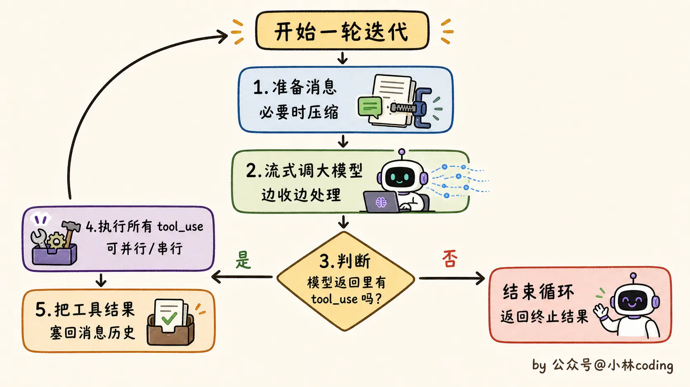

### 工具并行与串行

但并不是所有工具都能这么并行。这里有个边界要讲清楚。

Claude Code 的工具在定义的时候，每个工具都有一个属性，标明它是「只读」还是「会改东西的」：

- 只读工具（比如 `Read`、`Grep`、`Glob`）：可以随便并行。你同时读 10 个文件，互不干扰。
- 会改状态的工具（比如 `Edit`、`Write`、`Bash`）：必须串行。两个写文件操作如果并发跑，可能互相覆盖。

这个属性是在工具定义时就声明的。

如果开发者一时忘了写，框架会 `fail-closed` 兜底，默认当成「会改东西的工具」（值为 `false`），强制串行执行。

也就是说，宁可错杀让你慢一点，也绝不会因为漏写而出现并发踩踏。

### 缺失 `tool_result` 的补偿

模型回话时会吐出 `tool_use` 块（工具调用请求）。工具跑完之后，要把执行结果以另一种格式塞回消息历史，这种「工具执行结果」叫 `tool_result` 块。

API 协议有一条死规定：每个 `tool_use` 块，必须有一个对应的 `tool_result` 块跟它配对。如果消息历史里有个孤零零的 `tool_use` 没人接，下一轮请求直接被 API 拒收，报错说「工具调用 ID 对不上」。

正常情况下没问题，工具跑完就有结果，配对很自然。但出错的时候呢？

比如：模型刚吐完 `tool_use` 块，网络突然断了，工具根本没开始跑；或者工具跑到一半，用户按了 `Ctrl+C`；或者模型出了问题，主循环临时切换到备用模型（这种切换机制叫「模型降级」），前一个模型吐出的 `tool_use` 就没机会执行了。

这些情况下，消息历史里就有了「孤立的 `tool_use` 块」。你不处理，下一轮想再调模型，API 直接拒收，会返回一个「请求格式不对」的错误。

Claude Code 的解决方案是：合成一个假的工具结果塞回去，内容写「这个工具因为 XX 错误没执行」。主循环里专门有段代码干这事，函数名也很直白，直译过来就是「把缺失的工具结果块补上」（源码里叫 `yieldMissingToolResultBlocks`）。

### 输出截断恢复

模型每一次返回都有个最大 token 数限制。Claude Code 常规默认是 32k，但在某些灰度场景下（背后是个可以开关的「特性开关」控制位）会被压到 8k 以控费。一旦模型一口气想吐 12k 的内容，到 8k 就被强行截断，剩下的 4k 没出来。这种状态在 API 协议里叫「输出 token 上限错误」。

Claude Code 的处理是两段式的，非常有意思：

1. **静默升档**：模型第一次触发 8k 截断时，主循环不报错，悄悄把上限调到 64k 然后重试这一轮。用户完全感知不到出过错，只是觉得「这次模型答得稍微慢了点」。
2. **`nudge` 续写**：如果调到 64k 还截断，那是真的输出太长了。这时候主循环会在下一轮的消息里，塞一段话给模型：「上次输出超长被截断了，请直接从断点续写，不要道歉、不要回顾你刚才在干什么、把剩余工作拆成更小的块」（英文原文是 `Output token limit hit. Resume directly — no apology, no recap...`，后面还会指示模型「从断点续写、把剩余工作拆小」）。

这种「在消息里轻轻推一把提示模型续写」的动作，英文里叫 `nudge`。但 `nudge` 不能无限循环，会陷入死锁。

所以源码里写死了 3 次上限：续写 3 次还不行，主循环就老老实实退出，返回原因「输出超长救不回来」。

## `grep`、RAG 与 Memory System

Claude Code 检索系统的层次感很强：

1. 底层：`Grep` / `Glob` / `Read` 三件套，处理简单定向检索。
2. 中层：派 `Explore` 子 agent，处理开放式探索和上下文隔离。
3. 上层：主 agent 编排整体任务。

RAG 的范式是「考试发卷子」：用户提问 → 系统一次性召回 Top-K 个片段 → 模型基于这些片段一次性生成答案。中间没有循环，没有反悔，没有「等等再看看」。这是一锤子买卖。

Claude Code 的范式是「现场探案」：用户提问 → 模型说「我先 Grep 一下」→ 系统执行 Grep 返回结果 → 模型看到结果说「嗯，看起来 `UserService` 比较像，我 Read 一下」→ 系统执行 Read 返回内容 → 模型说「找到了，逻辑是这样的：……」。这是循环，是边查边推理。

### 为什么不用 RAG

Claude Code 不用 RAG，主要有六个原因：

1. **冷启动**：`grep` 是毫秒级响应，开箱即用；RAG 要先建索引，分钟级冷启动，劝退一半用户。
2. **实时性**：`grep` 每次现读磁盘最新版本；RAG 索引会滞后，文件改了得重建。
3. **精确性**：`grep` 是确定性的字符正则匹配，要找 `getUserById` 就只有它；RAG 是向量近似匹配，会把一堆相似函数糊在一起。
4. **Token 经济**：`grep` 加 `Read` 按需读取，模型只看真正需要的几行；RAG 一上来就要给整个代码库做 embedding，存储和计算成本都不小。
5. **可解释性**：`grep` 每一步检索过程都对用户透明可审计；RAG 的 Top-K 召回是黑盒，出 bug 没法 debug。
6. **决策权**：`grep` 让 LLM 自己决定每一轮搜什么、读什么，多轮迭代逐步逼近答案；RAG 是一次性把材料丢给模型，模型只能将错就错。

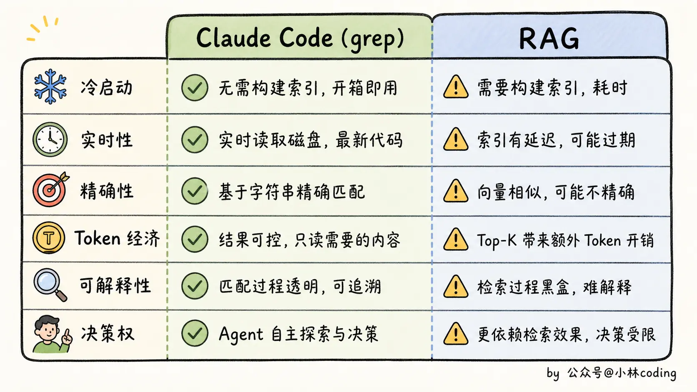

两种方案代表了两种不同的设计哲学。

- **RAG 派**的潜台词是：LLM 不够强，所以我们要用工程手段帮它把材料准备好。`chunking`、`embedding`、向量召回，本质都是「替模型做决定」。
- **Claude Code 派**的潜台词是：LLM 已经足够强，工程的角色是给它准备好工具，把决策权还给它。`grep` 不替模型做任何决定，它只是个工具。用还是不用、什么时候用、怎么用，全是模型说了算。

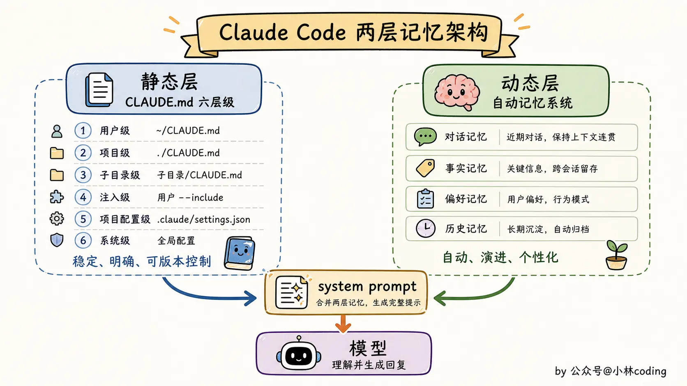

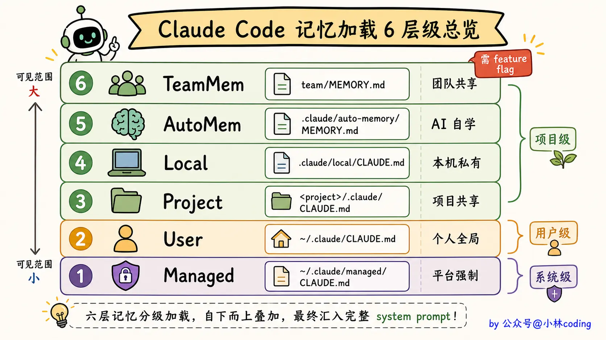

### 记忆如何写入

光设计好类型和存储格式还不够。记忆是怎么写进去的？

最朴素的做法是让主对话自己写：每轮结束让模型「想想这次有啥该记的」，然后自己写文件。

但有两个缺点：

1. **模型分心**：主任务都做不好，还要分一脑子去想「这条要不要记、属于哪类、放哪里」，回复质量会打折。
2. **Token 浪费**：每轮都得在 `System Prompt` 里塞一段「记一下偏好啊」的指令，每次都进、每次都算钱，全是冗余。

Claude Code 的方案是：每轮对话结束后，后台单独跑一个代理来抽取记忆。

这个代理叫 `extractMemories`，触发时机是每轮 `query loop` 完整结束（也就是模型给出最终回复、没有任何 `tool call` 了），通过一个 `stopHook` 钩子触发。

`Extract Memories` 代理不是从零启动一个新对话，而是「完美 fork（复刻一份）主对话」，复用主对话的 prompt cache（把已经算过的 `System Prompt` 缓存下来，下次不用重算）。

这意味着什么？意味着它不用重新加载几千 token 的 `System Prompt`，只需要看着对话历史，决定「这次有没有值得记的东西」就行。整个抽取过程多花的钱很少。

抽取代理的逻辑大致是：

1. 扫一遍这一轮对话里用户的反馈、纠正、信息。
2. 跟现有记忆比对，看有没有重复。
3. 如果有新的值得记的内容，按四种类型分类，写一个新文件。

注意「跟现有记忆比对」这步。代理会主动检测 `hasMemoryWritesSince`，过滤掉它刚刚写过的内容，避免对同一件事反复写记忆。

## Multi-Agent

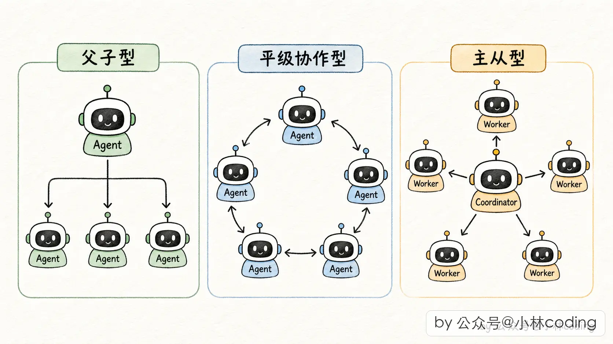

### 三种协作形态

1. **父子型**：主 agent 处理整个任务，遇到某个子问题时派一个 subagent 出去搞定，拿结果回来接着干。这是最常见的，Claude Code 里的 `Task` 工具就是这种。
2. **平级协作型**：几个 agent 职责对等，通过共享状态或者消息互相协作。不过这种在工程上比较难落地，状态同步很麻烦。
3. **主从型（Coordinator-Worker）**：有一个专门的「协调者 agent」，它自己不干活，只负责派 worker、收结果、做合成。worker 之间互不通信，全靠协调者调度。这种是高并发场景的标配。

Claude Code 源码里，常规 `Subagent` 对应父子型，`Coordinator` 模式对应主从型，`Fork Subagent` 是父子型的一个特殊优化版本。

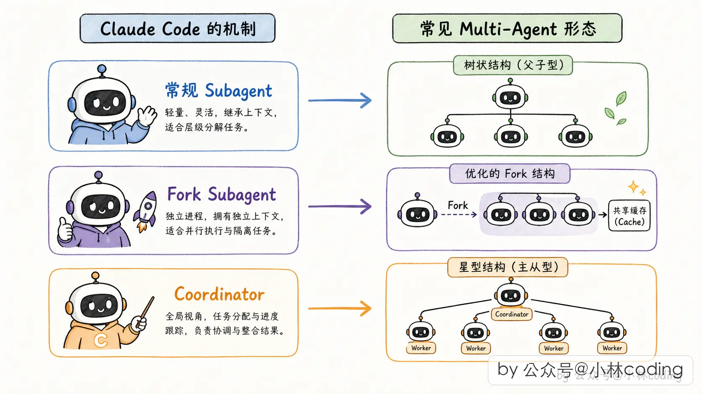

### 工具与上下文隔离

Claude Code 多 agent 设计里最关键的一环是隔离机制。

为什么隔离最关键？多 agent 系统本质就是「一堆 agent 共处一个进程、共享一个底层运行时」。如果隔离做得不好，一个 subagent 偷偷污染了父 agent 的状态、或者调了不该调的工具，整个系统就会乱成一锅粥。

Claude Code 在 subagent 启动时，把隔离做到了两个维度：工具隔离（不给子 agent 它不该有的工具）和上下文隔离（不让子 agent 搅乱父 agent 的运行时状态）。

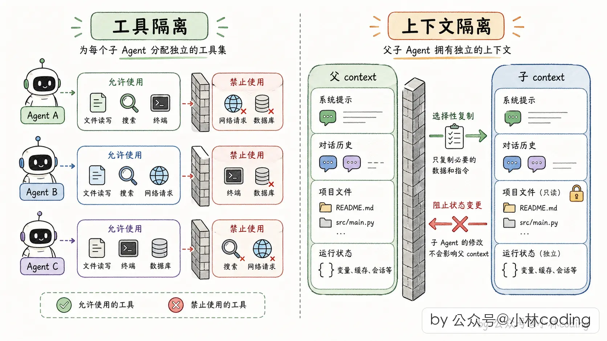

Claude Code 给 subagent 发工具的思路是「按 agent 身份走三道准入门」：

1. **所有 subagent 通用黑名单**：禁掉几类工具，包括能派新 subagent 的工具（防止子再派孙、孙再派重孙的递归嵌套）、能主动问用户问题的工具（子 agent 不该抢主 agent 的对话权）、能切换规划模式的工具（规划模式是主 agent 用来跟用户对齐方案的）以及能停止其他任务的工具（任务管理是主线程的专属权力）。
2. **自定义 agent 额外黑名单**：用户自己写的 agent（比如在项目里自己配的那种 Markdown agent）比内置 agent 要再严一点，因为用户写的没经过官方审核，多防一道更安全。
3. **后台异步 agent 走白名单**：这类 agent 是完全后台跑的，没法跟用户交互，所以只准用事先圈定好的一小批工具（读文件、搜代码、执行命令、编辑文件这些）。白名单的哲学是「默认不准用，明确列出来的才能用」，比黑名单更保险。

### 父子通信与 auto-background

父子之间能怎么通信，取决于你开没开「团队（`agent-teams`）模式」。

默认形态和团队形态，是两条很不一样的线：

- **默认形态**：subagent 更像一次「重型工具调用」，父 agent 派它出去、它跑完把结果交回来。这条线里，父 agent 没法中途给在跑的子 agent 插话，消息基本是子 → 父单向通知。
- **团队（`agent-teams`）模式**：开启之后才升级成完整的双向消息驱动，父 agent 能往子 agent 的信箱里扔字条，子 agent 也能回话，真正的双向对讲。

父 agent 对正在跑的子 agent 是「只能等」的，没法中途塞新指令给它。就是一次「派出去，等结果」，跟你平时调一个普通工具没啥两样。

那又冒出一个新问题：如果子任务跑得特别久，父 agent 干等着不就被卡死了吗？Claude Code 这里有个补丁，叫 `auto-background`。

如果 subagent 很快跑完（比如 30 秒内），父 agent 就在前台阻塞等，像一次普通工具调用，完事就拿结果继续。但如果 subagent 跑超过 2 分钟还没完，Claude Code 会自动把它转到后台，让父 agent 可以先继续干别的。子任务真完成时，再回头通知父 agent。

这个设计本质上是把同步工具调用自动降级成异步通知的优化。没有它，长任务会一直占着父 agent 的执行权，用户也没法跟父 agent 继续对话。

### Coordinator 模式

Subagent（不管是常规的还是 `Fork` 的），本质都是父子结构：父 agent 派一个子，自己该干啥干啥，子完成了通知一声。

但如果你的任务量很大，需要一堆 agent 同时开工呢？比如一个大的代码迁移，要并行调研 10 个模块。这时候父子结构就显得单薄了。

Claude Code 为此设计了一个专门的模式：`Coordinator` 模式。这是 Claude Code 多 agent 设计里最「多 agent」的部分，也是最能打的地方。

常规模式下，主 agent 是「全能型选手」：它读代码、写代码、跑测试、做规划全都干，只在需要时才派 subagent 帮一把。

`Coordinator` 模式下，主 agent 不干实际工作了，它只做三件事：派 worker、收结果、合成答案。

这个角色转换是通过主 agent 的 `System Prompt` 强制约束出来的。

既然主 agent 要协调，就得有专门的协调工具。`Coordinator` 模式下，主 agent 多了一套「团队管理」工具箱：

1. **派 worker 的工具**：派一个新 worker 出去干某件具体的活，派完立刻返回 worker 的 ID。
2. **创建/解散团队的工具**：批量管理 worker 组。
3. **给 worker 发消息的工具**：给已经派出去的 worker 发后续指令（也就是前面讲的 `SendMessage`），因为 worker 的上下文还在，续命比重新派一个更省钱。
4. **合成最终输出的工具**：协调者合成完答案后，通过这个工具把最终回复交给用户。
5. **停止 worker 的工具**：当协调者意识到某个 worker 跑错方向时，把它停掉省 token。

这套工具放在一起，协调者就有了一整套指挥团队的 API。
